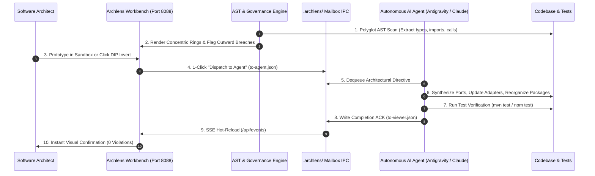
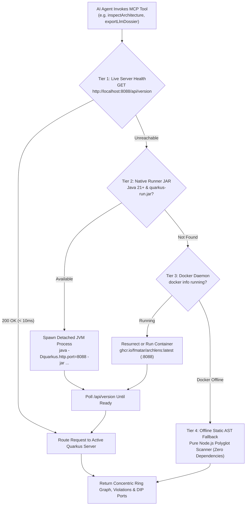

# Archlens — Dynamic Clean Architecture Workbench

[](https://github.com/fmatar/archlens/actions/workflows/ci.yml)
[](https://github.com/fmatar/archlens/actions/workflows/release.yml)
[](https://openjdk.org/)
[](https://quarkus.io/)
[](https://svelte.dev/)
[](Dockerfile)
[](#polyglot-language-support)
[](https://opensource.org/licenses/Apache-2.0)
[](ROADMAP.md)
[](docs/KANBAN.md)

> *"The Dependency Rule: Source code dependencies must point only inward, toward higher-level policies."*  
> — **Robert C. Martin (Uncle Bob)**

An interactive real-time architectural visualization workbench, polyglot Clean Architecture governance engine, and autonomous AI refactoring studio for modern software systems.

*(Explore the [Product Roadmap](ROADMAP.md) & [Living Kanban Board](docs/KANBAN.md))*

  
*(High Definition Video: [`media/archlens-teaser.mp4`](media/archlens-teaser.mp4) &bull; Extended Tour: [`media/archlens-user-journey.mp4`](media/archlens-user-journey.mp4) &bull; Animated Preview: [`media/archlens-teaser.gif`](media/archlens-teaser.gif))*

---

## 💡 How It Works

Archlens operates as a **closed-loop feedback system** that bridges high-level architectural design with low-level source code refactoring. It continuously protects codebases against architectural drift through three interconnected pillars:



### 1. Polyglot AST Analysis & Governance Engine
Archlens reads your project source files directly. Pluggable Abstract Syntax Tree (AST) scanners (Java 25, Python, TypeScript, Go, Rust, Clojure) discover packages, classes, structs, and interfaces, mapping every import and function call against your configured Clean Architecture concentric tiers:
$$\text{Domain Core (Tier 0)} \longleftarrow \text{Application (Tier 1)} \longleftarrow \text{Adapters (Tier 2)} \longleftarrow \text{Infrastructure (Tier 3)}$$
Any source dependency violating Uncle Bob's Dependency Rule (pointing outward from inner tiers to outer details) is instantly flagged as an architectural breach.

### 2. Interactive Real-Time Canvas & "What-If" Sandbox
The Svelte 5 frontend visualizes components arranged in concentric rings. With built-in **Violation X-Ray (`V`)**, **Hierarchical Edge Bundling (`B`)**, and the **Architectural Sandbox (`S`)**, architects can simulate moving classes between rings in-memory to immediately view violation deltas ($\Delta \pm N$) and Robert C. Martin coupling metrics without touching disk code.

### 3. Closed-Loop AI Agent Refactoring ("Dispatch to Agent")
When an architectural violation is identified or a new package layout is designed in the Sandbox, clicking **`Dispatch to Agent`** writes a concrete, structured refactoring task into `.archlens/to-agent.json`. Your autonomous AI coding companion (Google Antigravity, Claude Code, Cursor) picks up the directive, synthesizes interface ports, updates caller injections, reorganizes packages, and runs test suites to guarantee a verified clean build.

---

## 📦 Installation & AI Skill Setup

Choose the installation method that fits your workflow:

### Option A: Zero-Touch Autonomous AI Setup (`--mcp` — Recommended for Antigravity & Claude)
If you work primarily through **Google Antigravity**, **Claude Code**, **Claude Desktop**, **Cursor**, **Windsurf**, or **Gemini CLI**, you **do not** need to manually start Docker containers or manage background servers. Run one command in your repository:
```bash
# Scaffold .archlens/policy.json, AGENTS.md/CLAUDE.md, and auto-configure all installed AI clients:
npx @fmatar/archlens-skill --mcp

# Or also deploy global agent skills into ~/.claude/skills and ~/.gemini/config/skills:
npx @fmatar/archlens-skill --global --mcp
```
Once registered, whenever your AI assistant invokes any Archlens MCP tool (e.g., `inspectArchitecture`, `exportLlmDossier`, `synthesizeDipInversion`, `evaluateFitness`), Archlens **automatically boots or resurrects its engine on demand** in the background (see the [4-Tier Auto-Resurrection Waterfall](#-how-automatic-startup-works-the-4-tier-auto-resurrection-waterfall)).

### Option B: Open Skills Ecosystem via `npx skills`
Using the open [Vercel Labs Skills](https://github.com/vercel-labs/skills) standard, equip any AI coding agent (Claude Code, Cursor, Antigravity, Copilot, Codex, Windsurf, Zed) with Archlens governance protocols and companion tools:
```bash
# Add to all detected AI assistants:
npx skills add fmatar/archlens

# Or add to a specific assistant:
npx skills add fmatar/archlens --agent claude-code
```

### Option C: Interactive Policy Scaffolder via `npx`
Run the interactive terminal wizard directly without installing any global packages:
```bash
# Production Stable Track
npx @fmatar/archlens-skill

# Canary / Development Preview (tracks latest develop branch)
npx @fmatar/archlens-skill@dev

# Direct from GitHub Repository
npx github:fmatar/archlens
```

### Option D: Global CLI Installation
Install the CLI globally on your workstation:
```bash
npm install -g @fmatar/archlens-skill

# Run from anywhere:
archlens-skill
```

### Option E: Always-On Docker Daemon (Persistent Visual Workbench)
If you want the visual web workbench (`http://localhost:8088`) always running across system reboots without waiting for an MCP tool call or CLI command, run the container with `--restart unless-stopped`:
```bash
# Mount your local workspace into /workspace with automatic restart across reboots:
docker run -d \
  --name archlens-server \
  --restart unless-stopped \
  -p 8088:8088 \
  -v "$HOME/workspace:/workspace" \
  ghcr.io/fmatar/archlens:latest
```

### Option F: Official GitHub Action for CI/CD Quality Gates
Enforce Clean Architecture rules, Uncle Bob ADP cycle detection, and Screaming Architecture in your GitHub Actions workflows with zero setup:
```yaml
- name: Archlens Clean Architecture Gate
  uses: fmatar/archlens@v1
  with:
    max-violations: 0
    detect-cycles: true
    screaming-threshold: 0.70
    fitness-threshold: 0.85
```

---

## ⚡ 3-Step Quickstart

Get full Clean Architecture governance, visual ring inspection, and autonomous AI refactoring running on any codebase in under two minutes:

### 1. Equip Your Repository & AI Assistants
Navigate to your project root and run the setup CLI:
```bash
cd /path/to/my-project
npx @fmatar/archlens-skill --yes --mcp
```
This single command atomically provisions:
* **`.archlens/policy.json`**: Concentric Clean Architecture tiers tailored to your repository's package structure.
* **`.archlens/workbench.config.json`**: Local workbench server and mailbox IPC parameters.
* **`CLAUDE.md` & `AGENTS.md`**: Contextual governance guidance and mailbox IPC protocols for AI coding agents.
* **Multi-Client MCP Manifests**: Registers the `archlens` MCP stdio bridge across Google Antigravity, Claude Code (`.mcp.json`), Claude Desktop, Gemini CLI, Cursor, Windsurf, and VS Code.

### 2. Choose Your Execution Path: Autonomous AI vs. Visual Browser Studio

| Workflow Path | How to Start | What Happens Under the Hood |
| :--- | :--- | :--- |
| **Path A: Autonomous AI Assistant**<br>*(Antigravity, Claude Code, Cursor)* | **Do nothing.** Just prompt your agent:<br>*"Inspect our Clean Architecture rings and check for outward breaches."* | The agent invokes the `archlens` MCP bridge (`npx -y @fmatar/archlens-skill mcp`), which **auto-starts** the native runner JAR or Docker container on port `8088` on demand (or falls back to offline static AST analysis). |
| **Path B: Interactive Visual Canvas**<br>*(Browser Workbench on `:8088`)* | Run:<br>`npx @fmatar/archlens-skill start --open` | Launches or resurrects the Archlens server on `http://localhost:8088` and opens the interactive Svelte 5 concentric ring studio in your default browser. |

### 3. Inspect Architecture & 1-Click Dispatch to Agent
Whether working in the visual browser (`http://localhost:8088`) or directly in your AI IDE:
* Press **`⌘O`** / **`Ctrl+O`** in the browser to switch projects or select any mounted repository.
* Press **`V`** to activate **Violation X-Ray** and isolate illegal outward dependencies in crimson.
* Click any violating edge (`⚡ Invert Dependency`) or enter the Sandbox (**`S`**) to stage fixes, then click **`Dispatch to Agent`** to let your AI assistant refactor the code and verify tests automatically.

---

## 🎯 Core Workflows (How to Use)

### 1. Visualizing Architecture & Isolating Breaches
Archlens arranges your codebase components into concentric rings radiating outward from the domain core:
* **Violation X-Ray (`V`)**: Dims compliant inward dependencies and highlights illegal outward dependencies in neon crimson.
* **Hierarchical Edge Bundling (`B`)**: Toggles Catmull-Rom spline corridor routing to declutter dense dependency graphs across large enterprise codebases.
* **1-Hop Focus (`F`)**: Select any component and isolate only its direct callers and dependencies.
* **Compact Cards (`C`)**: Collapse detailed class lists into high-level macro package summaries.

---

### 2. "What-If" Architectural Sandbox & 1-Click "Dispatch to Agent"
Refactoring monolithic architectures is risky without knowing the impact in advance. The **Architectural Sandbox** enables zero-disk in-memory prototyping:

1. Press **`S`** or click **`🧪 Sandbox`** to enter simulation mode.
2. Click any class and reassign it to a different tier (e.g. moving a class from `adapters` to `application`).
3. Observe real-time **Violation Deltas** in the bottom floating toolbar (e.g. `⚡ -3 Violations`).
4. Click **`Metrics & Staged`** to evaluate how the move impacts Martin coupling and stability numbers.
5. Click **`Dispatch to Agent`**:
   * Archlens writes an `APPLY_PROPOSAL` directive into `.archlens/to-agent.json`.
   * Your AI companion (Claude / Antigravity) physically relocates classes on disk, rewires import statements, executes test suites (`mvn test` / `npm test`), and posts an ACK to trigger a hot-reload on your screen.

*Learn more: [Architectural Sandbox & What-If Simulation Guide](https://github.com/fmatar/archlens/wiki/Architectural-Sandbox)*

---

### 3. Surgical DIP Inverter & 1-Click Port Synthesis
Remediate outward Clean Architecture violations with mathematical precision:

1. Click any violating crimson edge or select a breach from the Inspector drawer.
2. Click **`⚡ Invert Dependency (DIP)`** to open the 3-tab Inversion Modal:
   * **Synthesized Port**: Inspect the automatically generated interface (e.g., `OrderRepositoryPort.java`) placed in the inner tier's `.ports` package with method signatures extracted via AST analysis.
   * **Refactor Previews**: Side-by-side diff previews showing the outer adapter implementing the port and the inner caller refactored to use constructor injection.
   * **AI Prompt**: Copy-ready prompt instructions for manual LLM pasting.
3. Click **`Dispatch to AI Agent`**:
   * Archlens posts an `INVERT_DEPENDENCY` command into `.archlens/to-agent.json`.
   * The AI companion creates the port interface, modifies the concrete adapter, injects the abstraction into the caller, and verifies tests pass.

*Learn more: [Surgical DIP Inverter Guide](https://github.com/fmatar/archlens/wiki/Surgical-DIP-Inverter)*

---

### 4. Robert C. Martin Coupling & Main Sequence Stability Engine
Archlens quantifies the structural health of every component using Uncle Bob’s seminal metrics:
* **Afferent Coupling ($C_a$)**: Incoming dependencies (classes outside that depend on classes inside).
* **Efferent Coupling ($C_e$)**: Outgoing dependencies (classes inside that depend on classes outside).
* **Instability ($I$)**: Ratio of outgoing dependencies: $I = \frac{C_e}{C_a + C_e}$, ranging from $0.0$ (maximally stable) to $1.0$ (maximally unstable).
* **Abstractness ($A$)**: Ratio of abstract classes and interfaces to total classes: $A = \frac{N_a}{N_c}$.
* **Distance from Main Sequence ($D$)**: Normalized deviation from the ideal balance: $D = |A + I - 1|$.

Press **`M`** to open the interactive **Main Sequence Scatter Plot**:
* **Zone of Pain** ($I \to 0, A \to 0$): Highly stable, highly concrete components that are rigid and painful to change (e.g., database models with heavy dependents).
* **Zone of Uselessness** ($I \to 1, A \to 1$): Highly abstract components with no dependents (dead abstractions).
* **Main Sequence Corridor**: Balanced components that adhere to the Stable Abstractions Principle.

*Learn more: [Robert C. Martin Coupling & Stability Metrics](https://github.com/fmatar/archlens/wiki/Robert-C-Martin-Metrics)*

---

### 5. Screaming Architecture (Uncle Bob Ch. 21) & Feature Clustering
Does your codebase yell its business domain, or does it whisper delivery mechanics and frameworks?
* **Screaming Architecture Score (SAS)**: Quantifies the ratio of business domain packages versus technical framework markers (`model`, `adapter`, `resource`, `service`).
  $$\text{SAS} = \frac{\text{Domain Packages}}{\text{Total Packages}}$$
* **Feature Clustering**: Automatically groups related domain entities into cohesive feature modules and computes projected SAS gains.
* **1-Click Screaming Migration**: Proposes domain verticalization restructuring plans and dispatches them directly to the AI companion via the Sandbox.

---

### 6. Architectural Fitness Functions & Trend Tracking
Enforce architectural invariants directly in CI/CD and throughout developer workflows:
* **Zero Cyclic Dependencies**: Strict enforcement of the Acyclic Dependencies Principle (ADP).
* **Maximum Outward Breaches**: Hard limits on outward concentric violations.
* **Minimum SAS Threshold**: Enforces domain-first package organization.
* **Fitness History & Release Snapshots**: Tracks architectural stability and quality trends across releases.

---

### 7. Multi-Format Architecture Diagram Export (Mermaid, SVG & Retina PNG)
Export publication-ready and Git-native architecture diagrams directly from the Workbench UI (**`E`**), Command Palette (**`⌘K`**), Surgical DIP Inverter modal, Living ADRs (`docs/adr/`), REST API (`/api/diagram/export`), MCP server, or headless CLI (`archlens check --format mermaid`):
* **3 Canonical Diagram Views**:
  * **Concentric Ring Component Topology (`COMPONENT_RINGS`)**: Renders concentric tiers (`L0`–`L3`) as nested `flowchart TB` subgraphs with Robert C. Martin metrics ($I, A, D$) and crimson `linkStyle` violation arrows.
  * **Class & Interface UML Diagram (`CLASS_UML`)**: Renders native Mermaid `classDiagram` syntax with `<<interface>>` and `<<abstract>>` stereotypes, visibility-prefixed fields/methods, and UML relation arrows honoring **Violation X-Ray (`V`)** and **1-Hop Focus (`F`)**.
  * **Before vs. After DIP Port Inversion (`DIP_REFACTOR`)**: Side-by-side `Before` and `After` subgraphs illustrating how the synthesized `<Target>Port` interface inverts outward coupling—automatically embedded into generated `docs/adr/000X-*.md` files.
* **3 Export Formats**:
  * **Mermaid (`.mmd` / Markdown fence)**: Copy-ready or downloadable `.mmd` source for GitHub/GitLab PRs, ADRs, and wikis.
  * **Standalone Vector SVG (`.svg`)**: Self-contained `<svg>` with Auto-Fit Full Graph (unculled) vs. Current Viewport framing, Dark Slate (`#020617`) vs. Transparent theme toggle, and optional Architecture Health Legend Footer.
  * **High-DPI Retina PNG (`2x` `.png`)**: Crisp rasterized export for slides, executive reports, and design docs.

---

## 🤖 Autonomous AI Companion Integration

Archlens provides two complementary communication protocols for AI coding assistants:

### 1. Mailbox IPC Companion Protocol (File-Based Queue)
For local, asynchronous pair programming, Archlens maintains bidirectional JSON mailboxes inside `.archlens/`:

| Mailbox File | Direction | Purpose |
| :--- | :--- | :--- |
| `.archlens/to-agent.json` | Workbench $\to$ Agent | Inbound refactoring commands dispatched from the UI |
| `.archlens/to-viewer.json` | Agent $\to$ Workbench | Outbound completion acknowledgments and test reports |

#### Supported Mailbox Directives:
* **`APPLY_PROPOSAL`**: Dispatched by **`Dispatch to Agent`** in the Sandbox. Contains all staged class moves and target packages.
* **`INVERT_DEPENDENCY`**: Dispatched by **`Dispatch to AI Agent`** in the DIP Inverter modal. Contains the synthesized port code, caller diff, and adapter diff.
* **`REGEN`**: Dispatched when clicking the **`Regen`** toolbar action. Directs the agent to re-scan the AST and re-evaluate compliance rules.
* **`REFRESH_CRAP`**: Signals the agent to run mutation tests (PITest / Stryker) and JaCoCo coverage to refresh risk metrics.

*Learn more: [Mailbox IPC Companion Protocol](https://github.com/fmatar/archlens/wiki/Mailbox-IPC)*

---

### 2. Model Context Protocol (MCP) Integration & Auto-Resurrection
Archlens includes a native **Model Context Protocol (MCP 2.0)** server powered by Quarkus (`quarkus-mcp-server-http` + `quarkus-mcp-server-hibernate-validator`) on Java 25 Virtual Threads (`@RunOnVirtualThread`), paired with a zero-dependency Node.js CLI stdio bridge (`@fmatar/archlens-skill`).

#### 🔄 How Automatic Startup Works: The 4-Tier Auto-Resurrection Waterfall
When you register Archlens via `npx @fmatar/archlens-skill --mcp`, your AI assistant (**Google Antigravity**, **Claude Code**, **Claude Desktop**, **Cursor**, **Windsurf**, **Gemini CLI**) launches `npx -y @fmatar/archlens-skill mcp` over stdio. You **never** have to manually start the server beforehand—every MCP tool call automatically traverses a deterministic 4-tier resolution waterfall (`ensureServerRunning`):



| Tier | Resolution Strategy | Condition | Behavior |
| :--- | :--- | :--- | :--- |
| **Tier 1** | **Live Server Reuse** | `http://localhost:8088/api/version` responds `200 OK` | Immediately proxies the MCP tool call to the running Quarkus engine with zero startup overhead. |
| **Tier 2** | **Native Quarkus Runner JAR** | `java -version` succeeds and a runner JAR exists (`ARCHLENS_JAR`, `~/.archlens/runner/quarkus-app/quarkus-run.jar`, or `target/quarkus-app/quarkus-run.jar`) | Spawns a detached background JVM process (`unref()`) on port `8088` and polls until healthy. |
| **Tier 3** | **Docker Container Auto-Resurrection** | Docker daemon is active (`docker info`) | Starts existing `archlens-server` container (`docker start`) or launches `ghcr.io/fmatar/archlens:latest` mounting the workspace on port `8088`. |
| **Tier 4** | **Offline Static AST Fallback** | Both Java and Docker are unavailable or offline | Executes the built-in zero-dependency Node.js polyglot AST scanner directly against disk files—guaranteeing MCP tools never fail in sandboxed or air-gapped environments. |

---

#### 🧭 Choosing a Lifecycle Mode: On-Demand vs. Studio vs. Daemon

| Lifecycle Mode | Setup / Command | When It Starts | Best For |
| :--- | :--- | :--- | :--- |
| **1. Zero-Touch On-Demand (MCP)** | `npx @fmatar/archlens-skill --mcp` *(one-time)* | Automatically on the first MCP tool call from Antigravity or Claude | Daily AI-assisted coding in Antigravity, Claude Code, Cursor, or Windsurf with zero manual container management. |
| **2. Interactive Visual Studio** | `npx @fmatar/archlens-skill start --open` | Immediately on command execution | Visual architecture exploration, Violation X-Ray (`V`), "What-If" Sandbox (`S`), and Main Sequence (`M`) analysis in the browser. |
| **3. Always-On Background Daemon** | `docker run -d --name archlens-server --restart unless-stopped -p 8088:8088 -v "$HOME/workspace:/workspace" ghcr.io/fmatar/archlens:latest` | Automatically whenever Docker Desktop / OS boots | Architects who keep `http://localhost:8088` pinned in a browser tab all day across multiple repositories. |

---

#### 🔌 Local MCP Transports
Archlens supports three local MCP connection modes:
1. **Zero-Container Stdio Bridge (Recommended for Local CLI & IDE Agents)**:
   Runs `npx -y @fmatar/archlens-skill mcp`. Automatically bridges to a running Archlens Workbench on `http://localhost:8088` (or auto-resurrects it via Tiers 1–3) and falls back to Tier 4 offline static AST analysis if Docker/Java is offline.
2. **Streamable HTTP (`MCP 2.0`)**:
   `http://localhost:8088/mcp` (when the Archlens Workbench container or `./mvnw quarkus:dev` is running on port `8088`).
3. **Server-Sent Events (`SSE`)**:
   `http://localhost:8088/mcp/sse`

---

#### ⚡ Automated 1-Command Multi-Agent Setup
Automatically discover and configure **Google Antigravity**, **Gemini CLI**, **Claude Desktop**, **Claude Code**, **Grok CLI**, **Cursor**, **Windsurf**, and **VS Code** on your workstation:
```bash
npx @fmatar/archlens-skill --mcp
```

---

#### 🛠️ Local MCP Setup by AI Assistant

<details open>
<summary><b>1. Google Antigravity (IDE & Agentic Workbench)</b></summary>

1. **Automated Setup** (provisions both `~/.gemini/antigravity/mcp_config.json` and lazy tool schemas + `instructions.md` in `~/.gemini/antigravity/mcp/archlens/`):
   ```bash
   npx @fmatar/archlens-skill --mcp
   ```
2. **Manual Configuration (`~/.gemini/antigravity/mcp_config.json`)**:
   ```json
   {
     "mcpServers": {
       "archlens": {
         "command": "npx",
         "args": ["-y", "@fmatar/archlens-skill", "mcp"],
         "env": {
           "ARCHLENS_SERVER_URL": "http://localhost:8088"
         }
       }
     }
   }
   ```
</details>

<details open>
<summary><b>2. Gemini CLI (`@google/gemini-cli`)</b></summary>

* **Via Gemini CLI Command**:
  ```bash
  gemini mcp add archlens -- npx -y @fmatar/archlens-skill mcp
  ```
* **Via Settings Manifest (`~/.gemini/settings.json` or project `.gemini/settings.json`)**:
  ```json
  {
    "mcpServers": {
      "archlens": {
        "command": "npx",
        "args": ["-y", "@fmatar/archlens-skill", "mcp"],
        "env": {
          "ARCHLENS_SERVER_URL": "http://localhost:8088"
        }
      }
    }
  }
  ```
  *(Or connect directly to the live Quarkus Streamable HTTP endpoint using `"httpUrl": "http://localhost:8088/mcp"`).*
</details>

<details open>
<summary><b>3. Claude Code (CLI) & Claude Desktop</b></summary>

* **Claude Code CLI (Stdio Bridge — Works Online & Offline)**:
  ```bash
  claude mcp add archlens -- npx -y @fmatar/archlens-skill mcp
  ```
* **Claude Code CLI (Direct Streamable HTTP / SSE on Port 8088)**:
  ```bash
  claude mcp add --transport http archlens http://localhost:8088/mcp
  # or SSE:
  claude mcp add --transport sse archlens http://localhost:8088/mcp/sse
  ```
* **Project `.mcp.json` or Claude Desktop (`~/Library/Application Support/Claude/claude_desktop_config.json`)**:
  ```json
  {
    "mcpServers": {
      "archlens": {
        "command": "npx",
        "args": ["-y", "@fmatar/archlens-skill", "mcp"],
        "env": {
          "ARCHLENS_SERVER_URL": "http://localhost:8088"
        }
      }
    }
  }
  ```
</details>

<details open>
<summary><b>4. Grok CLI (`xAI`)</b></summary>

Add Archlens to your workspace `.grok/mcp.json` or global `~/.grok/mcp.json`:
```json
{
  "mcpServers": {
    "archlens": {
      "command": "npx",
      "args": ["-y", "@fmatar/archlens-skill", "mcp"],
      "env": {
        "ARCHLENS_SERVER_URL": "http://localhost:8088"
      }
    }
  }
}
```
</details>

<details open>
<summary><b>5. Cursor, Windsurf & VS Code (GitHub Copilot)</b></summary>

* **Cursor (`.cursor/mcp.json`) & Windsurf (`~/.codeium/windsurf/mcp_config.json`)**:
  ```json
  {
    "mcpServers": {
      "archlens": {
        "command": "npx",
        "args": ["-y", "@fmatar/archlens-skill", "mcp"]
      }
    }
  }
  ```
  *(Or use `"url": "http://localhost:8088/mcp/sse"` when the Archlens container is running on port `8088`).*
* **VS Code (`.vscode/mcp.json`)**:
  ```json
  {
    "servers": {
      "archlens": {
        "type": "stdio",
        "command": "npx",
        "args": ["-y", "@fmatar/archlens-skill", "mcp"]
      }
    }
  }
  ```
</details>

---

#### 🧰 Available MCP Tools (10), Resources (3) & Prompts (2)

| Capability | Name | Description |
| :--- | :--- | :--- |
| **`@Tool`** | `inspectArchitecture` | Extracts the full Clean Architecture graph: concentric rings, classes, edges (`isViolating`), and ADP cycles. |
| **`@Tool`** | `exportLlmDossier` | Generates a Markdown refactoring dossier diagnosing outward breaches and prescribing concrete DIP ports. |
| **`@Tool`** | `synthesizeDipInversion` | Synthesizes a polyglot Dependency Inversion port (Java/Python/TS/Go/Rust) with caller & adapter diff previews. |
| **`@Tool`** | `evaluateFitness` | Computes the Architecture Fitness Index (`AFI` 0–100%, Grade `A`–`F`), Main Sequence ($I, A, D$), and Screaming Score (`SAS`). |
| **`@Tool`** | `getFitnessHistory` | Retrieves historical fitness snapshots and regression trajectory (`IMPROVING`, `STABLE`, `DEGRADING`). |
| **`@Tool`** | `proposeScreamingMigration` | Proposes vertical domain feature clusters and calculates projected Screaming Architecture Score gains. |
| **`@Tool`** | `listSnapshots` | Lists saved architecture snapshots in `.archlens/snapshots/` and historical Git release tags. |
| **`@Tool`** | `getSnapshot` | Retrieves a specific historical release or pre-refactor architecture snapshot (`@NotBlank snapshotId`). |
| **`@Tool`** | `getPolicy` | Returns the active `.archlens/policy.json` concentric ring governance policy. |
| **`@Tool`** | `syncDipAdr` | Mints and synchronizes a living Architecture Decision Record (`docs/adr/ADR-*.md`) for a DIP refactoring. |
| **`@Resource`** | `archlens://llms.txt` | Canonical `llmstxt.org` Clean Architecture rules, CLI recipes, and refactoring protocol specification. |
| **`@Resource`** | `archlens://policy` | Active `.archlens/policy.json` concentric ring definitions and architectural proposals. |
| **`@Resource`** | `archlens://fitness` | Live Architecture Fitness Index (`AFI`) evaluation JSON report. |
| **`@Prompt`** | `architectural-review` | Structured prompt template for conducting a concentric ring & Main Sequence architectural review. |
| **`@Prompt`** | `dip-refactoring-guide` | Guided prompt template (`@NotBlank fromClass`, `@NotBlank toClass`) for executing a surgical DIP inversion. |

*Learn more: [Model Context Protocol (MCP) Integration](https://github.com/fmatar/archlens/wiki/MCP-Integration)*

---

## 🧭 Reference

### Keyboard & Interaction Shortcuts

| Key | Action | Description |
| :--- | :--- | :--- |
| `⌘O` / `Ctrl+O` | **Project Switcher** | Open native folder browser to switch active repositories |
| `V` | **Violation X-Ray** | Toggle isolation of illicit outward dependency violations in neon crimson |
| `B` | **Edge Bundling** | Route connections along concentric cubic Bézier corridors |
| `D` | **Declutter Mode** | Cycle through canvas declutter filters (Arrows, Elements, Classes) |
| `S` | **Sandbox "What-If"** | Enter or exit interactive architectural sandbox simulation |
| `M` | **Main Sequence** | Toggle 2D Cartesian scatter plot of Abstractness ($A$) vs. Instability ($I$) |
| `C` | **Compact Cards** | Collapse fine-grained class lists into high-level macro cards |
| `F` | **1-Hop Focus** | Isolate direct inbound and outbound dependencies for selected node |
| `P` | **Policy Designer** | Open the interactive Concentric Ring & Policy Editor modal |
| `E` | **Export Diagram** | Export Concentric Rings, Class UML, or DIP Refactoring views as Mermaid (`.mmd`/`md`), SVG, or `2x` Retina PNG |
| `L` | **LLM Prompt Dossier** | Export copy-ready Clean Architecture refactoring prompt for LLMs |
| `T` | **Telemetry Drawer** | Open real-time Agent Mailbox IPC telemetry and audit stream |
| `G` | **Release Comparator** | Compare architecture against Git tags and release snapshots |
| `⌘K` / `/` | **Command Palette** | Quick search classes, packages, and trigger workbench actions |
| `+` / `-` / `0` | **Zoom & Pan** | Zoom in, zoom out, or reset canvas viewport |

---

### 🌐 Polyglot Language Support

Archlens provides native AST scanners via a modular Service Provider Interface (SPI):

| Language | Ecosystem & AST Engine | File Extensions | Capabilities |
| :--- | :--- | :--- | :--- |
| **Java 25** | JavaParser 3.28 (`ThreadLocal`) | `.java` | Records, Sealed Types, Interfaces, Method Signatures, Multi-Module Monorepos, Inward Rules |
| **Python** | Statement-Normalizing AST Lexer | `.py` | Class-First Edges, `Protocol`/`ABC`/`Enum` Stereotypes, Method Signatures, Multi-Line & Nested Imports, `__init__.py` Barrel Re-exports |
| **TypeScript / JS / Svelte** | Statement-Normalizing AST Scanner | `.ts`, `.tsx`, `.js`, `.jsx`, `.svelte`, `.svelte.ts` | Classes, Svelte 5 Runes, `interface`/`abstract class`/`enum` Stereotypes, Multi-Line ESM, Barrel Re-exports, `tsconfig.json` & Turborepo (`@workspace/*`) Aliases |
| **Rust** | Syn / Cargo AST Extractor | `.rs` | Structs, Traits, Impls, Module `use` Paths, Trait DIP Synthesis |
| **Go** | Go AST Tree Walker | `.go` | Structs, Interfaces, Package Imports, Type Definitions, Package-level Functions, Interface DIP Synthesis |
| **Clojure** | EDN & Regex AST Scanner | `.clj`, `.cljs`, `.edn` | Namespaces (`ns`), `(:require ...)`, `def`, `defn`, Protocols |

---

### 🛠️ CLI Reference (`@fmatar/archlens-skill`)

| Command / Flag | Shorthand | Description | Default |
| :--- | :--- | :--- | :--- |
| `init` | | Initialize Clean Architecture policy in target project (default command) | |
| `start` | | Start Archlens Workbench server (native JAR or Docker container; auto-resurrects on demand) | |
| `check` | | Audit repository against Clean Architecture policy rules, ADP cycles, and fitness thresholds | |
| `prompt` | | Export Clean Architecture LLM Refactoring Prompt Dossier | |
| `mcp` | | Launch Model Context Protocol (MCP 2.0) stdio server with 4-tier auto-resurrection | |
| `--mcp` | `-m` | Auto-configure MCP client manifests (Google Antigravity, Claude Code/Desktop, Cursor, Windsurf, VS Code) | `false` |
| `--open` | `-o` | Open visual workbench in default browser upon startup | `false` |
| `--native` | | Prefer running workbench via native Java Quarkus runner JAR | `true` |
| `--docker` | | Force running workbench via Docker container (`ghcr.io/fmatar/archlens:latest`) | `false` |
| `--jar <PATH>` | | Custom path to Archlens Quarkus runner JAR (or via `ARCHLENS_JAR` env var) | Auto-discovered |
| `--port <PORT>` | | Workbench HTTP port | `8088` |
| `--path <DIR>` | `-p` | Target repository directory | `.` (current directory) |
| `--title <NAME>` | `-t` | Project title in visual workbench | Formatted folder name |
| `--prefix <PKG>` | | Common package prefix (e.g. `com.example.service`) | Auto-detected |
| `--server-url <URL>` | | Visual Workbench server endpoint | `http://localhost:8088` |
| `--max-violations <N>` | | Maximum allowable outward dependency violations during `check` | `0` |
| `--detect-cycles` | | Enforce Robert C. Martin Acyclic Dependencies Principle (ADP) | `false` |
| `--screaming-threshold <N>` | | Enforce minimum Screaming Architecture score (`0.0`–`1.0`) | `0.60` |
| `--suggest-features` | | Suggest Screaming Architecture feature slice clusters during `check` | `false` |
| `--fitness-threshold <N>` | | Enforce minimum Architectural Fitness Index (`0.0`–`1.0`) | `0.80` |
| `--format <FMT>` | | Audit output format (`pretty`, `json`, `sarif`, `mermaid` / `mmd`) | `pretty` |
| `--output <PATH>` | `-O` | Write audit report to specified file path | `stdout` |
| `--copy` | `-c` | Copy LLM prompt output directly to system clipboard | `false` |
| `--global` | `-g` | Install skill into global agent directories (`~/.claude/skills`, `~/.gemini/config/skills`) | `false` |
| `--update` | `-u` | Re-scan code and update existing policy while preserving custom rules | `false` |
| `--upgrade` | | Migrate legacy `.uml-viewer` configuration to `.archlens` | `false` |
| `--force` | `-f` | Overwrite existing configuration files | `false` |
| `--dry-run` | | Simulate execution without writing files | `false` |
| `--yes` | `-y` | Accept defaults automatically (non-interactive mode) | `false` |
| `--version` | `-v` | Display package version | |
| `--help` | `-h` | Display help reference | |

---

## 🏛️ Contributing, Vision & Resources

### 💡 The Vision & Inspiration
Robert C. Martin’s writings have been a foundational reference point throughout modern software engineering. *Clean Code*, *Clean Architecture*, and the SOLID principles established how we protect core business policies from the volatility of frameworks, delivery mechanisms, and external databases.

When Uncle Bob open-sourced [unclebob/uml-viewer](https://github.com/unclebob/uml-viewer), the vision was captivating: transforming the Dependency Rule from an abstract diagram in a book into a living, tangible feedback loop right on our screens. Seeing that experimental prototype sparked an immediate ambition: bring this exact philosophy into modern polyglot enterprise environments.

Archlens takes Uncle Bob's core thesis and expands it into a comprehensive architecture governance and refactoring workbench supporting six languages, hierarchical edge routing, and autonomous agent collaboration.

---

### 💻 Building from Source

For developers wishing to contribute to Archlens locally (see the full [Developer & Contributor Guide](docs/guide/DEVELOPER_GUIDE.md)):

#### Prerequisites
* Java 25 (OpenJDK / GraalVM)
* Apache Maven 3.9+
* Node.js 22+ and npm / pnpm

```bash
# 1. Start the Backend (Port 8088)
cd backend
./mvnw clean quarkus:dev

# 2. Start the Frontend (in a separate terminal, Port 5173)
cd ../frontend
pnpm install
pnpm dev

# 3. Run Full-Stack Quality Verification, Unit Tests & E2E Smoke Suite
mvn clean spotless:check verify
npm test
npm run smoke:build
npm --prefix frontend run check
npm --prefix frontend run test
```

---

### 📚 Documentation & Resources

* **[Archlens GitHub Wiki](https://github.com/fmatar/archlens/wiki)** *(Complete architectural guides & deep-dives)*
  * [Surgical DIP Inverter Guide](https://github.com/fmatar/archlens/wiki/Surgical-DIP-Inverter)
  * [Architectural Sandbox & What-If Simulation](https://github.com/fmatar/archlens/wiki/Architectural-Sandbox)
  * [Robert C. Martin Coupling & Stability Metrics](https://github.com/fmatar/archlens/wiki/Robert-C-Martin-Metrics)
  * [Model Context Protocol (MCP) Integration](https://github.com/fmatar/archlens/wiki/MCP-Integration)
  * [Mailbox IPC Companion Protocol](https://github.com/fmatar/archlens/wiki/Mailbox-IPC)
* [User Guide](docs/guide/USER_GUIDE.md)
* [Developer & Contributor Guide](docs/guide/DEVELOPER_GUIDE.md)
* [C4 Architecture Specification](docs/specs/C4_ARCHITECTURE.md)
* [Inspiration & Vision](docs/guide/INSPIRATION_AND_VISION.md)
* [SDLC Compliance Report](docs/specs/SDLC_COMPLIANCE_REPORT.md)
* [Changelog](CHANGELOG.md)
* [Contribution Process](CONTRIBUTING.md)
* [Contributors & Acknowledgements](CONTRIBUTORS.md)

---

## 📄 License

Licensed under the [Apache License, Version 2.0](LICENSE).  
See the [NOTICE](NOTICE) file for attribution and acknowledgements.
