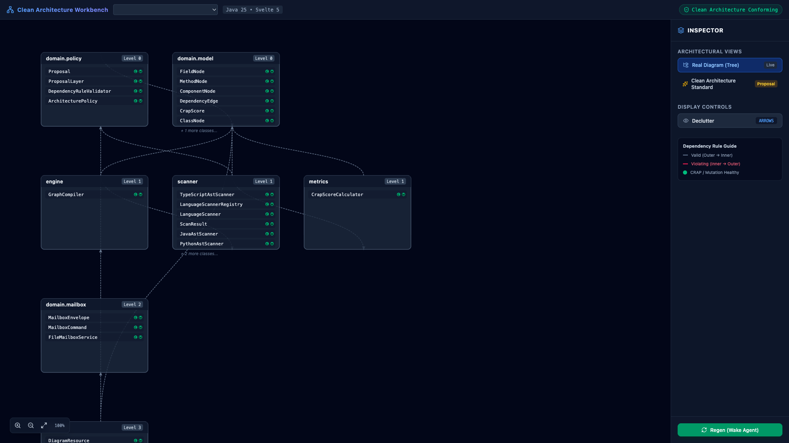
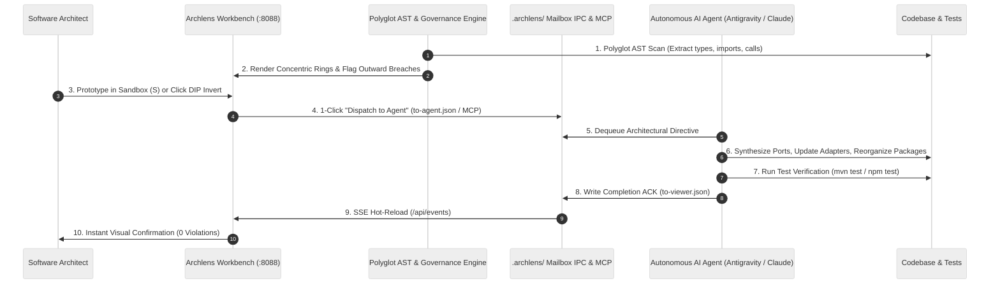
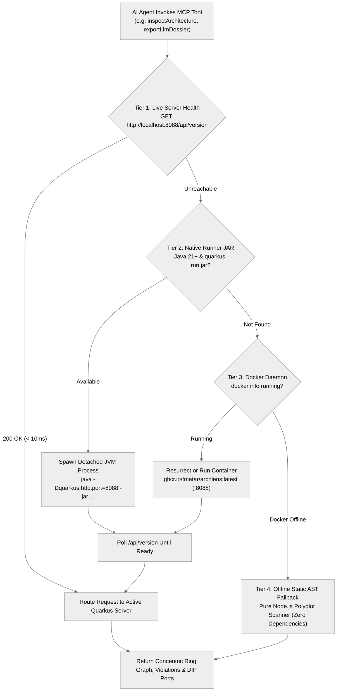

<div align="center">

<picture>
  <source media="(prefers-color-scheme: dark)" srcset="docs/logo-dark.svg" />
  <source media="(prefers-color-scheme: light)" srcset="docs/logo-light.svg" />
  
</picture>

# Archlens — Dynamic Clean Architecture Workbench

**Real-time polyglot Clean Architecture workbench, AST governance engine, and autonomous AI refactoring studio for modern software teams.**

[](https://github.com/fmatar/archlens/actions/workflows/ci.yml)
[](https://github.com/fmatar/archlens/releases/latest)
[](https://www.npmjs.com/package/@fmatar/archlens-skill)
[](LICENSE)

[**Quickstart**](#-quickstart) · [**Why Archlens?**](#-why-archlens) · [**How It Works**](#-how-it-works) · [**AI & MCP Studio**](#-autonomous-ai-companion--mcp-integration) · [**Reference**](#-reference--cli) · [**Docs & Wiki**](https://github.com/fmatar/archlens/wiki) · [**`llms.txt`**](llms.txt)

</div>

---



> *"The Dependency Rule: Source code dependencies must point only inward, toward higher-level policies."* — **Robert C. Martin (Uncle Bob)**  
> 🎬 **Watch**: [`media/archlens-teaser.mp4`](media/archlens-teaser.mp4) · [`media/archlens-user-journey.mp4`](media/archlens-user-journey.mp4) · [`media/archlens-teaser.gif`](media/archlens-teaser.gif)

---

## 🎯 Why Archlens?

Autonomous AI coding agents generate functional features at unprecedented speed—yet without continuous structural guardrails, they silently introduce outward dependency leaks, package cycles, and architectural erosion. Static UML diagrams rot the moment code is committed, while text-only linters dump disconnected logs without showing how to invert the breach.

**Archlens turns Uncle Bob's Clean Architecture Dependency Rule into a live, closed-loop visual feedback and refactoring engine:**

- ⚡ **Polyglot AST Governance Across 6 Languages**: Native scanners for **Java 25**, **Python**, **TypeScript / JS / Svelte 5**, **Rust**, **Go**, and **Clojure** map every class, interface, and import onto concentric tiers (`Domain Core` $\leftarrow$ `Application` $\leftarrow$ `Adapters` $\leftarrow$ `Infrastructure`) in milliseconds.
- 🔒 **Zero-Disk "What-If" Sandbox & Surgical DIP Synthesis**: Simulate moving classes across rings in memory to preview violation deltas ($\Delta \pm N$) and Robert C. Martin metrics ($C_a, C_e, I, A, D$), or synthesize Dependency Inversion Principle (DIP) interface ports in one click.
- 🧩 **Closed-Loop Autonomous AI Refactoring (MCP 2.0 + Mailbox IPC)**: Dispatch verified refactoring plans directly to **Google Antigravity**, **Claude Code**, **Cursor**, **Windsurf**, or **Gemini CLI** via native Model Context Protocol (MCP) tools and `.archlens/` Mailbox IPC.

---

## ⚡ Quickstart

Get full Clean Architecture governance, visual ring inspection, and autonomous AI refactoring running on any repository in under 90 seconds:

### 1. Equip Your Repository & AI Coding Agents (One Command)

```bash
npx @fmatar/archlens-skill --yes --skills --mcp
```

This single command atomically provisions `.archlens/policy.json` (concentric ring rules), `AGENTS.md` / `CLAUDE.md` companion protocols, installs the 3 Archlens skills via `npx skills`, and registers the `archlens` MCP 2.0 stdio bridge across **Google Antigravity**, **Claude Code**, **Claude Desktop**, **Cursor**, **Windsurf**, **Gemini CLI**, and **VS Code**.

### 2. Run in Autonomous AI Mode, Visual Browser Studio, or CI

```bash
# Launch the interactive Svelte 5 Concentric Ring Workbench at http://localhost:8088:
npx @fmatar/archlens-skill start --open

# Run a headless Clean Architecture, ADP Cycle & Fitness Gate check in CI/CD:
npx @fmatar/archlens-skill check --max-violations 0 --detect-cycles --fitness-threshold 0.85

# Export a publication-ready Mermaid architecture diagram directly from the CLI:
npx @fmatar/archlens-skill check --format mermaid --output docs/architecture.mmd
```

<details>
<summary><strong>📦 Alternative Installation Channels (Skills CLI, Docker Daemon, GitHub Action, Canary Track)</strong></summary>

#### Open Skills Ecosystem (`npx skills`)
```bash
npx skills add fmatar/archlens --all -y
# Or target a specific agent globally:
npx skills add fmatar/archlens --all -g --agent claude-code -y
```

#### Always-On Docker Daemon (`http://localhost:8088`)
```bash
docker run -d \
  --name archlens-server \
  --restart unless-stopped \
  -p 8088:8088 \
  -v "$HOME/workspace:/workspace" \
  ghcr.io/fmatar/archlens:latest
```

#### Official GitHub Action for CI/CD Quality Gates
```yaml
- name: Archlens Clean Architecture Gate
  uses: fmatar/archlens@v1
  with:
    max-violations: 0
    detect-cycles: true
    screaming-threshold: 0.70
    fitness-threshold: 0.85
```

#### Global CLI or Canary (`@dev`) Track
```bash
# Global install:
npm install -g @fmatar/archlens-skill

# Canary preview tracking latest develop branch:
npx @fmatar/archlens-skill@dev
```

</details>

---

## 💡 How It Works

Archlens operates as a **closed-loop architectural governor** bridging visual topology design with automated source-code refactoring:



### Core Architectural Capabilities

- **Concentric Ring Visualization & Violation X-Ray (`V`)**: Isolates outward dependency breaches in crimson, routes dense graphs with **Hierarchical Edge Bundling (`B`)**, and isolates component neighborhoods with **1-Hop Focus (`F`)**.
- **"What-If" Architectural Sandbox (`S`)**: Reassign classes across rings in memory, inspect live violation deltas ($\Delta \pm N$) and Martin stability shifts, and click **`Dispatch to Agent`** (`APPLY_PROPOSAL`) to apply verified package moves on disk.
- **Surgical DIP Inverter (`INVERT_DEPENDENCY`)**: Click any violating edge to synthesize a language-native `<Target>Port` interface, preview side-by-side caller/adapter diffs, mint a living ADR (`docs/adr/`), and dispatch to your AI agent.
- **Robert C. Martin Main Sequence Scatter Plot (`M`)**: Computes Afferent Coupling ($C_a$), Efferent Coupling ($C_e$), Instability ($I = \frac{C_e}{C_a + C_e}$), Abstractness ($A = \frac{N_a}{N_c}$), and Distance from the Main Sequence ($D = |A + I - 1|$), highlighting components in the *Zone of Pain* or *Zone of Uselessness*.
- **Screaming Architecture (`SAS`) & Fitness Functions (`AFI`)**: Quantifies domain-vs-framework package ratios, proposes vertical feature slice migrations, and tracks historical Architecture Fitness Index (`AFI`) trends across Git releases (`G`).
- **Multi-Format Diagram Export (`E`)**: Export **Concentric Rings (`COMPONENT_RINGS`)**, **Class & Interface UML (`CLASS_UML`)**, or **Before/After DIP Inversion (`DIP_REFACTOR`)** views as **Mermaid (`.mmd`)**, **Standalone Vector SVG (`.svg`)**, or **`2x` Retina PNG (`.png`)**.

<details>
<summary><strong>🔬 Deep-Dive: Core Workbench Workflows (Sandbox, DIP Inverter, Main Sequence, Export)</strong></summary>

#### 1. "What-If" Architectural Sandbox & 1-Click Dispatch
1. Press **`S`** or click **`Sandbox`** in the top toolbar to enter simulation mode.
2. Drag or reassign any class to a target concentric ring (e.g., moving a domain policy out of `adapters` into `domain`).
3. Inspect real-time **Violation Deltas** (`⚡ -3 Violations`) and Martin coupling impact in the bottom Sandbox toolbar.
4. Click **`Dispatch to Agent`** to write an `APPLY_PROPOSAL` envelope to `.archlens/to-agent.json` for automated refactoring and test verification.

#### 2. Surgical DIP Inverter & Living ADR Synchronization
1. Click any crimson violating edge on the canvas or in the right Inspector drawer and select **`⚡ Invert Dependency (DIP)`**.
2. Inspect the 3-tab modal: **Synthesized Port** (AST-extracted method signatures), **Refactor Previews** (caller constructor injection + outer adapter `implements` diff), and **AI Prompt**.
3. Click **`Sync ADR`** (`POST /api/mailbox/sync-adr`) to mint a living Architecture Decision Record in `docs/adr/` with embedded Before/After Mermaid diagrams, or click **`Dispatch to AI Agent`** to execute the refactoring.

#### 3. Multi-Format Architecture Diagram Export (`E`)
Press **`E`** (or run `npx @fmatar/archlens-skill check --format mermaid`) to export:
- **Concentric Ring Component Topology (`COMPONENT_RINGS`)**: Nested `flowchart TB` subgraphs (`L0`–`L3`) with Martin metrics ($I, A, D$) and crimson `linkStyle` violation arrows.
- **Class & Interface UML (`CLASS_UML`)**: Native Mermaid `classDiagram` with `<<interface>>` and `<<abstract>>` stereotypes, visibility-prefixed members, and active `V` / `F` filter state.
- **Before vs. After DIP Port Inversion (`DIP_REFACTOR`)**: Side-by-side subgraph comparison showing how the synthesized `<Target>Port` inverts the outward dependency.

</details>

---

## 🤖 Autonomous AI Companion & MCP Integration

When registered via `npx @fmatar/archlens-skill --mcp`, your AI assistant (**Google Antigravity**, **Claude Code**, **Claude Desktop**, **Cursor**, **Windsurf**, **Gemini CLI**) connects to `npx -y @fmatar/archlens-skill mcp` over stdio. Every MCP tool call traverses a **4-Tier Auto-Resurrection Waterfall** so you never have to manually boot a server beforehand:



<details>
<summary><strong>🧰 Available MCP Tools (10), Resources (3), Prompts (2) & Per-Agent Setup Manifests</strong></summary>

#### MCP 2.0 Surface (`quarkus-mcp-server` + `@fmatar/archlens-skill mcp`)

| Capability | Name | Description |
| :--- | :--- | :--- |
| **`@Tool`** | `inspectArchitecture` | Extracts the full Clean Architecture graph: concentric rings, classes, edges (`isViolating`), and ADP cycles. |
| **`@Tool`** | `exportLlmDossier` | Generates a Markdown refactoring dossier diagnosing outward breaches and prescribing concrete DIP ports. |
| **`@Tool`** | `synthesizeDipInversion` | Synthesizes a polyglot Dependency Inversion port (Java/Python/TS/Go/Rust) with caller & adapter diff previews. |
| **`@Tool`** | `evaluateFitness` | Computes the Architecture Fitness Index (`AFI` 0–100%, Grade `A`–`F`), Main Sequence ($I, A, D$), and Screaming Score (`SAS`). |
| **`@Tool`** | `getFitnessHistory` | Retrieves historical fitness snapshots and regression trajectory (`IMPROVING`, `STABLE`, `DEGRADING`). |
| **`@Tool`** | `proposeScreamingMigration` | Proposes vertical domain feature clusters and calculates projected Screaming Architecture Score gains. |
| **`@Tool`** | `listSnapshots` | Lists saved architecture snapshots in `.archlens/snapshots/` and historical Git release tags. |
| **`@Tool`** | `getSnapshot` | Retrieves a specific historical release or pre-refactor architecture snapshot (`@NotBlank snapshotId`). |
| **`@Tool`** | `getPolicy` | Returns the active `.archlens/policy.json` concentric ring governance policy. |
| **`@Tool`** | `syncDipAdr` | Mints and synchronizes a living Architecture Decision Record (`docs/adr/ADR-*.md`) for a DIP refactoring. |
| **`@Resource`** | `archlens://llms.txt` | Canonical `llmstxt.org` Clean Architecture rules, CLI recipes, and refactoring protocol specification. |
| **`@Resource`** | `archlens://policy` | Active `.archlens/policy.json` concentric ring definitions and architectural proposals. |
| **`@Resource`** | `archlens://fitness` | Live Architecture Fitness Index (`AFI`) evaluation JSON report. |
| **`@Prompt`** | `architectural-review` | Structured prompt template for conducting a concentric ring & Main Sequence architectural review. |
| **`@Prompt`** | `dip-refactoring-guide` | Guided prompt template (`@NotBlank fromClass`, `@NotBlank toClass`) for executing a surgical DIP inversion. |

#### Manual MCP Configuration (`.mcp.json` / Antigravity / Claude / Cursor / Gemini CLI)
```json
{
  "mcpServers": {
    "archlens": {
      "command": "npx",
      "args": ["-y", "@fmatar/archlens-skill@1.1.2", "mcp"],
      "env": {
        "ARCHLENS_SERVER_URL": "http://localhost:8088"
      }
    }
  }
}
```
- **Claude Code CLI**: `claude mcp add archlens -- npx -y @fmatar/archlens-skill mcp` (or Streamable HTTP: `claude mcp add --transport http archlens http://localhost:8088/mcp`)
- **Gemini CLI**: `gemini mcp add archlens -- npx -y @fmatar/archlens-skill mcp`

#### Mailbox IPC Companion Queue (`.archlens/`)
- **`.archlens/to-agent.json`** (`Workbench -> Agent`): Inbound refactoring directives (`APPLY_PROPOSAL`, `INVERT_DEPENDENCY`, `REGEN`, `REFRESH_CRAP`).
- **`.archlens/to-viewer.json`** (`Agent -> Workbench`): Outbound completion acknowledgments and test verification telemetry.

</details>

---

## 🧭 Reference & CLI

<details>
<summary><strong>⌨️ Workbench Keyboard Shortcuts & Interaction Matrix</strong></summary>

| Key | Action | Description |
| :--- | :--- | :--- |
| `⌘O` / `Ctrl+O` | **Project Switcher** | Open repository browser modal to switch active workspaces |
| `V` | **Violation X-Ray** | Isolate illicit outward dependency breaches in neon crimson |
| `B` | **Edge Bundling** | Route connections along concentric cubic Bézier corridors |
| `D` | **Declutter Mode** | Cycle through canvas declutter filters (Arrows, Elements, Classes) |
| `S` | **Sandbox "What-If"** | Enter or exit interactive architectural sandbox simulation |
| `M` | **Main Sequence** | Toggle 2D Cartesian scatter plot of Abstractness ($A$) vs. Instability ($I$) |
| `C` | **Compact Cards** | Collapse fine-grained class lists into macro component cards |
| `F` | **1-Hop Focus** | Isolate direct inbound and outbound dependencies for selected node |
| `P` | **Policy Designer** | Open the interactive Concentric Ring & Policy Editor modal |
| `E` | **Export Diagram** | Export Concentric Rings, Class UML, or DIP Refactoring views as Mermaid, SVG, or `2x` Retina PNG |
| `L` | **LLM Prompt Dossier** | Export copy-ready Clean Architecture refactoring prompt dossier |
| `T` | **Telemetry Drawer** | Open real-time Agent Mailbox IPC telemetry and audit stream |
| `G` | **Release Comparator** | Compare live architecture against Git tags and release snapshots |
| `⌘K` / `/` | **Command Palette** | Fuzzy search classes, components, and workbench commands |
| `+` / `-` / `0` | **Zoom & Pan** | Zoom in, zoom out, or reset canvas camera viewport |

</details>

<details>
<summary><strong>🌐 Polyglot AST Scanner Matrix (Java 25, Python, TypeScript/Svelte 5, Rust, Go, Clojure)</strong></summary>

| Language | Ecosystem & AST Engine | File Extensions | Capabilities |
| :--- | :--- | :--- | :--- |
| **Java 25** | JavaParser 3.28 (`ThreadLocal`) | `.java` | Records, Sealed Types, Interfaces, Method Signatures, Multi-Module Monorepos, Inward Rules |
| **Python** | Statement-Normalizing AST Lexer | `.py` | Class-First Edges, `Protocol`/`ABC`/`Enum` Stereotypes, Method Signatures, Multi-Line & Nested Imports, `__init__.py` Barrel Re-exports |
| **TypeScript / JS / Svelte** | Statement-Normalizing AST Scanner | `.ts`, `.tsx`, `.js`, `.jsx`, `.svelte`, `.svelte.ts` | Classes, Svelte 5 Runes, `interface`/`abstract class`/`enum` Stereotypes, Multi-Line ESM, Barrel Re-exports, `tsconfig.json` & Turborepo Aliases |
| **Rust** | Syn / Cargo AST Extractor | `.rs` | Structs, Traits, Impls, Module `use` Paths, Trait DIP Synthesis |
| **Go** | Go AST Tree Walker | `.go` | Structs, Interfaces, Package Imports, Type Definitions, Package-level Functions, Interface DIP Synthesis |
| **Clojure** | EDN & Regex AST Scanner | `.clj`, `.cljs`, `.edn` | Namespaces (`ns`), `(:require ...)`, `def`, `defn`, Protocols |

</details>

<details>
<summary><strong>🛠️ Complete CLI Reference (`@fmatar/archlens-skill`) & Local Source Build</strong></summary>

| Command / Flag | Shorthand | Description | Default |
| :--- | :--- | :--- | :--- |
| `init` | | Initialize Clean Architecture policy in target project (default command) | |
| `start` | | Start Archlens Workbench server (native JAR or Docker container; auto-resurrects on demand) | |
| `check` | | Audit repository against Clean Architecture policy rules, ADP cycles, and fitness thresholds | |
| `prompt` | | Export Clean Architecture LLM Refactoring Prompt Dossier | |
| `mcp` | | Launch Model Context Protocol (MCP 2.0) stdio server with 4-tier auto-resurrection | |
| `--mcp` | `-m` | Auto-configure MCP client manifests (Antigravity, Claude, Cursor, Windsurf, VS Code) | `false` |
| `--open` | `-o` | Open visual workbench in default browser upon startup | `false` |
| `--native` | | Prefer running workbench via native Java Quarkus runner JAR | `true` |
| `--docker` | | Force running workbench via Docker container (`ghcr.io/fmatar/archlens:latest`) | `false` |
| `--port <PORT>` | | Workbench HTTP port | `8088` |
| `--path <DIR>` | `-p` | Target repository directory | `.` |
| `--max-violations <N>` | | Maximum allowable outward dependency violations during `check` | `0` |
| `--detect-cycles` | | Enforce Robert C. Martin Acyclic Dependencies Principle (ADP) | `false` |
| `--screaming-threshold <N>` | | Enforce minimum Screaming Architecture score (`0.0`–`1.0`) | `0.60` |
| `--fitness-threshold <N>` | | Enforce minimum Architectural Fitness Index (`0.0`–`1.0`) | `0.80` |
| `--format <FMT>` | | Audit output format (`pretty`, `json`, `sarif`, `mermaid` / `mmd`) | `pretty` |
| `--output <PATH>` | `-O` | Write audit report to specified file path | `stdout` |
| `--global` | `-g` | Install skill into global agent directories (`~/.claude/skills`, `~/.gemini/config/skills`) | `false` |
| `--update` | `-u` | Re-scan code and update existing policy while preserving custom rules | `false` |
| `--yes` | `-y` | Accept defaults automatically (non-interactive mode) | `false` |

#### Building from Source (Contributors)
Requires **Java 25 (OpenJDK / GraalVM)**, **Apache Maven 3.9+**, and **Node.js 22+ / pnpm**:
```bash
# 1. Start the Quarkus Backend (:8088)
cd backend && ./mvnw clean quarkus:dev

# 2. Start the Svelte 5 Frontend (:5173)
cd frontend && pnpm install && pnpm dev

# 3. Run Full-Stack Quality Verification
mvn clean spotless:check verify
npm test && npm --prefix frontend run check && npm --prefix frontend test
```

</details>

---

## 📚 Documentation, Roadmap & Resources

- **Machine-Readable LLM Context**: [`llms.txt`](llms.txt) (`llmstxt.org` canonical index for AI coding agents)
- **Architecture & Governance Guides**:
  - [Archlens GitHub Wiki](https://github.com/fmatar/archlens/wiki) · [Codebase & Concentric Ring Map](wiki/Codebase-Map.md) · [Architecture Overview](wiki/Architecture.md)
  - [User Guide](docs/guide/USER_GUIDE.md) · [Developer & Contributor Guide](docs/guide/DEVELOPER_GUIDE.md) · [Design System (`DESIGN.md`)](DESIGN.md)
  - [C4 Architecture Specification](docs/specs/C4_ARCHITECTURE.md) · [Causal Decision Map](docs/DECISION_MAP.md) · [Product Constitution (`PRODUCT.md`)](PRODUCT.md)
  - [Product Roadmap](ROADMAP.md) · [Living Kanban Board](docs/KANBAN.md) · [Changelog](CHANGELOG.md) · [Contributing](CONTRIBUTING.md)

---

## 📄 License

Licensed under the [Apache License, Version 2.0](LICENSE). See [NOTICE](NOTICE) for attribution and acknowledgements.
