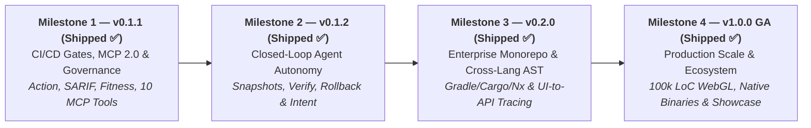

# 🗺️ Archlens Product Roadmap (`v0.1.1` $\to$ `v1.0.0 GA`)

An engineering and product roadmap defining the chronological Semantic Versioning (SemVer) releases, strategic themes, capability traceability (`CAP-XX` / `ADR-XXX`), and acceptance criteria advancing **Archlens (Dynamic Clean Architecture Workbench)** from its shipped **`v0.1.1`** baseline through **`v0.1.2`** and **`v0.2.0`** to **`v1.0.0 General Availability (GA)`**.

---

## 🧭 Chronological Release Architecture



---

## 📊 Release Progression & Product Value Matrix

| Release Target | Milestone Theme | Primary Persona & Outcome | Linked Epic & Specs | Status |
| :--- | :--- | :--- | :--- | :--- |
| **`v0.1.1`** *(Shipped)* | **Milestone 1: CI/CD Quality Gates, MCP 2.0 & Team Governance** | **DevOps & AI Pair Programmers**: Enforce Clean Architecture in GitHub Actions with inline SARIF annotations and 10-tool local/HTTP MCP parity. | [#165](https://github.com/fmatar/archlens/issues/165), [#200](https://github.com/fmatar/archlens/issues/200), `ADR-001`–`ADR-003` | **100% Complete** ✅ |
| **`v0.1.2`** *(Shipped)* | **Milestone 2: Closed-Loop Agent Autonomy & Guardrails** | **Software Architects**: Dispatch DIP/Sandbox refactorings with human intent notes, verify violation/cycle deltas + test suites in 1 click, and atomically revert bad agent edits. | [#164](https://github.com/fmatar/archlens/issues/164), `#1097`, `#1662`, `CAP-04` | **100% Complete** ✅ |
| **`v0.2.0`** *(Shipped)* | **Milestone 3: Enterprise Monorepo & Cross-Language AST Scalability** | **Platform & Polyglot Teams**: Analyze multi-module Gradle, Cargo, and Nx/Turborepo workspaces and trace frontend `fetch()` calls directly to backend REST endpoints. | [#163](https://github.com/fmatar/archlens/issues/163), `#3001`, `CAP-01`, `CAP-02`, `CAP-03` | **100% Complete** ✅ |
| **`v1.0.0 GA`** *(Shipped)* | **Milestone 4: Production Hardening, 100k LoC Virtualization & Ecosystem** | **Enterprise & Open-Source Community**: Zero-install native binaries, 60fps canvas rendering on 100k+ LoC codebases, and an interactive `archlens.io` showcase. | [#166](https://github.com/fmatar/archlens/issues/166), `#4001` | **100% Complete** ✅ |

---

## 🎯 Milestones, Deliverables & Exit Criteria

### 1. [Milestone 1: CI/CD Quality Gates, MCP 2.0 & Team Governance (`v0.1.1` — Shipped ✅)](https://github.com/fmatar/archlens/milestone/3)
*Focus: Shifting Archlens from a local developer studio into an enforceable CI/CD and multi-agent MCP standard.*

- **Linked Epics & Issues**: [#165 Epic: Archlens Headless GitHub Action, SARIF PR Annotations & Living ADR Sync](https://github.com/fmatar/archlens/issues/165), [#200 Multi-Agent Local MCP Setup & 10-Tool Registry Parity](https://github.com/fmatar/archlens/issues/200)
- **Deliverables**:
  1. **Archlens Headless GitHub Action (`fmatar/archlens@v1`)**:
     - [x] Official composite GitHub Action ([`action.yml`](action.yml)) executing headless architectural audits (`npx @fmatar/archlens-skill check`) in CI workflows.
     - [x] Enforces Uncle Bob's ADP (`--detect-cycles`), maximum outward breach limits (`--max-violations`), minimum Screaming Architecture Score (`--screaming-threshold`), and Composite Architecture Fitness Index (`--fitness-threshold`).
  2. **First-Class Pull Request Annotations (SARIF v2.1.0)**:
     - [x] SARIF v2.1.0 report generation (`--format sarif -O archlens-results.sarif`) with automatic upload via `github/codeql-action/upload-sarif@v3` for inline PR annotations (`ARCH001`–`ARCH004`).
  3. **Quarkus MCP 2.0 & Multi-Agent Stdio Parity (`ADR-001`–`ADR-003`)**:
     - [x] Full 10-tool (`inspectArchitecture`, `exportLlmDossier`, `listSnapshots`, `getSnapshot`, `synthesizeDipInversion`, `evaluateFitness`, `getFitnessHistory`, `proposeScreamingMigration`, `getPolicy`, `syncDipAdr`), 3-resource (`archlens://llms.txt`, `archlens://policy`, `archlens://fitness`), and 2-prompt (`architectural-review`, `dip-refactoring-guide`) parity across Quarkus HTTP/SSE (`/mcp`, `/mcp/sse`) and CLI Stdio (`cli/src/mcp-server.js`).
  4. **Living ADR Sync & Historical Architecture Fitness Timelines**:
     - [x] Automated generation and indexing of numbered ADR markdown files in `docs/adr/` (`SyncAdrUseCase`, `POST /api/mailbox/sync-adr`, and `syncDipAdr` MCP tool).
     - [x] Git release/tag comparator (`SnapshotResource`, `ManageSnapshotsUseCase`, `GET /api/snapshots`) and continuous Architecture Fitness Index (`ArchitectureFitnessCalculator`, `.archlens/fitness-history.json`, and `FitnessModal.svelte`).
- **Exit Criteria**: Shipped and verified in `v0.1.0-Beta-09` through `v0.1.1`.

---

### 2. [Milestone 2: Closed-Loop Agent Autonomy & Guardrails (`v0.1.2` — Shipped ✅)](https://github.com/fmatar/archlens/milestone/2)
*Focus: Elevating AI agent collaboration from one-off command dispatching into a verifiable, transactional pair-architect loop.*

- **Linked Epic & Issues**: [#164 Epic: Transactional Worktree Rollbacks & Automated Mailbox Refactoring Verification](https://github.com/fmatar/archlens/issues/164), `#1097`
- **Deliverables**:
  1. **Transactional "What-If" Rollback & Source/Policy Snapshot Isolation (`CAP-04`, `#1097`)**:
     - [x] Interactive What-If Sandbox (`simulateMode`) on the Svelte 5 canvas with live client-side violation delta (`simulatedViolationsDelta`) and Main Sequence metric recalculation (`CAP-04`).
     - [x] Transactional pre-refactor source-tree and policy snapshots (`.archlens/snapshots/<snapshotId>/files/` + `manifest.txt` + `policy.json`) automatically captured on `INVERT_DEPENDENCY` and `APPLY_PROPOSAL`.
     - [x] 1-click **`Revert Snapshot`** UI button in `AgentDrawer.svelte` (`POST /api/mailbox/rollback`) restoring modified source files, deleting newly created agent port files, and restoring `.archlens/policy.json`.
  2. **Automated Verification Gate (`VERIFY_REFACTOR`, `#1097`, `#1662`)**:
     - [x] Closed-loop AST outward violation and ADP cycle verification (`POST /api/mailbox/verify` via `VerifyAndRollbackRefactorUseCase`) confirming `currentViolations <= baselineViolations` and `currentCycles <= baselineCycles`, with a 1-click **`Verify Refactor`** UI button in `AgentDrawer.svelte` and `VERIFY_COMPLETE` telemetry in `.archlens/to-viewer.json`.
     - [x] Polyglot automated build/test-suite execution (`mvn test`, `gradle test`, `npm test`, `pytest`, `go test ./...`, `cargo test`) inside `VerifyAndRollbackRefactorUseCase` (`runTests: true` via the **`+ Tests`** toggle in `AgentDrawer.svelte`) before acknowledging completion in `.archlens/to-viewer.json`.
  3. **Dual-Agent Architectural Intent & Human Directives (`#1097`)**:
     - [x] Optional `reason` rationale supported in `POST /api/mailbox/sync-adr` (`syncDipAdr` MCP tool) and a 1-click **`Record ADR`** UI button in `AgentDrawer.svelte`.
     - [x] Attach human architectural intent notes (`architecturalIntent` via `InvertDipModal.svelte` and `SandboxToolbar.svelte`) directly from the canvas UI into `.archlens/to-agent.json` payloads.
- **Exit Criteria for `v0.1.2`**: Zero outward violations, zero ADP cycles, transactional source + policy rollback verified by unit tests, and optional test-runner gate completed.

---

### 3. [Milestone 3: Enterprise Monorepo & Cross-Language AST Scalability (`v0.2.0` — Shipped ✅)](https://github.com/fmatar/archlens/milestone/1)
*Focus: Ensuring AST parsing scales seamlessly across polyglot enterprise monorepos, multi-build workspaces, and full-stack UI-to-API boundaries.*

- **Linked Epic & Specs**: [#163 Epic: Enterprise Monorepos, Multi-Module Scanners & Cross-Lang AST Tracing](https://github.com/fmatar/archlens/issues/163), `#3001`, `CAP-01`, `CAP-02`, `CAP-03`
- **Deliverables**:
  1. **Enterprise Monorepo & Multi-Module Scanners (`#3001`, `CAP-02`)**:
     - [x] Deep nested Maven multi-module discovery (`discoverMavenModuleSourceDirs`) and `tsconfig.json` / `jsconfig.json` path alias & barrel `index.ts` re-export resolution (`CAP-02`).
     - [x] Cross-project boundary detection: distinguishing internal intra-repository imports vs external 3rd-party dependencies.
     - [x] Gradle subproject (`settings.gradle` / `settings.gradle.kts`), Nx/Turborepo/pnpm workspace (`pnpm-workspace.yaml` / `package.json` `workspaces`), and Cargo workspace (`[workspace]`) multi-module aggregation across `FileScannerUtil.discoverWorkspaceModules`, `JavaAstScanner`, `RustAstScanner`, `TypeScriptAstScanner`, and `cli/src/analyzer.js`.
  2. **Cross-Language Boundary Tracing (`#3001`)**:
     - [x] Bridge frontend API client calls (Svelte 5 / TS `fetch('/api/...')` / `axios('/api/...')`) to backend entrypoints (Quarkus/Spring REST `@Path` / `@RequestMapping` and FastAPI/Flask `@app.get` / `@router.post` via `FileScannerUtil.indexBackendRestRoutes`) within a unified cross-language dependency graph (`HTTP /api/...` edges).
  3. **AST Parser Resiliency & Polyglot Dialect Parity (`CAP-01`, `CAP-03`, `#3001`)**:
     - [x] Graceful partial AST degradation: per-file exception isolation in `JavaAstScanner` (`ParserConfiguration.LanguageLevel.JAVA_25`), `TypeScriptAstScanner`, `PythonAstScanner` (`CAP-01`), `GoAstScanner`, `RustAstScanner`, and `ClojureAstScanner`.
     - [x] Modern Java 25 syntax idioms (records, sealed classes, pattern matching), Svelte 5 runes (`$state`, `$derived`, `$props`), and polyglot DIP port synthesis (`DipInversionSynthesizer` for Java, Python, TypeScript, Go, and Rust — `CAP-03`).
     - [x] Go 1.23 iterator idioms (`iter.Seq[T]` / `iter.Seq2[K, V]` signatures and functional iterator contracts in `GoAstScanner`) and Python 3.12 (`PEP 695`) `type <Alias>[T] = ...` statement aliases and generic classes/functions in `PythonAstScanner`.
- **Exit Criteria for `v0.2.0`**: Multi-module Gradle/Cargo/pnpm workspace auto-discovery and cross-language REST boundary linking verified with fixture integration tests.

---

### 4. [Milestone 4: Production Hardening, Distribution & Ecosystem (`v1.0.0 GA` — Shipped ✅)](https://github.com/fmatar/archlens/milestone/4)
*Focus: Community distribution, 100k+ LoC performance virtualization, native binaries, and an interactive public showcase.*

- **Linked Epic**: [#166 Epic: v1.0.0 GA Production Hardening, skills.sh Ecosystem & 100k LoC Virtualization](https://github.com/fmatar/archlens/issues/166), `#4001`
- **Deliverables**:
  1. **Ecosystem & Distribution (`#4001`)**:
     - [x] Official multi-agent skill (`skills/archlens/SKILL.md`) for **[skills.sh](https://skills.sh)** (`npx skills add fmatar/archlens`) and zero-install CLI (`npx @fmatar/archlens-skill`).
     - [x] Daemonless Jib multi-arch OCI container images (`linux/amd64`, `linux/arm64`) published to GHCR (`ghcr.io/fmatar/archlens`) with CycloneDX SBOM attestation, plus `-Pnative` Maven profile for GraalVM builds.
     - [x] Automated GraalVM native binary builds (`linux-amd64`; macOS/Windows targets dropped in 1.1.0 because releases build only on the self-hosted `local-archlens` Linux runners) attached to GitHub Releases, optional Docker Hub (`docker.io/fmatar/archlens`) dual-registry publishing in [`.github/workflows/release.yml`](.github/workflows/release.yml), and native binary auto-discovery (`findNativeBinary` / `startNativeBinary`) in [`cli/src/docker-runner.js`](cli/src/docker-runner.js).
  2. **Canvas Performance & Virtualization at Scale (`100k+ LoC`, `#4001`)**:
     - [x] Viewport frustum culling (`visiblePackages` with `400px` margin), 6-class card pagination, and semantic Level-of-Detail (LoD) zooming (`compactLod` automatically collapsing class details below `0.55` zoom).
     - [x] Hybrid HTML5 `<canvas>` / WebGL rendering fallback (`isWebGlRendererActive` in [`diagram.svelte.ts`](frontend/src/lib/state/diagram.svelte.ts) and [`Canvas.svelte`](frontend/src/lib/components/Canvas.svelte)) automatically activating at `>= 500` visible classes (with manual `W` HUD toggle).
  3. **Public Interactive Showcase (`#4001`)**:
     - [x] Curated interactive reference architecture showcase presets (`SHOWCASE_PRESETS` in [`demoData.ts`](frontend/src/lib/data/demoData.ts) and project switcher in [`App.svelte`](frontend/src/App.svelte)) pre-loaded with **Spring PetClinic (Java 25)**, **Quarkus Reactive Microservice**, and **RealWorld Conduit (Full-Stack TS + FastAPI)**.
- **Exit Criteria for `v1.0.0 GA`**: 60fps canvas rendering at 500+ visible classes, automated native binary release artifacts, and live `archlens.io` reference playground.

---

## 📋 Living Kanban Board

Track real-time progress across all epics, milestones, and issues in [`docs/KANBAN.md`](docs/KANBAN.md).
To synchronize the board at any time:
```bash
.agent/scripts/kanban-sync.sh
```
