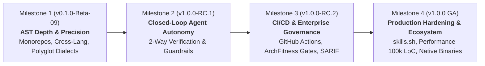

# 🗺️ Archlens Product Roadmap (v0.1.1 $\to$ v1.0.0 GA)

An engineering roadmap outlining the strategic milestones, technical deliverables, and architectural criteria required to advance **Archlens (Dynamic Clean Architecture Workbench)** from **v0.1.1** to an enterprise-grade **v1.0.0 General Availability (GA)** release.

---

## 🧭 Milestone Architecture



---

## 🎯 Milestones & Traceability

### [Milestone 1: AST Depth & Polyglot Scalability (v0.1.0-Beta-09)](https://github.com/fmatar/archlens/milestone/1)
*Focus: Ensuring AST parsing never breaks on complex enterprise architectures, monorepos, and hybrid language setups.*

- **Linked Epic**: [#163 Epic: Enterprise Monorepos, Multi-Module Scanners & Cross-Lang AST Tracing](https://github.com/fmatar/archlens/issues/163)
- **Key Deliverables**:
  1. **Enterprise Monorepo & Multi-Module Scanners**:
     - [x] Deep nested Maven multi-module discovery (`discoverMavenModuleSourceDirs`) and `tsconfig.json` / `jsconfig.json` path alias & barrel `index.ts` re-export resolution (`CAP-02`).
     - [x] Cross-project boundary detection: distinguishing internal intra-repository imports vs external 3rd-party dependencies.
     - [ ] Gradle subproject (`settings.gradle`), Nx/Turborepo workspace, and Cargo workspace (`[workspace]`) multi-module aggregation.
  2. **Cross-Language Boundary Tracing**:
     - [ ] Bridge frontend API client calls (Svelte 5 / TS `fetch` / `axios`) to backend entrypoints (Quarkus REST / SSE / FastAPI) within a unified cross-language graph.
  3. **AST Parser Resiliency & Fault Tolerance**:
     - [x] Graceful partial AST degradation: per-file exception isolation in `JavaAstScanner` (`ParserConfiguration.LanguageLevel.JAVA_25`), `TypeScriptAstScanner`, `PythonAstScanner` (`CAP-01`), `GoAstScanner`, `RustAstScanner`, and `ClojureAstScanner`.
     - [x] Modern Java 25 syntax idioms (records, sealed classes, pattern matching) and Svelte 5 runes (`$state`, `$derived`, `$props`).
     - [ ] Go 1.23 iterator idioms (`iter.Seq`) and Python 3.12 `type` statement aliases.

---

### [Milestone 2: Closed-Loop Agent Autonomy & Guardrails (v1.0.0-RC.1)](https://github.com/fmatar/archlens/milestone/2)
*Focus: Elevating AI agent collaboration from one-off command dispatching into a bulletproof, verifiable pair-architect workflow.*

- **Linked Epic**: [#164 Epic: Transactional Worktree Rollbacks & Automated Mailbox Refactoring Verification](https://github.com/fmatar/archlens/issues/164)
- **Key Deliverables**:
  1. **Transactional "What-If" Rollback & Git Staging Isolation**:
     - [x] Interactive What-If Sandbox (`simulateMode`) on the Svelte 5 canvas with live client-side violation delta (`simulatedViolationsDelta`) and Main Sequence metric recalculation (`CAP-04`).
     - [x] Policy snapshot backup (`.archlens/snapshots/policy.backup.json`) and REST rollback endpoint (`POST /api/mailbox/rollback`).
     - [ ] Dedicated Git worktree isolation for source-code refactoring directives (`APPLY_PROPOSAL`, `INVERT_DEPENDENCY`) and a 1-click "Revert Agent Changes" button on the canvas UI.
  2. **Automated Verification Gate (`VERIFY_REFACTOR`)**:
     - [x] AST violation delta verification (`POST /api/mailbox/verify` via `VerifyAndRollbackRefactorUseCase`) confirming `currentViolations <= baselineViolations`.
     - [ ] Automated backend test-suite execution inside `VerifyAndRollbackRefactorUseCase` before acknowledging completion in `.archlens/to-viewer.json`.
  3. **Dual-Agent Architectural Intent & Human Directives**:
     - [x] Optional `reason` rationale supported in `POST /api/mailbox/sync-adr` (`syncDipAdr` MCP tool).
     - [ ] Attach human architectural intent notes and custom constraints directly from the canvas UI into `.archlens/to-agent.json` payloads.

---

### [Milestone 3: CI/CD Quality Gates & Team Governance (v1.0.0-RC.2)](https://github.com/fmatar/archlens/milestone/3)
*Focus: Shifting Archlens from a local developer studio into an enforceable team standard.*

- **Linked Epic**: [#165 Epic: Archlens Headless GitHub Action, SARIF PR Annotations & Living ADR Sync](https://github.com/fmatar/archlens/issues/165)
- **Key Deliverables**:
  1. **Archlens Headless GitHub Action (`fmatar/archlens@v1`)**:
     - [x] Official composite GitHub Action ([`action.yml`](action.yml)) executing headless architectural audits (`npx @fmatar/archlens-skill check`) in CI workflows.
     - [x] Enforces Uncle Bob's ADP (`--detect-cycles`), maximum outward breach limits (`--max-violations`), minimum Screaming Architecture Score (`--screaming-threshold`), and Composite Architecture Fitness Index (`--fitness-threshold`).
  2. **First-Class Pull Request Annotations (SARIF / GitHub Checks)**:
     - [x] SARIF v2.1.0 report generation (`--format sarif -O archlens-results.sarif`) with automatic upload via `github/codeql-action/upload-sarif@v3` for inline PR annotations (`ARCH001`–`ARCH004`).
  3. **Automated Architecture Decision Records (ADR) Sync**:
     - [x] Automated generation and indexing of numbered ADR markdown files in `docs/adr/` (`SyncArchitecturalDecisionUseCase`, `POST /api/mailbox/sync-adr`, and `syncDipAdr` MCP tool).
  4. **Historical Architecture Fitness Timelines**:
     - [x] Git release/tag comparator (`SnapshotResource`, `CompareSnapshotUseCase`, `GET /api/snapshots`) and continuous Architecture Fitness Index (`FitnessEvaluator`, `.archlens/fitness-history.json`, and `FitnessModal.svelte`).

---

### [Milestone 4: Production Hardening, Distribution & Ecosystem (v1.0.0 GA)](https://github.com/fmatar/archlens/milestone/4)
*Focus: Community distribution, extreme performance, zero friction, and comprehensive documentation.*

- **Linked Epic**: [#166 Epic: v1.0.0 GA Production Hardening, skills.sh Ecosystem & 100k LoC Virtualization](https://github.com/fmatar/archlens/issues/166)
- **Key Deliverables**:
  1. **Ecosystem & Distribution**:
     - [x] Official multi-agent skill (`skills/archlens/SKILL.md`) for **[skills.sh](https://skills.sh)** (`npx skills add fmatar/archlens`) and zero-install CLI (`npx @fmatar/archlens-skill`).
     - [x] Multi-arch Docker images (`linux/amd64`, `linux/arm64`) published to GHCR (`ghcr.io/fmatar/archlens`) with CycloneDX SBOM attestation, plus `-Pnative` Maven profile for GraalVM builds.
     - [ ] Automated cross-platform GraalVM native binary builds attached to GitHub Releases and Docker Hub image publishing.
  2. **Canvas Performance & Virtualization at Scale (100k+ LoC)**:
     - [x] Viewport frustum culling (`visiblePackages` with `400px` margin), 6-class card pagination, and semantic Level-of-Detail (LoD) zooming (`compactLod` automatically collapsing class details below `0.55` zoom).
     - [ ] Hybrid HTML5 Canvas / WebGL rendering fallback for extreme graphs exceeding 500+ simultaneously visible classes.
  3. **Public Interactive Showcase**:
     - [ ] Live web-based playground on `archlens.io` pre-loaded with open-source reference architectures (Spring PetClinic, Quarkus Quickstarts, RealWorld spec).

---

## 📊 Living Kanban Board

Track real-time progress across all epics, milestones, and issues in [`docs/KANBAN.md`](docs/KANBAN.md).
To synchronize the board at any time:
```bash
.agent/scripts/kanban-sync.sh
```
