# 🗺️ Causal Decision Graph & Architecture Lineage (`DECISION_MAP.md`)

> **Auto-Generated by Agentic SDLC Engine**: Tracks how product capabilities (`PRODUCT.md`), specifications, tickets, and Spec-Drift ADRs evolved into the current system state.

---

## 🧬 Causal Decision Lineage Graph

```mermaid
flowchart TD
  INV_01["INV-01: Zero direct commits, merges, or pushes to `main` or `develop` (enforced by 4-Layer Git Guard & Stage 7 Merkle Gate Receipts)."]
  INV_02["INV-02: 100% of code changes require an active SDLC ticket session and Dual-Gate verification ($\ge 85\%$ diff coverage, $\ge 80\%$ mutation score)."]
  INV_03["INV-03: Core Domain entities (Ring 0) must remain pure with zero imports from outer Web, DB, or framework layers (Clean Architecture Dependency Rule)."]
  INV_04["INV-04: Polyglot AST Scanners must emit class/interface-level `DependencyEdge` endpoints when symbols or classes exist (falling back to module `ClassNode` IDs for function-only modules) and classify abstract/interface stereotypes (`INTERFACE`, `ABSTRACT`) accurately for Robert C. Martin metrics ($C_a, C_e, I, A, D$)."]
  INV_05["INV-05: All architectural or contract deviations from this constitution require a linked ADR (`docs/adr/ADR-00X.md`) synchronized with `PRODUCT.md` and `docs/DECISION_MAP.md`."]
  CAP_01["CAP-01: Python AST Class-Level Edges, ABC/Protocol Stereotypes & Method Signatures"]
  SPEC_01["SPEC-01 (docs/specs/cap-01.md)"]
  CAP_02["CAP-02: TypeScript/JS Multi-Line ESM, Barrel Re-Exports, tsconfig Aliases & CLI Scanner"]
  SPEC_02["SPEC-02 (docs/specs/cap-02.md)"]
  CAP_03["CAP-03: Polyglot Surgical DIP Inverter & CLI Main Sequence Distance"]
  SPEC_03["SPEC-03 (docs/specs/cap-03.md)"]
  CAP_04["CAP-04: What-If Sandbox Simulation, Class-Move Precedence & Proposal Persistence"]
  SPEC_04["SPEC-04 (docs/specs/cap-04.md)"]
  ADR_001["ADR-001: Quarkus 3.40 MCP 2.0 Hexagonal Decoupling, Virtual Threads & Main Sequence Calibration"]
  _6262["Ticket #6262 (feature/issue-#6262-quarkus-mcp-and-sdlc-enhancement)"]
  ADR_002["ADR-002: Quarkus 3.40.1.1 BOM Upgrade, Ring 1 WorkspacePathResolver Binding & MCP Hibernate Validator"]
  _196["Ticket #196 (feature/issue-#196-release-v0-1-1)"]
  ADR_003["ADR-003: Multi-Agent Local MCP Registry, CI Hardening & End-to-End Smoke Suite"]
  _200["Ticket #200 (feature/issue-#200-docs-mcp-ci-hardening)"]
  ADR_COMPACT_v0_1_0_Beta_12["Compacted 1 ADR(s) into SRS.md (v0.1.0-Beta-12)"]
  __5887["Ticket ##5887 (feature/issue-#5887-polyglot-ast-dip-sandbox)"]
  _192["Ticket #192 (feature/issue-#192-quarkus-mcp-audit-remediation)"]
  _8253["Ticket #8253 (feature/issue-#8253-wiki-roadmap-docs-drift-sync)"]
  _1097["Ticket #1097 (feature/issue-#1097-closed-loop-refactor-verification-and-ro)"]
  _1662["Ticket #1662 (feature/issue-#1097-closed-loop-refactor-verification-and-ro)"]
  _3001["Ticket #3001 (feature/issue-#1097-closed-loop-refactor-verification-and-ro)"]
  CAP_01 -->|specified_by| SPEC_01
  CAP_02 -->|specified_by| SPEC_02
  CAP_03 -->|specified_by| SPEC_03
  CAP_03 -->|depends_on| CAP_01
  CAP_03 -->|depends_on| CAP_02
  CAP_04 -->|specified_by| SPEC_04
  CAP_04 -->|depends_on| CAP_01
  CAP_04 -->|depends_on| CAP_02
  _6262 -->|triggered_drift_adr| ADR_001
  CAP_01 -.->|ADR Drift| ADR_001
  CAP_02 -.->|ADR Drift| ADR_001
  CAP_03 -.->|ADR Drift| ADR_001
  CAP_04 -.->|ADR Drift| ADR_001
  _196 -->|triggered_drift_adr| ADR_002
  CAP_01 -.->|ADR Drift| ADR_002
  CAP_02 -.->|ADR Drift| ADR_002
  CAP_03 -.->|ADR Drift| ADR_002
  CAP_04 -.->|ADR Drift| ADR_002
  _200 -->|triggered_drift_adr| ADR_003
  CAP_01 -.->|ADR Drift| ADR_003
  CAP_02 -.->|ADR Drift| ADR_003
  CAP_03 -.->|ADR Drift| ADR_003
  CAP_04 -.->|ADR Drift| ADR_003
  CAP_01 -->|realized_by| ADR_COMPACT_v0_1_0_Beta_12
  CAP_02 -->|realized_by| ADR_COMPACT_v0_1_0_Beta_12
  CAP_03 -->|realized_by| ADR_COMPACT_v0_1_0_Beta_12
  CAP_04 -->|realized_by| ADR_COMPACT_v0_1_0_Beta_12
```

---

## ⚡ Spec Drift & ADR Pivot Ledger

| ADR ID | Decision Title | Scope | Status | Triggered By | Supersedes / Amends |
| :--- | :--- | :--- | :--- | :--- | :--- |
| **ADR-001** | Quarkus 3.40 MCP 2.0 Hexagonal Decoupling, Virtual Threads & Main Sequence Calibration | `technical` | `accepted` | #6262 | CAP-01, CAP-02, CAP-03, CAP-04 |
| **ADR-002** | Quarkus 3.40.1.1 BOM Upgrade, Ring 1 WorkspacePathResolver Binding & MCP Hibernate Validator | `technical` | `accepted` | #196 | CAP-01, CAP-02, CAP-03, CAP-04 |
| **ADR-003** | Multi-Agent Local MCP Registry, CI Hardening & End-to-End Smoke Suite | `technical` | `accepted` | #200 | CAP-01, CAP-02, CAP-03, CAP-04 |

---

## 🎯 Product Capability Realization Matrix

| Capability ID | Description | Current Status |
| :--- | :--- | :--- |
| **CAP-01** | Python AST Class-Level Edges, ABC/Protocol Stereotypes & Method Signatures | `AMENDED (ADR-003)` |
| **CAP-02** | TypeScript/JS Multi-Line ESM, Barrel Re-Exports, tsconfig Aliases & CLI Scanner | `AMENDED (ADR-003)` |
| **CAP-03** | Polyglot Surgical DIP Inverter & CLI Main Sequence Distance | `AMENDED (ADR-003)` |
| **CAP-04** | What-If Sandbox Simulation, Class-Move Precedence & Proposal Persistence | `AMENDED (ADR-003)` |
