# 🗺️ Causal Decision Graph & Architecture Lineage (`DECISION_MAP.md`)

> **Auto-Generated by Agentic SDLC Engine**: Tracks how product capabilities (`PRODUCT.md`), specifications, tickets, and Spec-Drift ADRs evolved into the current system state.

---

## 🧬 Causal Decision Lineage Graph

```mermaid
flowchart TD
  INV_01["INV-01: Zero direct commits, merges, or pushes to `main` or `develop` (enforced by 4-Layer Git Guard & Stage 7 Merkle Gate Receipts)."]
  INV_02["INV-02: 100% of code changes require an active SDLC ticket session and Dual-Gate verification ($\ge 85\%$ diff coverage, $\ge 80\%$ mutation score)."]
  INV_03["INV-03: Core Domain entities (Ring 0) must remain pure with zero imports from outer Web, DB, or framework layers (Clean Architecture Dependency Rule)."]
  INV_04["INV-04: Polyglot Scanners must emit class/interface-level `DependencyEdge` endpoints when symbols or classes exist (falling back to module `ClassNode` IDs for function-only modules) and classify abstract/interface stereotypes (`INTERFACE`, `ABSTRACT`) accurately for component coupling metrics ($C_a, C_e, I, A, D$)."]
  INV_05["INV-05: All architectural or contract deviations from this constitution require a linked ADR (`docs/adr/ADR-00X.md`) synchronized with `PRODUCT.md` and `docs/DECISION_MAP.md`."]
  CAP_01["CAP-01: Python Lexical Class-Level Edges, ABC/Protocol Stereotypes & Method Signatures"]
  SPEC_01["SPEC-01 (docs/specs/cap-01.md)"]
  CAP_02["CAP-02: TypeScript/JS Multi-Line ESM, Barrel Re-Exports, tsconfig Aliases & CLI Scanner"]
  SPEC_02["SPEC-02 (docs/specs/cap-02.md)"]
  CAP_03["CAP-03: Polyglot Surgical DIP Inverter & CLI Main Sequence Distance"]
  SPEC_03["SPEC-03 (docs/specs/cap-03.md)"]
  CAP_04["CAP-04: What-If Sandbox Simulation, Class-Move Precedence & Proposal Persistence"]
  SPEC_04["SPEC-04 (docs/specs/cap-04.md)"]
  ADR_001["ADR-001: Quarkus 3.40 MCP 2.0 Hexagonal Decoupling, Virtual Threads & Main Sequence Calibration"]
  _6262["Ticket #6262 (feature/issue-#6262-quarkus-mcp-and-sdlc-enhancement)"]
  ADR_002["ADR-002: Quarkus 3.40.1.1 BOM Upgrade, Ring 1 WorkspacePathResolver Binding & MCP Hibernate Validator"]
  _196["Ticket #196 (feature/issue-#196-release-v0-1-1)"]
  ADR_003["ADR-003: Multi-Agent Local MCP Registry, CI Hardening & End-to-End Smoke Suite"]
  _200["Ticket #200 (feature/issue-#200-docs-mcp-ci-hardening)"]
  ADR_004["ADR-004: Multi-Format Architecture Diagram Export (Mermaid, SVG, PNG) & v1.1.0 Release"]
  _4772["Ticket #4772 (feature/issue-#4772-sync-sdlc-v2-and-release-finalization)"]
  ADR_005["ADR-005: Quarkus 3.40.1.2, MCP 2.0.4 & Latest GA Dependency Alignment"]
  _6157["Ticket #6157 (feature/issue-#6157-upgrade-backend-and-frontend-latest-ga-d)"]
  ADR_006["ADR-006: Release v1.1.1 — Manifest Synchronization, Brand Identity & GA Dependency Alignment"]
  _222["Ticket #222 (feature/issue-#222-release-v1-1-1)"]
  ADR_007["ADR-007: Enforce Agent Skills Release Parity and Convert Skill Installer to npx skills"]
  _8238["Ticket #8238 (feature/issue-#8238-enforce-skills-release-and-npx-skills)"]
  ADR_008["ADR-008: Release v1.1.2 — Agent Skills Release Parity & npx skills Ecosystem Publication"]
  _9283["Ticket #9283 (feature/issue-#9283-release-v1-1-2)"]
  ADR_009["ADR-009: Dual-Transport Quarkus MCP STDIO Profile and Ephemeral Docker Container Support"]
  _8714["Ticket #8714 (feature/issue-#8714-add-quarkus-mcp-stdio-docker-container-t)"]
  ADR_010["ADR-010: Release v1.1.3 — Auto-MCP Global Onboarding, Interactive Docker Transport Choice & Documentation Parity"]
  _8454["Ticket #8454 (feature/issue-#8454-auto-mcp-onboarding-and-release-v1-1-3)"]
  ADR_011["ADR-011: Release v1.1.4 — Fix npx Symlink Entrypoint Resolution in @fmatar/archlens-skill"]
  _4934["Ticket #4934 (feature/issue-#4934-fix-npx-symlink-entrypoint-and-release-v)"]
  ADR_012["ADR-012: Phase 1 Security, Action Self-Test Fixtures & macOS Canonical Root Guard"]
  _224["Ticket #224"]
  ADR_013["ADR-013: Release v1.1.5 — Phase 0 Workbench Security & Phase 1 CLI, GitHub Action & CI Hardening"]
  _247["Ticket #247 (fix/security-hotfix-v1-1-6)"]
  ADR_014["ADR-014: Release v1.1.6 — Security Hotfix for Matrix-Parameter Auth Bypass, Chained RCE, CI Gates & Supply Chain"]
  ADR_015["ADR-015: Phase 1.5 — GraalVM Native SecureRandom Fix, Recoverable Rollback Trash & Diagram Export MCP Tool Parity"]
  _263["Ticket #263 (feature/issue-#263-phase-1-5-native-securerandom-rollback-t)"]
  ADR_016["ADR-016: Wave 1 MCP Confinement Pure-Git Tag Caching and Watcher Root Switching"]
  _265["Ticket #265 (feature/issue-#265-wave-1-correctness-and-auth)"]
  ADR_017["ADR-017: Phase 2 Skipped-File Telemetry Clojure Removal and Provenance Cleanup"]
  _238["Ticket #238 (feature/issue-#238-phase-2-trust-hygiene-and-skipped-files)"]
  ADR_018["ADR-018: Phase 3 — Repository Hygiene, Clean Architecture Ports & Constructor DI, and Playwright E2E CI"]
  _246["Ticket #246 (feature/issue-#246-phase-3-hygiene-di-ports-and-e2e-ci)"]
  ADR_019["ADR-019: Release v1.2.0 — Phase 1.5, Wave 1, Phase 2 Telemetry & Phase 3 Clean Architecture Ports"]
  ADR_020["ADR-020: Migrate NPM Package Scope to @fadym/archlens-skill with OIDC Trusted Publishing"]
  _268["Ticket #268 (fix/issue-268-frontend-deps-and-proposal-race)"]
  ADR_021["ADR-021: Wave 2 — Frontend Minor/Patch Dependency Updates & Monotonic loadGraph Sequence Guard"]
  _243["Ticket #243 (refactor/issue-243-lexical-scanners-and-comment-string-stri)"]
  ADR_022["ADR-022: Wave 3 — Honest Lexical Scanner Naming & Comment/String Literal Pre-Pass Sanitization"]
  _244["Ticket #244 (feat/issue-244-unified-cli-backend-check)"]
  ADR_023["ADR-023: Wave 4 — Backend-First CLI check Delegation, Ephemeral Loopback Lifecycle & Engine Parity Suite"]
  ADR_COMPACT_v0_1_0_Beta_12["Compacted 1 ADR(s) into SRS.md (v0.1.0-Beta-12)"]
  ADR_COMPACT_v1_1_1["Compacted 5 ADR(s) into SRS.md (v1.1.1)"]
  __5887["Ticket ##5887 (feature/issue-#5887-polyglot-ast-dip-sandbox)"]
  _192["Ticket #192 (feature/issue-#192-quarkus-mcp-audit-remediation)"]
  _8253["Ticket #8253 (feature/issue-#8253-wiki-roadmap-docs-drift-sync)"]
  _1097["Ticket #1097 (feature/issue-#1097-closed-loop-refactor-verification-and-ro)"]
  _1662["Ticket #1662 (feature/issue-#1097-closed-loop-refactor-verification-and-ro)"]
  _3001["Ticket #3001 (feature/issue-#1097-closed-loop-refactor-verification-and-ro)"]
  _4001["Ticket #4001 (feature/issue-#1097-closed-loop-refactor-verification-and-ro)"]
  _6538["Ticket #6538 (feature/issue-#6538-hexagonal-vault-brand-identity-ui-and-re)"]
  CAP_01 -->|specified_by| SPEC_01
  CAP_02 -->|specified_by| SPEC_02
  CAP_03 -->|specified_by| SPEC_03
  CAP_03 -->|depends_on| CAP_01
  CAP_03 -->|depends_on| CAP_02
  CAP_04 -->|specified_by| SPEC_04
  CAP_04 -->|depends_on| CAP_01
  CAP_04 -->|depends_on| CAP_02
  _6262 -->|triggered_drift_adr| ADR_001
  CAP_01 -.->|ADR Drift| ADR_001
  CAP_02 -.->|ADR Drift| ADR_001
  CAP_03 -.->|ADR Drift| ADR_001
  CAP_04 -.->|ADR Drift| ADR_001
  _196 -->|triggered_drift_adr| ADR_002
  CAP_01 -.->|ADR Drift| ADR_002
  CAP_02 -.->|ADR Drift| ADR_002
  CAP_03 -.->|ADR Drift| ADR_002
  CAP_04 -.->|ADR Drift| ADR_002
  _200 -->|triggered_drift_adr| ADR_003
  CAP_01 -.->|ADR Drift| ADR_003
  CAP_02 -.->|ADR Drift| ADR_003
  CAP_03 -.->|ADR Drift| ADR_003
  CAP_04 -.->|ADR Drift| ADR_003
  _4772 -->|triggered_drift_adr| ADR_004
  CAP_01 -.->|ADR Drift| ADR_004
  CAP_02 -.->|ADR Drift| ADR_004
  CAP_03 -.->|ADR Drift| ADR_004
  CAP_04 -.->|ADR Drift| ADR_004
  _6157 -->|triggered_drift_adr| ADR_005
  CAP_01 -.->|ADR Drift| ADR_005
  CAP_02 -.->|ADR Drift| ADR_005
  CAP_03 -.->|ADR Drift| ADR_005
  CAP_04 -.->|ADR Drift| ADR_005
  _222 -->|triggered_drift_adr| ADR_006
  CAP_01 -.->|ADR Drift| ADR_006
  CAP_02 -.->|ADR Drift| ADR_006
  CAP_03 -.->|ADR Drift| ADR_006
  CAP_04 -.->|ADR Drift| ADR_006
  _8238 -->|triggered_drift_adr| ADR_007
  _9283 -->|triggered_drift_adr| ADR_008
  ADR_007 -.->|ADR Drift| ADR_008
  _8714 -->|triggered_drift_adr| ADR_009
  _8454 -->|triggered_drift_adr| ADR_010
  ADR_009 -.->|ADR Drift| ADR_010
  _4934 -->|triggered_drift_adr| ADR_011
  ADR_010 -.->|ADR Drift| ADR_011
  _224 -->|triggered_drift_adr| ADR_012
  ADR_011 -.->|ADR Drift| ADR_012
  _247 -->|triggered_drift_adr| ADR_013
  ADR_012 -.->|ADR Drift| ADR_013
  _247 -->|triggered_drift_adr| ADR_014
  ADR_013 -.->|ADR Drift| ADR_014
  _263 -->|triggered_drift_adr| ADR_015
  ADR_014 -.->|ADR Drift| ADR_015
  _265 -->|triggered_drift_adr| ADR_016
  ADR_015 -.->|ADR Drift| ADR_016
  _238 -->|triggered_drift_adr| ADR_017
  ADR_016 -.->|ADR Drift| ADR_017
  _246 -->|triggered_drift_adr| ADR_018
  ADR_017 -.->|ADR Drift| ADR_018
  _247 -->|triggered_drift_adr| ADR_019
  ADR_018 -.->|ADR Drift| ADR_019
  _247 -->|triggered_drift_adr| ADR_020
  ADR_019 -.->|ADR Drift| ADR_020
  _268 -->|triggered_drift_adr| ADR_021
  ADR_020 -.->|ADR Drift| ADR_021
  _243 -->|triggered_drift_adr| ADR_022
  ADR_021 -.->|ADR Drift| ADR_022
  _244 -->|triggered_drift_adr| ADR_023
  ADR_022 -.->|ADR Drift| ADR_023
  CAP_01 -->|realized_by| ADR_COMPACT_v0_1_0_Beta_12
  CAP_02 -->|realized_by| ADR_COMPACT_v0_1_0_Beta_12
  CAP_03 -->|realized_by| ADR_COMPACT_v0_1_0_Beta_12
  CAP_04 -->|realized_by| ADR_COMPACT_v0_1_0_Beta_12
  CAP_01 -->|realized_by| ADR_COMPACT_v1_1_1
  CAP_02 -->|realized_by| ADR_COMPACT_v1_1_1
  CAP_03 -->|realized_by| ADR_COMPACT_v1_1_1
  CAP_04 -->|realized_by| ADR_COMPACT_v1_1_1
```

---

## ⚡ Spec Drift & ADR Pivot Ledger

| ADR ID | Decision Title | Scope | Status | Triggered By | Supersedes / Amends |
| :--- | :--- | :--- | :--- | :--- | :--- |
| **ADR-001** | Quarkus 3.40 MCP 2.0 Hexagonal Decoupling, Virtual Threads & Main Sequence Calibration | `technical` | `accepted` | #6262 | CAP-01, CAP-02, CAP-03, CAP-04 |
| **ADR-002** | Quarkus 3.40.1.1 BOM Upgrade, Ring 1 WorkspacePathResolver Binding & MCP Hibernate Validator | `technical` | `accepted` | #196 | CAP-01, CAP-02, CAP-03, CAP-04 |
| **ADR-003** | Multi-Agent Local MCP Registry, CI Hardening & End-to-End Smoke Suite | `technical` | `accepted` | #200 | CAP-01, CAP-02, CAP-03, CAP-04 |
| **ADR-004** | Multi-Format Architecture Diagram Export (Mermaid, SVG, PNG) & v1.1.0 Release | `technical` | `accepted` | #4772 | CAP-01, CAP-02, CAP-03, CAP-04 |
| **ADR-005** | Quarkus 3.40.1.2, MCP 2.0.4 & Latest GA Dependency Alignment | `technical` | `accepted` | #6157 | CAP-01, CAP-02, CAP-03, CAP-04 |
| **ADR-006** | Release v1.1.1 — Manifest Synchronization, Brand Identity & GA Dependency Alignment | `technical` | `accepted` | #222 | CAP-01, CAP-02, CAP-03, CAP-04 |
| **ADR-007** | Enforce Agent Skills Release Parity and Convert Skill Installer to npx skills | `technical` | `accepted` | #8238 | None |
| **ADR-008** | Release v1.1.2 — Agent Skills Release Parity & npx skills Ecosystem Publication | `technical` | `accepted` | #9283 | ADR-007 |
| **ADR-009** | Dual-Transport Quarkus MCP STDIO Profile and Ephemeral Docker Container Support | `technical` | `accepted` | #8714 | None |
| **ADR-010** | Release v1.1.3 — Auto-MCP Global Onboarding, Interactive Docker Transport Choice & Documentation Parity | `technical` | `accepted` | #8454 | ADR-009 |
| **ADR-011** | Release v1.1.4 — Fix npx Symlink Entrypoint Resolution in @fmatar/archlens-skill | `technical` | `accepted` | #4934 | ADR-010 |
| **ADR-012** | Phase 1 Security, Action Self-Test Fixtures & macOS Canonical Root Guard | `technical` | `accepted` | #224 | ADR-011 |
| **ADR-013** | Release v1.1.5 — Phase 0 Workbench Security & Phase 1 CLI, GitHub Action & CI Hardening | `technical` | `accepted` | #247 | ADR-012 |
| **ADR-014** | Release v1.1.6 — Security Hotfix for Matrix-Parameter Auth Bypass, Chained RCE, CI Gates & Supply Chain | `technical` | `accepted` | #247 | ADR-013 |
| **ADR-015** | Phase 1.5 — GraalVM Native SecureRandom Fix, Recoverable Rollback Trash & Diagram Export MCP Tool Parity | `technical` | `accepted` | #263 | ADR-014 |
| **ADR-016** | Wave 1 — MCP Write Confinement, Pure-Git Tag Caching, and Watcher Root Switching | `technical` | `accepted` | #265 | ADR-015 |
| **ADR-017** | Phase 2 — Skipped-File Telemetry, Clojure & Legacy Prototype Removal, and Provenance Hygiene | `technical` | `accepted` | #238 | ADR-016 |
| **ADR-018** | Phase 3 — Repository Hygiene, Clean Architecture Ports & Constructor DI, and Playwright E2E CI | `technical` | `accepted` | #246 | ADR-017 |
| **ADR-019** | Release v1.2.0 — Phase 1.5, Wave 1, Phase 2 Telemetry & Phase 3 Clean Architecture Ports | `technical` | `accepted` | #247 | ADR-018 |
| **ADR-020** | Migrate NPM Package Scope to @fadym/archlens-skill with OIDC Trusted Publishing | `technical` | `accepted` | #247 | ADR-019 |
| **ADR-021** | Wave 2 — Frontend Minor/Patch Dependency Updates & Monotonic loadGraph Sequence Guard | `technical` | `accepted` | #268 | ADR-020 |
| **ADR-022** | Wave 3 — Honest Lexical Scanner Naming & Comment/String Literal Pre-Pass Sanitization | `architectural` | `accepted` | #243 | ADR-021 |
| **ADR-023** | Wave 4 — Backend-First CLI check Delegation, Ephemeral Loopback Lifecycle & Engine Parity Suite | `architectural` | `accepted` | #244 | ADR-022 |

---

## 🎯 Product Capability Realization Matrix

| Capability ID | Description | Current Status |
| :--- | :--- | :--- |
| **CAP-01** | Python Lexical Class-Level Edges, ABC/Protocol Stereotypes & Method Signatures | `AMENDED (ADR-022)` |
| **CAP-02** | TypeScript/JS Multi-Line ESM, Barrel Re-Exports, tsconfig Aliases & CLI Scanner | `AMENDED (ADR-022)` |
| **CAP-03** | Polyglot Surgical DIP Inverter & CLI Main Sequence Distance | `AMENDED (ADR-006)` |
| **CAP-04** | What-If Sandbox Simulation, Class-Move Precedence & Proposal Persistence | `AMENDED (ADR-006)` |
