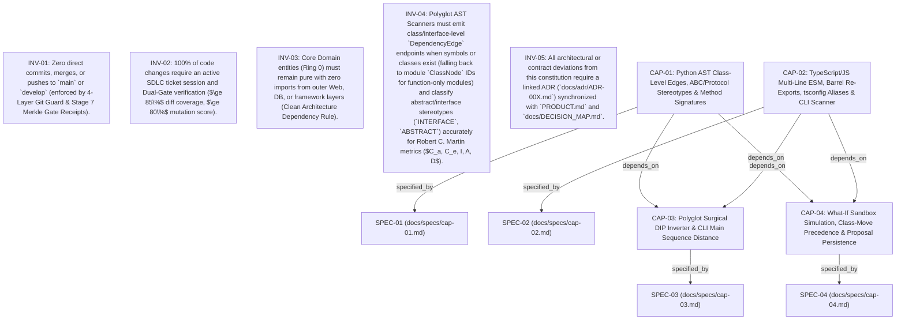

# 🗺️ Causal Decision Graph & Architecture Lineage (`DECISION_MAP.md`)

> **Auto-Generated by Agentic SDLC Engine**: Tracks how product capabilities (`PRODUCT.md`), specifications, tickets, and Spec-Drift ADRs evolved into the current system state.

---

## 🧬 Causal Decision Lineage Graph

---

## ⚡ Spec Drift & ADR Pivot Ledger

| ADR ID | Decision Title | Scope | Status | Triggered By | Supersedes / Amends |
| :--- | :--- | :--- | :--- | :--- | :--- |
| *None* | No architectural drift ADRs recorded yet | - | - | - | - |

---

## 🎯 Product Capability Realization Matrix

| Capability ID | Description | Current Status |
| :--- | :--- | :--- |
| **CAP-01** | Python AST Class-Level Edges, ABC/Protocol Stereotypes & Method Signatures | `DELIVERED` |
| **CAP-02** | TypeScript/JS Multi-Line ESM, Barrel Re-Exports, tsconfig Aliases & CLI Scanner | `DELIVERED` |
| **CAP-03** | Polyglot Surgical DIP Inverter & CLI Main Sequence Distance | `DELIVERED` |
| **CAP-04** | What-If Sandbox Simulation, Class-Move Precedence & Proposal Persistence | `DELIVERED` |
