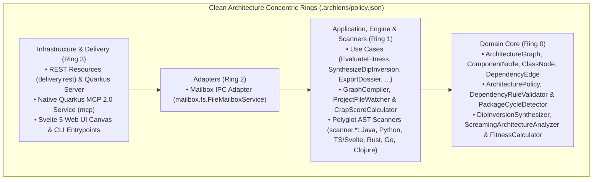

# Archlens Developer & Contributor Guide

Welcome to the **Archlens** developer community! This comprehensive guide provides everything required to understand the codebase, set up your local development environment, build and test each module, implement new polyglot language scanners, extend the Model Context Protocol (MCP) server, and contribute adhering to Robert C. Martin (Uncle Bob) craftsmanship standards.

---

## 🏛️ 1. Architecture & Core Philosophy

Archlens is engineered around **Clean Architecture** and the **Dependency Inversion Principle (DIP)**:

> *"Source code dependencies must point only inward, toward higher-level policies."*  
> — **Robert C. Martin (Uncle Bob)**



### The Inward Dependency Rule:
- **Domain Core (Ring 0)**: Pure business domain models (`domain.graph`, `domain.policy`, `domain.fitness`, `domain.screaming`, `domain.dossier`, `domain.mailbox`). Zero dependencies on outer frameworks, HTTP libraries, or filesystem I/O.
- **Application, Engine & Scanners (Ring 1)**: Orchestrates use cases (`usecase.*`), graph compilation (`engine.GraphCompiler`), CRAP score calculation (`metrics.CrapScoreCalculator`), and polyglot AST scanning (`scanner.*`).
- **Adapters (Ring 2)**: Implements file mailbox communication queues (`mailbox.fs.*` implementing `domain.mailbox.MailboxGateway`).
- **Infrastructure & Delivery (Ring 3)**: Exposes HTTP/REST APIs (`delivery.rest.*`), Server-Sent Events (SSE), Quarkus MCP 2.0 endpoints (`mcp.ArchlensMcpService`), the Svelte 5 browser canvas (`frontend/`), and the Node.js CLI (`cli/`).

---

## 📁 2. Monorepo Organization

```text
archlens/
├── backend/                  # Quarkus 3.40 Java 25 Application
│   ├── src/main/java/        # Ring 0 (domain), Ring 1 (usecase, engine, scanner, metrics), Ring 2 (mailbox.fs), Ring 3 (delivery, mcp)
│   ├── src/main/resources/   # Application properties, SpotBugs exclusions, PMD rule configurations
│   ├── src/test/java/        # 320+ unit, scanner, MCP, and architecture verification tests
│   └── pom.xml               # Backend Maven configuration (JaCoCo, Spotless, PMD, SpotBugs, CycloneDX)
├── frontend/                 # Svelte 5 + Tailwind CSS v4 Interactive Canvas
│   ├── src/lib/components/   # Component cards, edges, modals, DIP inverter, sandbox, command palette
│   ├── src/lib/state/        # Svelte 5 runes ($state, $derived) reactive state & sandbox engine
│   ├── src/lib/utils/        # Martin coupling metrics (Ca, Ce, I, A, D), cubic Bézier edge routing
│   ├── package.json          # Frontend dependencies and Vite scripts
│   └── vitest.config.ts      # Vitest component and store testing configuration
├── cli/                      # Zero-Dependency Multi-Agent Skill & MCP Stdio Bridge (@fmatar/archlens-skill)
│   ├── bin/index.js          # CLI entrypoint (archlens, archlens-skill, archlens-init)
│   ├── src/analyzer.js       # Polyglot offline AST classifier & LLM dossier generator
│   ├── src/checker.js        # Headless CI conformance, ADP cycle, Screaming & Fitness gate engine
│   ├── src/docker-runner.js  # 4-Tier Auto-Resurrection engine (Live -> Native JAR -> Docker -> Offline)
│   ├── src/installer.js      # Policy scaffolder and companion guideline injector (AGENTS.md / CLAUDE.md)
│   ├── src/mcp-registry.js   # Multi-client MCP manifest registry (Antigravity, Claude, Gemini, Cursor, VS Code)
│   ├── src/mcp-server.js     # JSON-RPC 2.0 stdio MCP server with 10 tools, 3 resources & offline fallback
│   ├── src/updater.js        # Safe incremental policy updater
│   ├── src/upgrader.js       # Legacy .uml-viewer to .archlens migration tool
│   └── test/                 # 80+ Node native test runner unit & integration tests
├── scripts/                  # Build, Release, Telemetry & End-to-End Smoke Automation
│   ├── smoke-test.js         # Packaged JAR + REST API + MCP SSE + MCP Stdio E2E smoke runner
│   ├── generate-report.js    # Full-stack JaCoCo, Vitest, JUnit & Git telemetry aggregator
│   ├── update-dependencies.sh# Automated Dual-Gate safe dependency upgrader with rollback
│   ├── set-version.js        # Atomic polyglot version bumper across Maven & NPM manifests
│   └── test/                 # Unit tests for smoke runner, report generator & dependency governance
├── wiki/                     # 14 Diátaxis & Clean Architecture Wiki documentation pages
├── docs/                     # Specifications (CAP-01..04), ADRs, User/Developer Guides & C4 Architecture
├── .archlens/                # Active repository governance policy (.archlens/policy.json) and mailbox IPC
├── package.json              # Root scripts (build, start, smoke, smoke:build, test, cli, deps:*)
└── pom.xml                   # Root Maven reactor POM aggregating backend, frontend, and CLI
```

---

## 🛠️ 3. Toolchain & Prerequisites

Ensure the following tools are installed on your workstation:

| Tool | Minimum Version | Recommended | Notes |
| :--- | :--- | :--- | :--- |
| **Java** | OpenJDK 21 | OpenJDK 25 / GraalVM 25 | Required for records, pattern matching, and backend compilation |
| **Maven** | 3.9.0 | 3.9.9+ | Primary backend build orchestrator |
| **Node.js** | 20.0.0 | 22.0.0+ | Required for frontend tooling and CLI execution |
| **pnpm** | 9.0.0 | Latest | Recommended package manager for frontend dependencies |
| **Docker** | 24.0.0 | Latest | Optional; required for container packaging and runtime tests |

---

## 🚀 4. Local Development Workflows

### Workflow A: Full-Stack Dev Mode (Recommended)

Run the backend and frontend simultaneously with live hot-reloading:

```bash
# Terminal 1: Launch Quarkus Backend (Port 8088)
cd backend
./mvnw quarkus:dev

# Terminal 2: Launch Svelte 5 Frontend (Port 5173)
cd frontend
pnpm install
pnpm dev
```

Open **`http://localhost:5173`** in your browser.  
Vite automatically proxies `/api` and `/mcp` requests to the Quarkus backend on port `8088`. Changes to Java sources, Svelte components, or Tailwind styles reload immediately.

---

### Workflow B: Standalone Backend Development

To verify, package, or execute backend unit tests:

```bash
cd backend

# Execute all 320+ unit, scanner, MCP, and architecture tests
mvn test

# Execute Spotless code format check
mvn spotless:check

# Auto-apply Spotless formatting
mvn spotless:apply

# Execute PMD static analysis
mvn pmd:check

# Execute SpotBugs security analysis
mvn compile spotbugs:check

# Package the runnable Quarkus application
mvn package -DskipTests
```

The compiled runnable jar is placed at `backend/target/quarkus-app/quarkus-run.jar`. Run it directly via:
```bash
java -jar backend/target/quarkus-app/quarkus-run.jar
```

---

### Workflow C: CLI Development (`@fmatar/archlens-skill`)

The CLI is engineered with zero external production dependencies using pure Node.js standard libraries:

```bash
cd cli

# Execute all CLI unit tests using Node's native test runner
npm test

# Test the CLI locally without installing
node bin/index.js --help

# Test MCP client discovery and manifest generation in dry-run mode
node bin/index.js --mcp --dry-run

# Test MCP stdio server with JSON-RPC initialize command
printf '{"jsonrpc":"2.0","id":1,"method":"initialize","params":{"protocolVersion":"2024-11-05"}}\n' | node bin/index.js mcp
```

Install your local CLI development build globally:
```bash
npm install -g ./cli
archlens-skill --version
```

---

### Workflow D: End-to-End Packaged Workbench & Multi-Agent MCP Smoke Suite

Before opening a pull request or cutting a release, run the End-to-End Smoke Suite (`scripts/smoke-test.js`). It boots the packaged `backend/target/quarkus-app/quarkus-run.jar` on an ephemeral port (`127.0.0.1:<port>`), exercises the live server and MCP bridge, and tears down cleanly via `SIGTERM`:

```bash
# Run against an existing packaged JAR:
npm run smoke

# Or automatically package the JAR if missing and run the smoke suite:
npm run smoke:build
```

**What `scripts/smoke-test.js` Verifies:**
1. **Bundled Svelte 5 Workbench UI (`GET /`)**: Verifies the frontend bundle is embedded and served by Quarkus.
2. **REST API Contracts**: Validates `/api/version`, `/api/graph`, `/api/fitness`, `/api/fitness/history`, `/api/violations/invert-plan`, and `/api/policy`.
3. **Native Quarkus MCP 2.0 SSE Transport (`GET /mcp/sse`)**: Verifies `200 OK` and `content-type: text/event-stream`.
4. **CLI MCP JSON-RPC 2.0 Stdio Bridge**: Verifies `initialize`, `tools/list` (`10` tools), `resources/list`, and `tools/call` (`evaluateFitness`, `synthesizeDipInversion`, `getPolicy`).
5. **Multi-Agent MCP Installer Dry-Run**: Validates `installMcpConfigs({ dryRun: true })` across detected AI assistant targets.

---

### Workflow E: Safe Dependency Governance & Maintenance

To keep the monorepo secure and modern without sacrificing build determinism:

```bash
# Audit dependencies across Maven and NPM without modifying files
npm run deps:check

# Safely upgrade dependencies to verified stable GA releases and run full Dual-Gate verification
npm run deps:update

# Explore major version upgrades with full Dual-Gate verification and automated rollback
npm run deps:update:major
```

If any verification test fails during an update, the engine immediately rolls back all manifest changes to preserve a clean git state.

---

### Workflow F: Documentation & Wiki Synchronization

Keep the `wiki/` pages and `wiki/Codebase-Map.md` synchronized with live AST exports and concentric ring rules:

```bash
# Synchronize wiki/Codebase-Map.md with source AST exports and Archlens rings
node .agent/scripts/sdlc-engine.mjs wiki sync

# Audit all 14 wiki pages for broken paths or unmapped modules
node .agent/scripts/sdlc-engine.mjs wiki audit --strict
```

---

## 🧩 5. How to Add a New Polyglot Language Scanner

Archlens uses a Service Provider Interface (SPI) design for language scanners. Follow this five-step recipe to add support for a new language (e.g. Swift, C#, Scala, Ruby):

### Step 1: Implement `LanguageScanner`
Create `backend/src/main/java/io/slixes/archlens/scanner/<Language>AstScanner.java`:

```java
package io.slixes.archlens.scanner;

import io.slixes.archlens.domain.graph.ClassNode;
import io.slixes.archlens.domain.graph.ComponentNode;
import io.slixes.archlens.domain.graph.DependencyEdge;
import io.slixes.archlens.domain.policy.ArchitecturePolicy;
import jakarta.enterprise.context.ApplicationScoped;
import java.io.File;
import java.io.IOException;
import java.util.List;

@ApplicationScoped
public class SwiftAstScanner implements LanguageScanner {

  @Override
  public String language() {
    return "swift";
  }

  @Override
  public boolean canScan(File projectRoot) {
    return new File(projectRoot, "Package.swift").exists() 
        || FileScannerUtil.hasFilesWithExtension(projectRoot, ".swift");
  }

  @Override
  public ScanResult scan(File projectRoot, ArchitecturePolicy policy) throws IOException {
    List<File> sourceFiles = FileScannerUtil.findFiles(projectRoot, ".swift");
    
    // Parse files, extract ClassNode/ComponentNode stereotypes (INTERFACE, ABSTRACT, CLASS)
    // and emit class-first DependencyEdge instances
    // ...
    
    return new ScanResult(nodes, edges);
  }
}
```

### Step 2: Register in `LanguageScannerRegistry`
Register the scanner inside `backend/src/main/java/io/slixes/archlens/scanner/LanguageScannerRegistry.java`:

```java
@Inject SwiftAstScanner swiftScanner;

@PostConstruct
void init() {
  scanners.add(javaScanner);
  scanners.add(pythonScanner);
  scanners.add(typeScriptScanner);
  scanners.add(rustScanner);
  scanners.add(goScanner);
  scanners.add(clojureScanner);
  scanners.add(swiftScanner); // Added scanner
}
```

### Step 3: Add Polyglot DIP Port Synthesis Template (Optional)
In `backend/src/main/java/io/slixes/archlens/domain/dossier/DipInversionSynthesizer.java`, add the idiomatic interface/protocol template for the new language (e.g., Swift `protocol <Target>Port`) so the Surgical DIP Inverter and `synthesizeDipInversion` MCP tool generate native code diffs.

### Step 4: Utilize `FileScannerUtil` for Fault-Tolerant Traversal
Always traverse source files using `FileScannerUtil.findFiles(...)`. This automatically skips hidden folders (`.git`, `.archlens`), dependency directories (`node_modules`, `target`, `.build`), Unix sockets, and unreadable files.

### Step 5: Add Comprehensive Tests
Create `backend/src/test/java/io/slixes/archlens/scanner/<Language>AstScannerTest.java`:
- Provide realistic source file fixtures in `@TempDir`.
- Verify extracted components, `INTERFACE` / `ABSTRACT` stereotypes for Martin Abstractness ($A$), inner layer classifications, and outward dependencies.
- Ensure 100% test pass rate with meaningful domain assertions.

---

## 🤖 6. How to Extend the Model Context Protocol (MCP) Server

Archlens exposes native MCP 2.0 capabilities directly from Quarkus using `quarkus-mcp-server-http` and `quarkus-mcp-server-hibernate-validator`, decoupled onto Ring 1 Use Cases and executed on Java 25 Virtual Threads (`@RunOnVirtualThread`).

### Step 1: Add a Tool Method in `ArchlensMcpService`
In `backend/src/main/java/io/slixes/archlens/mcp/ArchlensMcpService.java`, inject your Ring 1 Use Case and declare your tool using `@Tool`, `@ToolArg`, and `@NotBlank`:

```java
@Tool(description = "Verify compliance of a specific component against Clean Architecture boundaries.")
public FitnessEvaluation checkComponent(
    @ToolArg(description = "Target component name") @NotBlank String componentName,
    @ToolArg(description = "Absolute or relative path to project root", defaultValue = ".") String projectRoot) 
    throws IOException {
  return evaluateFitnessUseCase.execute(projectRoot);
}
```

### Step 2: Update the CLI Manifest Registry
Add the tool's parameter definition to `cli/src/mcp-registry.js` under `ARCHLENS_TOOL_SCHEMAS`:

```javascript
checkComponent: {
  name: 'checkComponent',
  description: 'Verify compliance of a specific component against Clean Architecture boundaries.',
  parameters: {
    type: 'object',
    properties: {
      componentName: { type: 'string', description: 'Target component name' },
      projectRoot: { type: 'string', description: 'Path to project directory', default: '.' }
    },
    required: ['componentName']
  }
}
```

### Step 3: Implement Offline Fallback in `mcp-server.js` & Add Smoke Assertion
1. In `cli/src/mcp-server.js`, handle the tool execution in `executeToolCall(...)` so AI agents receive accurate static responses even when Docker or the Quarkus server is offline.
2. Update the tool count assertion in `scripts/smoke-test.js` (`runMcpStdioSmokeChecks`) and `cli/test/mcp-registry.test.js`.

---

## 🧪 7. Quality Standards & Verification Matrix

Every pull request must pass all quality gates cleanly without warnings:

| Quality Gate | Command | Passing Standard |
| :--- | :--- | :--- |
| **Full Maven Build & Gates** | `mvn -B -ntp clean spotless:check verify` | 0 formatting, PMD, SpotBugs, or test failures |
| **Spotless Code Formatting** | `mvn spotless:check` / `mvn spotless:apply` | 0 formatting discrepancies |
| **PMD Static Analysis** | `mvn pmd:check` | 0 violations (`failOnViolation=true`) |
| **SpotBugs Security Analysis** | `mvn compile spotbugs:check` | 0 bugs (`threshold=Low`, `effort=Max`) |
| **Backend Unit & Arch Tests** | `mvn test` | 100% passing (320+ tests, $\ge 85\%$ JaCoCo coverage) |
| **CLI & Script Test Suite** | `npm test` | 100% passing (101+ Node native tests, $\ge 85\%$ coverage) |
| **E2E Packaged JAR & MCP Smoke** | `npm run smoke` (or `npm run smoke:build`) | 100% passing (UI bundle, 7 REST APIs, MCP SSE, 10 MCP tools) |
| **Self-Governance Arch Gate** | `node cli/bin/index.js check --path . --max-violations 0 --detect-cycles --screaming-threshold 0.70 --fitness-threshold 0.85` | 0 outward violations, 0 ADP cycles, Grade A Fitness |
| **Frontend Unit Tests** | `npm --prefix frontend test` | 100% passing Vitest tests (53+ tests) |
| **Frontend Type Checking** | `npm --prefix frontend run check` | 0 TypeScript or Svelte 5 errors |
| **Wiki Determinism Audit** | `node .agent/scripts/sdlc-engine.mjs wiki audit --strict` | 14/14 wiki pages valid, 100% modules mapped |

---

## 🎯 8. Uncle Bob Test Craftsmanship Standards

To maintain clean code and protect against regression without brittle tests, adhere to these principles:

1. **State-Based Verification Over Mock Abuse**:
   - Prefer anonymous domain fakes or real test fixtures over mock interaction assertions (`verify(x).someMethod()`).
   - Test observable behavior and return values rather than internal execution mechanics.
2. **Zero Trivial Assertions**:
   - Every test must validate actual business invariants, ring boundaries, or error paths.
3. **Dual-Gate Testing Goals**:
   - Aim for $\ge 85\%$ line and branch coverage on new logic.
   - Aim for $\ge 80\%$ mutation kill score. Tests should catch deliberate faults in production code.

---

## 🌿 9. Git Workflow & Submitting Pull Requests

1. **Branching Strategy**:
   - Always branch off `develop` (direct PRs from feature branches to `main` are blocked by CI branch flow enforcement).
   - Branch naming format: `feature/issue-#<id>-<short-description>`, `fix/issue-#<id>-<short-description>`, or `docs/issue-#<id>-<short-description>`.
2. **Conventional Commits**:
   Follow conventional commit messages:
   - `feat(scanner): add Swift language scanner`
   - `fix(canvas): resolve edge tooltip lingering on hover leave`
   - `docs(guide): update developer guide with MCP and smoke test workflows`
   - `refactor(mcp): sanitize snapshot identifiers against traversal`
3. **Pull Request Checklist**:
   - [ ] Targeted against `develop`.
   - [ ] Issue referenced in summary (`Closes #<id>`).
   - [ ] All automated checks pass (`mvn clean spotless:check verify`, `npm test`, `npm run smoke`, `npm --prefix frontend test`).
   - [ ] `CHANGELOG.md` updated under `[Unreleased]`.
   - [ ] Documentation and `wiki/` updated to reflect changes.
