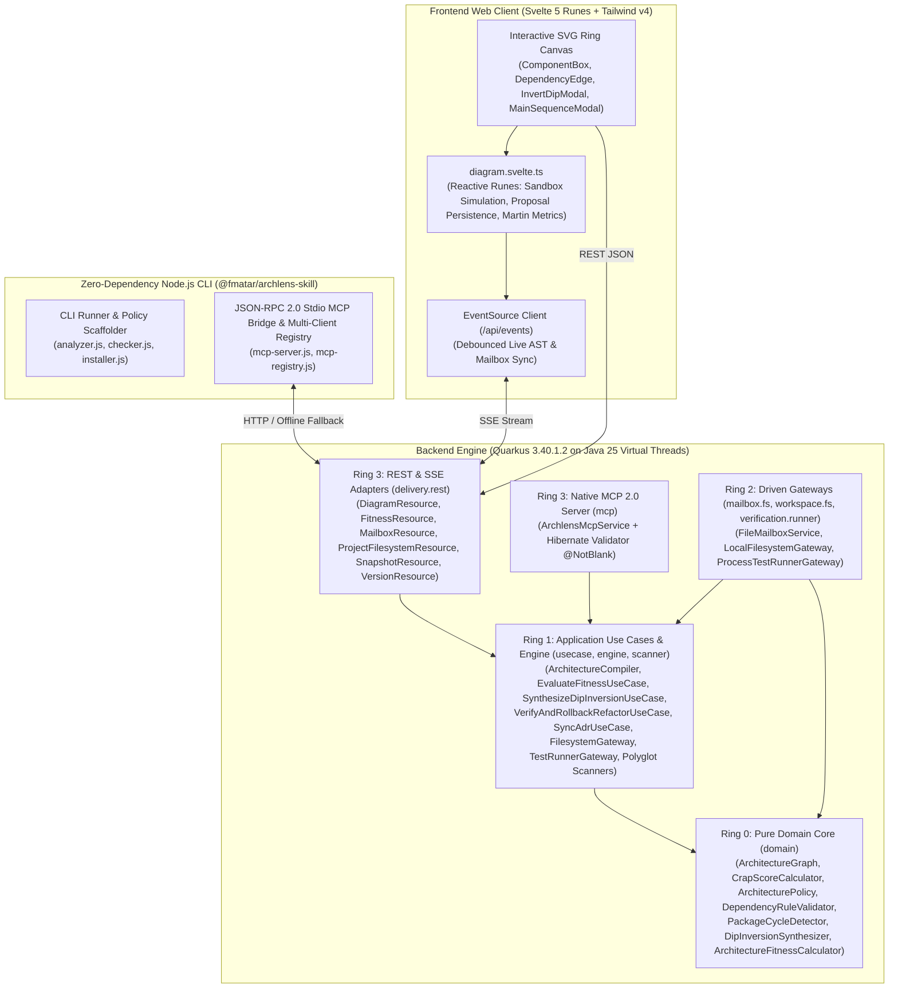

# C4 Architecture Specification: Archlens Dynamic Clean Architecture Workbench

## 1. System Context Diagram (C4 Level 1)

```mermaid
flowchart TD
    User["Software Architect / Engineer"]
    Agent["Autonomous AI Coding Agent\n(Antigravity, Gemini CLI, Claude Code, Grok, Cursor, Windsurf)"]
    
    subgraph System ["Archlens Governance & Refactoring Workbench (v1.1.6)"]
        App["Archlens Dynamic Workbench\n(Quarkus 3.40.1.2 on Java 25 + Svelte 5 + @fmatar/archlens-skill CLI)"]
    end
    
    TargetCode["Polyglot Target Codebase\n(Java 25, Python, TS/JS/Svelte 5, Rust, Go)"]
    PolicyAndMailbox[".archlens/ Governance & IPC\n(policy.json, to-agent.json, to-viewer.json, snapshots/, cache/, trash/)"]
    AdrDocs["Living Architectural Lineage\n(docs/adr/ADR-*.md & SARIF Reports)"]

    User -->|Inspects Rings, Simulates in Sandbox, Dispatches Directives| App
    App -->|Scans Polyglot Sources & Evaluates Concentric Invariants| TargetCode
    App <-->|Reads/Persists Policy, Snapshots & Mailbox IPC| PolicyAndMailbox
    Agent <-->|Queries 11 MCP Tools, 3 Resources & 2 Prompts (/mcp, /mcp/sse, stdio)| App
    Agent <-->|Dequeues Directives & Posts Verification ACKs| PolicyAndMailbox
    Agent -->|Synthesizes DIP Ports, Reorganizes Packages & Runs Tests| TargetCode
    App -->|Mints Living ADRs & Exports SARIF 2.1.0| AdrDocs
```

---

## 2. Container Diagram (C4 Level 2)



---

## 3. Concentric Ring Hierarchy & Component Contracts (C4 Level 3)

Archlens strictly enforces its own Clean Architecture policy ([`.archlens/policy.json`](../../.archlens/policy.json)), achieving a **`91% (Grade A)`** Architecture Fitness Index, **`1.00 (100%)`** Screaming Architecture Score, **`0`** layer violations, and **`0`** package cycles:

| Concentric Ring | Packages (`io.slixes.archlens.*`) | Key Components & Responsibilities |
| :--- | :--- | :--- |
| **Ring 0: Domain Core** | `domain.graph`, `domain.policy`, `domain.fitness`, `domain.screaming`, `domain.dossier`, `domain.mailbox` | Pure immutable records (`ArchitectureGraph`, `ComponentNode`, `ClassNode`, `DependencyEdge`, `FitnessEvaluation`, `DipInversionPlan`) and pure domain services (`CrapScoreCalculator`, `DependencyRuleValidator`, `PackageCycleDetector`, `ArchitectureFitnessCalculator`, `ScreamingArchitectureAnalyzer`, `DipInversionSynthesizer`, `ArchitecturalDossierGenerator`, `MailboxGateway`). Zero framework or I/O imports. |
| **Ring 1: Application & Engine** | `usecase`, `engine`, `scanner` | Application interactors (`EvaluateFitnessUseCase`, `GetFitnessHistoryUseCase`, `ExportDossierUseCase`, `ExportDiagramUseCase`, `SynthesizeDipInversionUseCase`, `ProposeScreamingMigrationUseCase`, `ManageSnapshotsUseCase`, `VerifyAndRollbackRefactorUseCase`, `SyncAdrUseCase`, `SavePolicyUseCase`, `ResolveFilesystemUseCase`, `WorkspacePathResolver`, `ProjectPathGuard`, `OpenedProjectRegistry`), ports (`FilesystemGateway`, `TestRunnerGateway`), `ArchitectureCompiler` (`GraphCompiler`), `ProjectFileWatcher`, and the 5-language `LanguageScanner` SPI (`JavaAstScanner`, `PythonAstScanner`, `TypeScriptAstScanner`, `RustAstScanner`, `GoAstScanner`). |
| **Ring 2: Driven Adapters** | `mailbox.fs`, `workspace.fs`, `verification.runner` | `FileMailboxService` (`MailboxGateway`), `LocalFilesystemGateway` (`FilesystemGateway`), and `ProcessTestRunnerGateway` (`TestRunnerGateway`) isolating filesystem discovery, snapshot backup/restore, and bounded test-runner process trees. |
| **Ring 3: Driving Delivery & MCP** | `delivery.rest`, `mcp` | Constructor-injected `@RunOnVirtualThread` REST resources (`DiagramResource`, `FitnessResource`, `MailboxResource`, `ProjectFilesystemResource`, `SnapshotResource`, `VersionResource`) and `ArchlensMcpService` exposing 11 `@Tool`s, 3 `@Resource`s, and 2 `@Prompt`s with `@NotBlank` Bean Validation constraints. |
