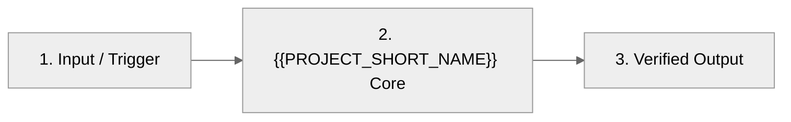

<!-- TEMPLATE_GUIDE_START -->
<!--
  10–30–90 High-Converting Developer Landing Page Template (Agentic SDLC Framework)
  =================================================================================
  Purpose: Minimize Time-to-Hello-World across the 10s (Orient) -> 30s (Believe) -> 90s (Run) filter.

  Authoring & Anti-Pattern Rules (Enforced by `node .agent/scripts/sdlc-engine.mjs readme audit --strict`):
  1. Cap shields at 3–4 badges max (NO badge Christmas trees).
  2. Wrap hero logos/diagrams in `<picture>` with `prefers-color-scheme` and initialize Mermaid with `%%{init: {'theme': 'neutral'}}%%`.
  3. Tailor the Hero Proof to the repository archetype (`cli`, `sdk`, or `platform`) and strip unused `<!-- ARCHETYPE:... -->` blocks.
  4. Never lead `## Quickstart` with `git clone` or contributor source-build steps (push those to `CONTRIBUTING.md`).
  5. Keep `README.md` focused (~120–160 visible lines): tuck flag/env matrices inside `<details>` and link full API references to `wiki/` + `llms.txt`.
-->
<!-- TEMPLATE_GUIDE_END -->
<div align="center">

<picture>
  <source media="(prefers-color-scheme: dark)" srcset="docs/logo-dark.svg">
  
</picture>

# {{PROJECT_NAME}}

**{{ONE_SENTENCE_HOOK}}**

[]({{CI_LINK}})
[]({{VERSION_LINK}})
[]({{LICENSE_LINK}})
[]({{DOCS_LINK}})

[Quickstart](#quickstart) · [Why {{PROJECT_SHORT_NAME}}?](#why-{{PROJECT_ANCHOR}}) · [How It Works](#how-it-works) · [Docs](#documentation--roadmap) · [Contributing](#contributing--license)

</div>

<!-- ARCHETYPE:cli -->
{{CLI_HERO_PROOF}}
<!-- /ARCHETYPE:cli -->
<!-- ARCHETYPE:sdk -->
```{{CODE_LANG}}
{{SDK_HERO_SNIPPET}}
```
<!-- /ARCHETYPE:sdk -->
<!-- ARCHETYPE:platform -->
{{PLATFORM_HERO_PROOF}}
<!-- /ARCHETYPE:platform -->

## Why {{PROJECT_SHORT_NAME}}?

{{PROBLEM_STATEMENT}}

- ⚡ **{{CAPABILITY_HEADLINE}}** — {{CAPABILITY_OUTCOME}}
- 🔒 **{{GUARANTEE_HEADLINE}}** — {{ARCHITECTURAL_GUARANTEE}}
- 🧩 **{{ECOSYSTEM_HEADLINE}}** — {{ECOSYSTEM_FIT}}

## Quickstart

> [!TIP]
> {{QUICKSTART_TIP}}

### 1. Install

```bash
{{INSTALL_COMMAND}}
```

### 2. Minimal Working Example

```{{QUICKSTART_LANG}}
{{QUICKSTART_SNIPPET}}
```

Expected output:

```text
{{EXPECTED_OUTPUT}}
```

## How It Works



<details>
<summary><strong>Benchmarks & Advanced Configuration</strong></summary>

| Variable / Flag | Default | Description |
| :--- | :--- | :--- |
| `{{CONFIG_KEY_1}}` | `{{CONFIG_DEFAULT_1}}` | {{CONFIG_DESC_1}} |
| `{{CONFIG_KEY_2}}` | `{{CONFIG_DEFAULT_2}}` | {{CONFIG_DESC_2}} |

</details>

## Documentation & Roadmap

- **Full Documentation & Architecture**: [{{DOCS_LABEL}}]({{DOCS_LINK}})
- **AI Coding Agent Context**: [`llms.txt`](./llms.txt)
- **Specs & Open Milestones**: {{ROADMAP_LINK}}

## Contributing & License

Local development, source builds, and pull request guidelines live in [CONTRIBUTING.md]({{CONTRIBUTING_LINK}}).
Distributed under the [{{LICENSE_NAME}} License]({{LICENSE_LINK}}).
