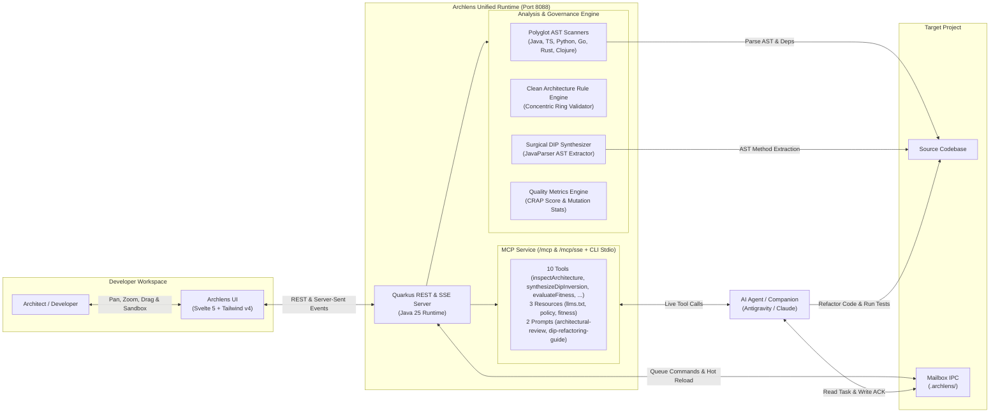
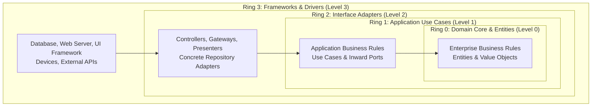

# System Architecture

Archlens is engineered as a unified, high-performance Clean Architecture analysis and governance platform. It pairs a **reactive Java 25 backend** with a **Svelte 5 frontend**, coupled via high-frequency Server-Sent Events (SSE) and Model Context Protocol (MCP) transports.

---

## 🏛️ High-Level System Architecture

---

## 🎯 The Concentric Rings

Archlens enforces Robert C. Martin's concentric Clean Architecture rings:

### The Invariant Dependency Rule
> **Dependencies must point strictly inward.**  
> A class in **Level 0 (Domain Core)** must NEVER depend on **Level 1 (Application)**, **Level 2 (Adapters)**, or **Level 3 (Frameworks)**. Any outward edge ($\text{Level}_{\text{from}} < \text{Level}_{\text{to}}$) is immediately flagged as an **Architectural Breach (Violation)** in neon crimson.

---

## ⚡ Polyglot AST Engine (SPI)

The backend employs an extensible Service Provider Interface (`LanguageScanner` SPI) for scanning polyglot codebases:
- **Java (`JavaAstScanner`)**: JavaParser `3.28.2` (`ParserConfiguration.LanguageLevel.JAVA_25`) full AST parsing of records, sealed classes, interfaces, annotations, method signatures, and type references, plus JaCoCo XML and PITest mutation report correlation.
- **TypeScript, JavaScript & Svelte 5 (`TypeScriptAstScanner`)**: Statement-normalizing ESM parser supporting multi-line `import`/`export ... from` statements, barrel `index.ts` re-exports, `tsconfig.json`/`jsconfig.json` `paths` & `baseUrl` aliases, and Svelte `<script>` extraction (`CAP-02`).
- **Python (`PythonAstScanner`)**: Indentation-aware statement scanner detecting classes, `ABC`/`@abstractmethod` (`ABSTRACT`), `Protocol` (`INTERFACE`), `@dataclass`/`NamedTuple`/`TypedDict` (`RECORD`), method signatures, and type annotations (`CAP-01`).
- **Go (`GoAstScanner`)**: Package, `struct`, and `interface` declaration scanner with intra-module import resolution via `go.mod`.
- **Rust (`RustAstScanner`)**: Crate and module scanner detecting `struct`, `enum`, `trait` (`INTERFACE`), `fn` signatures, and `use crate::` / `super::` paths.
- **Clojure (`ClojureAstScanner`)**: Namespace (`ns`) declaration, `:require` dependency, and `defn`/`defprotocol`/`defrecord` scanner.

---

## 🔄 Reactive Svelte 5 Frontend

The user interface uses Svelte 5 Runes for state management and UI reactivity:
- **`$state`**: Holds active architecture models, graph components, and sandbox simulation layers.
- **`$derived`**: Reactively recalculates Robert C. Martin metrics ($C_a, C_e, I, A, D$), violation deltas, and edge styles on every staged move.
- **`$effect`**: Drives high-performance GSAP transitions and canvas re-layouts.
- **EventSource (`/api/events`)**: Connects to the backend SSE stream, reacting instantaneously to file saves, agent mailbox updates, and live AST refreshes.
