# 🗺️ Codebase-to-Wiki Traceability & Archlens Ring Map

> **Deterministic AST & Clean Architecture Inventory**  
> Generated and verified by `node .agent/scripts/sdlc-engine.mjs wiki sync` (`sdlc-wiki`) and governed by `.archlens/policy.json`.  
> Every module, exported symbol, concentric ring boundary, skill, capability (`CAP-XX`), and decision record (`ADR-00X`) is mapped below.

---

## 1. Archlens Concentric Ring Dependency Graph

In accordance with Robert C. Martin's **Clean Architecture** and `.archlens/policy.json`, dependencies point strictly inward toward **Ring 0 (Domain Core & Primitives)**.

- **Afferent Coupling ($Ca$)**: Number of modules that depend on this module (inward stability).
- **Efferent Coupling ($Ce$)**: Number of modules this module depends on (outward fan-out).
- **Instability ($I = \frac{Ce}{Ca + Ce}$)**: `0.00` indicates a maximally stable core module; `1.00` indicates a pure outer entrypoint/adapter.

```mermaid
flowchart TD
  subgraph Ring0 ["Ring 0: Domain Core & Primitives"]
    audit_chain_mjs["audit-chain.mjs (11 exports, I=0)"]
    cache_mjs["cache.mjs (6 exports, I=0.5)"]
    core_mjs["core.mjs (13 exports, I=0)"]
    ArchitecturalDossierGenerator_java["ArchitecturalDossierGenerator.java (2 exports, I=0.71)"]
    DiagramExportType_java["DiagramExportType.java (2 exports, I=0)"]
    DipInversionPlan_java["DipInversionPlan.java (1 exports, I=0)"]
    DipInversionSynthesizer_java["DipInversionSynthesizer.java (2 exports, I=0.63)"]
    DossierGenerator_java["DossierGenerator.java (1 exports, I=0.5)"]
    MermaidDiagramGenerator_java["MermaidDiagramGenerator.java (4 exports, I=0.64)"]
    ArchitectureFitnessCalculator_java["ArchitectureFitnessCalculator.java (3 exports, I=0.57)"]
    FitnessEvaluation_java["FitnessEvaluation.java (1 exports, I=0)"]
    FitnessHistoryTrend_java["FitnessHistoryTrend.java (1 exports, I=0)"]
  end
  subgraph Ring1 ["Ring 1: Application & Governance"]
    adr_drift_mjs["adr-drift.mjs (6 exports, I=0.3)"]
    arch_trace_mjs["arch-trace.mjs (5 exports, I=0.25)"]
    decision_graph_mjs["decision-graph.mjs (5 exports, I=0.17)"]
    dossier_mjs["dossier.mjs (2 exports, I=0.6)"]
    product_dag_mjs["product-dag.mjs (9 exports, I=0.5)"]
    session_mjs["session.mjs (15 exports, I=0.69)"]
    wiki_sync_mjs["wiki-sync.mjs (6 exports, I=0.75)"]
    ArchitectureCompiler_java["ArchitectureCompiler.java (1 exports, I=0.14)"]
    GraphCompiler_java["GraphCompiler.java (4 exports, I=1)"]
    ProjectFileWatcher_java["ProjectFileWatcher.java (5 exports, I=0)"]
    CrapCalculator_java["CrapCalculator.java (1 exports, I=1)"]
    CrapScoreCalculator_java["CrapScoreCalculator.java (3 exports, I=0.5)"]
  end
  subgraph Ring2 ["Ring 2: Adapters & Enforcement"]
    git_guard_mjs["git-guard.mjs (5 exports, I=0.5)"]
    installer_mjs["installer.mjs (21 exports, I=0.57)"]
    pm_provider_mjs["pm-provider.mjs (13 exports, I=0.17)"]
    quality_gate_mjs["quality-gate.mjs (26 exports, I=0.8)"]
    workbench_server_mjs["workbench-server.mjs (7 exports, I=0.78)"]
    FileMailboxService_java["FileMailboxService.java (1 exports, I=1)"]
    AgentDrawer_svelte["AgentDrawer.svelte (1 exports, I=0.5)"]
    Canvas_svelte["Canvas.svelte (1 exports, I=0.88)"]
    ClassCard_svelte["ClassCard.svelte (1 exports, I=0.75)"]
    CommandPalette_svelte["CommandPalette.svelte (1 exports, I=0.75)"]
    ComponentBox_svelte["ComponentBox.svelte (1 exports, I=0.67)"]
    DependencyEdge_svelte["DependencyEdge.svelte (1 exports, I=0.67)"]
  end
  subgraph Ring3 ["Ring 3: CLI Router & Entrypoint"]
    sdlc_engine_mjs["sdlc-engine.mjs (4 exports, I=1)"]
    DiagramResource_java["DiagramResource.java (18 exports, I=1)"]
    FitnessResource_java["FitnessResource.java (3 exports, I=1)"]
    MailboxResource_java["MailboxResource.java (4 exports, I=1)"]
    ProjectFilesystemResource_java["ProjectFilesystemResource.java (1 exports, I=1)"]
    SnapshotResource_java["SnapshotResource.java (2 exports, I=1)"]
    VersionResource_java["VersionResource.java (1 exports, I=0)"]
    backend_src_main_java_io_slixes_archlens_delivery_rest_WorkspacePathResolver_java["WorkspacePathResolver.java (7 exports, I=0)"]
    ArchlensMcpService_java["ArchlensMcpService.java (16 exports, I=1)"]
    App_svelte["App.svelte (1 exports, I=0.94)"]
    main_ts["main.ts (0 exports, I=1)"]
    index_js["index.js (0 exports, I=1)"]
  end
  sdlc_engine_mjs --> core_mjs
  sdlc_engine_mjs --> cache_mjs
  sdlc_engine_mjs --> audit_chain_mjs
  sdlc_engine_mjs --> decision_graph_mjs
  sdlc_engine_mjs --> product_dag_mjs
  sdlc_engine_mjs --> adr_drift_mjs
  sdlc_engine_mjs --> dossier_mjs
  sdlc_engine_mjs --> git_guard_mjs
  sdlc_engine_mjs --> pm_provider_mjs
  sdlc_engine_mjs --> installer_mjs
  sdlc_engine_mjs --> session_mjs
  sdlc_engine_mjs --> arch_trace_mjs
  sdlc_engine_mjs --> quality_gate_mjs
  sdlc_engine_mjs --> workbench_server_mjs
  sdlc_engine_mjs --> wiki_sync_mjs
  adr_drift_mjs --> core_mjs
  adr_drift_mjs --> decision_graph_mjs
  adr_drift_mjs --> audit_chain_mjs
  arch_trace_mjs --> core_mjs
  arch_trace_mjs --> session_mjs
  cache_mjs --> core_mjs
  decision_graph_mjs --> core_mjs
  dossier_mjs --> core_mjs
  dossier_mjs --> product_dag_mjs
  dossier_mjs --> adr_drift_mjs
  git_guard_mjs --> core_mjs
  git_guard_mjs --> audit_chain_mjs
  git_guard_mjs --> adr_drift_mjs
  installer_mjs --> core_mjs
  installer_mjs --> arch_trace_mjs
  installer_mjs --> git_guard_mjs
  installer_mjs --> pm_provider_mjs
  pm_provider_mjs --> core_mjs
  product_dag_mjs --> core_mjs
  product_dag_mjs --> pm_provider_mjs
  product_dag_mjs --> decision_graph_mjs
  product_dag_mjs --> audit_chain_mjs
  quality_gate_mjs --> core_mjs
  quality_gate_mjs --> session_mjs
  quality_gate_mjs --> pm_provider_mjs
  quality_gate_mjs --> audit_chain_mjs
  quality_gate_mjs --> adr_drift_mjs
  quality_gate_mjs --> git_guard_mjs
  quality_gate_mjs --> arch_trace_mjs
  quality_gate_mjs --> installer_mjs
```



---

## 2. Source Modules by Concentric Ring

### 🏛️ Ring 0: Domain Core & Primitives

| Source Module | Lines | $Ca$ / $Ce$ | Instability ($I$) | Exported AST Symbols (Line #) | Wiki Coverage |
| :--- | :--- | :--- | :--- | :--- | :--- |
| `.agent/scripts/lib/audit-chain.mjs` | 343 | 7 / 0 | `0` | `AUDIT_LEDGER_FILE` (L6), `GENESIS_HASH` (L7), `calculateRecordHash` (L9), `appendAuditRecord` (L14), `verifyAuditChain` (L58), `RECEIPT_KEY_FILE` (L150), `loadReceiptKey` (L158), `signReceiptPayload` (L183) +3 more | `wiki/Codebase-Map.md`, `wiki/Skills-Reference.md` |
| `.agent/scripts/lib/cache.mjs` | 162 | 1 / 1 | `0.5` | `getGateCachePath` (L9), `computeTreeHash` (L17), `getGateCacheHit` (L96), `recordGateCache` (L110), `getGateCacheStats` (L143), `clearGateCache` (L153) | `wiki/Codebase-Map.md`, `wiki/Skills-Reference.md` |
| `.agent/scripts/lib/core.mjs` | 274 | 14 / 0 | `0` | `loadEnv` (L10), `fileExists` (L40), `readFileSafe` (L48), `execCommand` (L56), `execAsync` (L65), `runParallelTasks` (L80), `parseFrontmatter` (L97), `inspectArchlens` (L120) +5 more | `wiki/Codebase-Map.md`, `wiki/Skills-Reference.md` |
| `backend/src/main/java/io/slixes/archlens/domain/dossier/ArchitecturalDossierGenerator.java` | 271 | 2 / 5 | `0.71` | `ArchitecturalDossierGenerator` (L19), `generate` (L25) | `wiki/Codebase-Map.md` |
| `backend/src/main/java/io/slixes/archlens/domain/dossier/DiagramExportType.java` | 27 | 1 / 0 | `0` | `DiagramExportType` (L6), `fromString` (L11) | `wiki/Codebase-Map.md` |
| `backend/src/main/java/io/slixes/archlens/domain/dossier/DipInversionPlan.java` | 22 | 3 / 0 | `0` | `DipInversionPlan` (L9) | `wiki/Codebase-Map.md` |
| `backend/src/main/java/io/slixes/archlens/domain/dossier/DipInversionSynthesizer.java` | 782 | 3 / 5 | `0.63` | `DipInversionSynthesizer` (L14), `synthesize` (L16) | `wiki/Codebase-Map.md`, `wiki/Traceability.md` |
| `backend/src/main/java/io/slixes/archlens/domain/dossier/DossierGenerator.java` | 21 | 2 / 2 | `0.5` | `DossierGenerator` (L10) | `wiki/Codebase-Map.md` |
| `backend/src/main/java/io/slixes/archlens/domain/dossier/MermaidDiagramGenerator.java` | 387 | 4 / 7 | `0.64` | `MermaidDiagramGenerator` (L27), `generateComponentRings` (L40), `generateClassUml` (L77), `generateDipRefactor` (L108) | `wiki/Codebase-Map.md` |
| `backend/src/main/java/io/slixes/archlens/domain/fitness/ArchitectureFitnessCalculator.java` | 244 | 3 / 4 | `0.57` | `ArchitectureFitnessCalculator` (L15), `evaluate` (L17), `calculateTrend` (L156) | `wiki/Codebase-Map.md` |
| `backend/src/main/java/io/slixes/archlens/domain/fitness/FitnessEvaluation.java` | 15 | 4 / 0 | `0` | `FitnessEvaluation` (L7) | `wiki/Codebase-Map.md` |
| `backend/src/main/java/io/slixes/archlens/domain/fitness/FitnessHistoryTrend.java` | 8 | 3 / 0 | `0` | `FitnessHistoryTrend` (L6) | `wiki/Codebase-Map.md` |
| `backend/src/main/java/io/slixes/archlens/domain/fitness/FitnessRule.java` | 12 | 0 / 0 | `0` | `FitnessRule` (L4) | `wiki/Codebase-Map.md` |
| `backend/src/main/java/io/slixes/archlens/domain/fitness/FitnessThresholds.java` | 31 | 3 / 0 | `0` | `FitnessThresholds` (L4), `defaultThresholds` (L27) | `wiki/Codebase-Map.md`, `wiki/Robert-C-Martin-Metrics.md` |
| `backend/src/main/java/io/slixes/archlens/domain/fitness/HistoricalFitnessSnapshot.java` | 14 | 1 / 0 | `0` | `HistoricalFitnessSnapshot` (L4) | `wiki/Codebase-Map.md` |
| `backend/src/main/java/io/slixes/archlens/domain/graph/ArchitectureGraph.java` | 61 | 22 / 0 | `0` | `ArchitectureGraph` (L5) | `wiki/Codebase-Map.md` |
| `backend/src/main/java/io/slixes/archlens/domain/graph/ClassNode.java` | 67 | 16 / 0 | `0` | `ClassNode` (L5), `Stereotype` (L21), `withId` (L29), `withLevel` (L48) | `wiki/Codebase-Map.md` |
| `backend/src/main/java/io/slixes/archlens/domain/graph/ComponentNode.java` | 13 | 9 / 0 | `0` | `ComponentNode` (L5) | `wiki/Codebase-Map.md` |
| `backend/src/main/java/io/slixes/archlens/domain/graph/CrapScore.java` | 8 | 8 / 0 | `0` | `CrapScore` (L3), `zero` (L4) | `wiki/Codebase-Map.md` |
| `backend/src/main/java/io/slixes/archlens/domain/graph/DependencyEdge.java` | 17 | 16 / 0 | `0` | `DependencyEdge` (L3), `Kind` (L4), `withViolating` (L13) | `wiki/Codebase-Map.md` |
| `backend/src/main/java/io/slixes/archlens/domain/graph/FieldNode.java` | 4 | 8 / 0 | `0` | `FieldNode` (L3) | `wiki/Codebase-Map.md` |
| `backend/src/main/java/io/slixes/archlens/domain/graph/MethodNode.java` | 17 | 9 / 0 | `0` | `MethodNode` (L5) | `wiki/Codebase-Map.md` |
| `backend/src/main/java/io/slixes/archlens/domain/graph/PackageCycle.java` | 25 | 3 / 0 | `0` | `PackageCycle` (L9), `length` (L17), `formattedPath` (L21) | `wiki/Codebase-Map.md` |
| `backend/src/main/java/io/slixes/archlens/domain/graph/ScreamingMetric.java` | 29 | 4 / 0 | `0` | `ScreamingMetric` (L9), `empty` (L25) | `wiki/Codebase-Map.md` |
| `backend/src/main/java/io/slixes/archlens/domain/mailbox/MailboxEnvelope.java` | 10 | 3 / 0 | `0` | `MailboxEnvelope` (L6), `MailboxCommand` (L7) | `wiki/Codebase-Map.md` |
| `backend/src/main/java/io/slixes/archlens/domain/mailbox/MailboxGateway.java` | 25 | 4 / 0 | `0` | `MailboxGateway` (L10) | `wiki/Codebase-Map.md` |
| `backend/src/main/java/io/slixes/archlens/domain/mailbox/RefactorVerificationResult.java` | 39 | 1 / 0 | `0` | `RefactorVerificationResult` (L4), `ofSuccess` (L13), `ofFailure` (L26) | `wiki/Codebase-Map.md` |
| `backend/src/main/java/io/slixes/archlens/domain/policy/ArchitecturePolicy.java` | 74 | 22 / 1 | `0.04` | `ArchitecturePolicy` (L6) | `wiki/Codebase-Map.md` |
| `backend/src/main/java/io/slixes/archlens/domain/policy/DependencyRuleValidator.java` | 111 | 1 / 1 | `0.5` | `DependencyRuleValidator` (L8), `fromLevels` (L22), `fromProposal` (L37), `resolveRank` (L62), `evaluate` (L94) | `wiki/Codebase-Map.md` |
| `backend/src/main/java/io/slixes/archlens/domain/policy/PackageCycleDetector.java` | 110 | 1 / 5 | `0.83` | `PackageCycleDetector` (L14), `detectCycles` (L24) | `wiki/Codebase-Map.md`, `wiki/Traceability.md` |
| `backend/src/main/java/io/slixes/archlens/domain/policy/PolicyValidator.java` | 25 | 1 / 1 | `0.5` | `PolicyValidator` (L6) | `wiki/Codebase-Map.md` |
| `backend/src/main/java/io/slixes/archlens/domain/policy/Proposal.java` | 13 | 1 / 0 | `0` | `Proposal` (L5), `ProposalLayer` (L6) | `wiki/Codebase-Map.md` |
| `backend/src/main/java/io/slixes/archlens/domain/screaming/FeatureCluster.java` | 15 | 0 / 0 | `0` | `FeatureCluster` (L9) | `wiki/Codebase-Map.md` |
| `backend/src/main/java/io/slixes/archlens/domain/screaming/ScreamingArchitectureAnalyzer.java` | 226 | 1 / 5 | `0.83` | `ScreamingArchitectureAnalyzer` (L22), `analyze` (L69), `isTechnicalPackage` (L154), `calculateScore` (L172) | `wiki/Codebase-Map.md` |
| `backend/src/main/java/io/slixes/archlens/domain/screaming/ScreamingMigrationAssistant.java` | 273 | 3 / 4 | `0.57` | `ScreamingMigrationAssistant` (L16), `generateProposal` (L57) | `wiki/Codebase-Map.md` |
| `backend/src/main/java/io/slixes/archlens/domain/screaming/ScreamingMigrationProposal.java` | 19 | 3 / 0 | `0` | `ScreamingMigrationProposal` (L11) | `wiki/Codebase-Map.md` |
| `frontend/src/lib/types/diagram.ts` | 314 | 12 / 0 | `0` | `Stereotype` (L1), `EdgeKind` (L2), `CrapScore` (L4), `FieldNode` (L10), `MethodNode` (L16), `ClassNode` (L30), `ComponentNode` (L48), `DependencyEdge` (L63) +25 more | `wiki/Codebase-Map.md` |

### 🏛️ Ring 1: Application & Governance

| Source Module | Lines | $Ca$ / $Ce$ | Instability ($I$) | Exported AST Symbols (Line #) | Wiki Coverage |
| :--- | :--- | :--- | :--- | :--- | :--- |
| `.agent/scripts/lib/adr-drift.mjs` | 621 | 7 / 3 | `0.3` | `listADRs` (L40), `createADR` (L80), `decideADR` (L183), `compactADRs` (L256), `checkSpecDrift` (L422), `auditContractDrift` (L510) | `wiki/Codebase-Map.md`, `wiki/Skills-Reference.md` |
| `.agent/scripts/lib/arch-trace.mjs` | 435 | 6 / 2 | `0.25` | `checkArchDiff` (L7), `parseMermaidDiagram` (L157), `diffMermaidGraphs` (L229), `recordArchTrace` (L253), `scaffoldArchlensPolicy` (L374) | `wiki/Codebase-Map.md`, `wiki/Skills-Reference.md` |
| `.agent/scripts/lib/decision-graph.mjs` | 332 | 5 / 1 | `0.17` | `DECISION_GRAPH_FILE` (L5), `DECISION_MAP_MD` (L6), `appendDecisionEvent` (L8), `buildDecisionGraph` (L39), `syncDecisionMapMarkdown` (L257) | `wiki/Codebase-Map.md`, `wiki/Skills-Reference.md` |
| `.agent/scripts/lib/dossier.mjs` | 117 | 2 / 3 | `0.6` | `extractExportSignatures` (L7), `generateTicketDossier` (L23) | `wiki/Codebase-Map.md`, `wiki/Skills-Reference.md` |
| `.agent/scripts/lib/product-dag.mjs` | 837 | 4 / 4 | `0.5` | `renderCapabilitySpecMarkdown` (L10), `renderProductPrdMarkdown` (L61), `renderProductSrsMarkdown` (L110), `initProductConstitution` (L185), `scaffoldCapabilitySpec` (L387), `parseProductMarkdown` (L563), `planProductDAG` (L637), `controlProductDAG` (L705) +1 more | `wiki/Codebase-Map.md`, `wiki/Skills-Reference.md` |
| `.agent/scripts/lib/session.mjs` | 662 | 4 / 9 | `0.69` | `getSessionPath` (L16), `getSessionStatus` (L20), `startSession` (L56), `updateSession` (L130), `switchSession` (L198), `listSessions` (L220), `renderDashboard` (L242), `resumeSession` (L279) +7 more | `wiki/Codebase-Map.md`, `wiki/Skills-Reference.md` |
| `.agent/scripts/lib/wiki-sync.mjs` | 854 | 2 / 6 | `0.75` | `inspectSourceModule` (L35), `resolveArchlensRing` (L142), `buildWikiCodeMap` (L211), `auditWiki` (L413), `renderCodebaseMapMarkdown` (L620), `syncWiki` (L782) | `wiki/Codebase-Map.md`, `wiki/Skills-Reference.md` |
| `backend/src/main/java/io/slixes/archlens/engine/ArchitectureCompiler.java` | 34 | 12 / 2 | `0.14` | `ArchitectureCompiler` (L12) | `wiki/Codebase-Map.md` |
| `backend/src/main/java/io/slixes/archlens/engine/GraphCompiler.java` | 513 | 0 / 15 | `1` | `GraphCompiler` (L34), `loadPolicy` (L77), `computeCommonPrefix` (L155), `compileGraph` (L193) | `wiki/Codebase-Map.md`, `wiki/Traceability.md` |
| `backend/src/main/java/io/slixes/archlens/engine/ProjectFileWatcher.java` | 244 | 1 / 0 | `0` | `ProjectFileWatcher` (L20), `isRunning` (L57), `shutdown` (L88), `preVisitDirectory` (L121), `isWatchedFile` (L224) | `wiki/Codebase-Map.md` |
| `backend/src/main/java/io/slixes/archlens/metrics/CrapCalculator.java` | 15 | 0 / 1 | `1` | `CrapCalculator` (L7) | `wiki/Codebase-Map.md` |
| `backend/src/main/java/io/slixes/archlens/metrics/CrapScoreCalculator.java` | 39 | 1 / 1 | `0.5` | `CrapScoreCalculator` (L7), `calculateMethodCrap` (L10), `aggregate` (L16) | `wiki/Codebase-Map.md` |
| `backend/src/main/java/io/slixes/archlens/scanner/ClojureAstScanner.java` | 256 | 0 / 6 | `1` | `ClojureAstScanner` (L20), `languageId` (L29), `supports` (L34), `scanProject` (L51) | `wiki/Codebase-Map.md` |
| `backend/src/main/java/io/slixes/archlens/scanner/FileScannerUtil.java` | 468 | 0 / 0 | `0` | `FileScannerUtil` (L30), `isIgnoredDirectory` (L62), `findFiles` (L85), `preVisitDirectory` (L97), `visitFile` (L105), `visitFileFailed` (L113), `findDirectories` (L143), `discoverWorkspaceModules` (L208) +2 more | `wiki/Codebase-Map.md` |
| `backend/src/main/java/io/slixes/archlens/scanner/GoAstScanner.java` | 282 | 0 / 6 | `1` | `GoAstScanner` (L25), `languageId` (L44), `supports` (L49), `scanProject` (L61) | `wiki/Codebase-Map.md` |
| `backend/src/main/java/io/slixes/archlens/scanner/JavaAstScanner.java` | 489 | 0 / 7 | `1` | `JavaAstScanner` (L34), `JavaParserFunction` (L39), `languageId` (L90), `supports` (L95), `resolveSourceDirs` (L111), `scanProject` (L177) | `wiki/Codebase-Map.md` |
| `backend/src/main/java/io/slixes/archlens/scanner/LanguageScanner.java` | 156 | 1 / 6 | `0.86` | `LanguageScanner` (L16), `ScanResult` (L56) | `wiki/Codebase-Map.md` |
| `backend/src/main/java/io/slixes/archlens/scanner/LanguageScannerRegistry.java` | 72 | 1 / 1 | `0.5` | `LanguageScannerRegistry` (L12), `register` (L26), `getAllScanners` (L32), `findScanner` (L45), `resolveScanner` (L54) | `wiki/Codebase-Map.md` |
| `backend/src/main/java/io/slixes/archlens/scanner/PythonAstScanner.java` | 965 | 0 / 6 | `1` | `PythonAstScanner` (L25), `languageId` (L47), `supports` (L52), `scanProject` (L182) | `wiki/Codebase-Map.md`, `wiki/Traceability.md` |
| `backend/src/main/java/io/slixes/archlens/scanner/RustAstScanner.java` | 184 | 0 / 5 | `1` | `RustAstScanner` (L24), `languageId` (L38), `supports` (L43), `scanProject` (L55) | `wiki/Codebase-Map.md` |
| `backend/src/main/java/io/slixes/archlens/scanner/TypeScriptAstScanner.java` | 1007 | 0 / 5 | `1` | `TypeScriptAstScanner` (L25), `languageId` (L104), `supports` (L109), `scanProject` (L125) | `wiki/Codebase-Map.md`, `wiki/Traceability.md` |
| `backend/src/main/java/io/slixes/archlens/usecase/EvaluateFitnessUseCase.java` | 52 | 2 / 6 | `0.75` | `EvaluateFitnessUseCase` (L18), `evaluateCurrent` (L31), `evaluateGraph` (L44) | `wiki/Codebase-Map.md` |
| `backend/src/main/java/io/slixes/archlens/usecase/ExportDiagramUseCase.java` | 108 | 2 / 8 | `0.8` | `ExportDiagramUseCase` (L21), `execute` (L43) | `wiki/Codebase-Map.md` |
| `backend/src/main/java/io/slixes/archlens/usecase/ExportDossierUseCase.java` | 36 | 2 / 4 | `0.67` | `ExportDossierUseCase` (L16), `execute` (L30) | `wiki/Codebase-Map.md` |
| `backend/src/main/java/io/slixes/archlens/usecase/GetFitnessHistoryUseCase.java` | 147 | 2 / 8 | `0.8` | `GetFitnessHistoryUseCase` (L29), `getHistory` (L48) | `wiki/Codebase-Map.md` |
| `backend/src/main/java/io/slixes/archlens/usecase/ManageSnapshotsUseCase.java` | 130 | 2 / 2 | `0.5` | `ManageSnapshotsUseCase` (L26), `getSnapshot` (L100) | `wiki/Codebase-Map.md` |
| `backend/src/main/java/io/slixes/archlens/usecase/ProposeScreamingMigrationUseCase.java` | 39 | 2 / 4 | `0.67` | `ProposeScreamingMigrationUseCase` (L16), `execute` (L31) | `wiki/Codebase-Map.md` |
| `backend/src/main/java/io/slixes/archlens/usecase/ResolveFilesystemUseCase.java` | 361 | 1 / 0 | `0` | `ResolveFilesystemUseCase` (L24) | `wiki/Codebase-Map.md` |
| `backend/src/main/java/io/slixes/archlens/usecase/SavePolicyUseCase.java` | 64 | 1 / 3 | `0.75` | `SavePolicyUseCase` (L19), `execute` (L34) | `wiki/Codebase-Map.md` |
| `backend/src/main/java/io/slixes/archlens/usecase/SyncAdrUseCase.java` | 160 | 1 / 1 | `0.5` | `SyncAdrUseCase` (L17), `AdrDocument` (L22), `recordDipInversion` (L38), `recordPackageReorganization` (L78) | `wiki/Codebase-Map.md` |
| `backend/src/main/java/io/slixes/archlens/usecase/SynthesizeDipInversionUseCase.java` | 38 | 2 / 5 | `0.71` | `SynthesizeDipInversionUseCase` (L17), `execute` (L31) | `wiki/Codebase-Map.md` |
| `backend/src/main/java/io/slixes/archlens/usecase/VerifyAndRollbackRefactorUseCase.java` | 472 | 1 / 4 | `0.8` | `VerifyAndRollbackRefactorUseCase` (L31), `TestExecutionOutcome` (L74), `TestSuiteExecutor` (L79), `createPreRefactorSnapshot` (L106), `verifyRefactoring` (L142), `detectTestCommand` (L258), `rollbackToSnapshot` (L359), `preVisitDirectory` (L432) +2 more | `wiki/Codebase-Map.md` |
| `backend/src/main/java/io/slixes/archlens/usecase/WorkspacePathResolver.java` | 247 | 3 / 0 | `0` | `WorkspacePathResolver` (L13), `isContainerEnvironment` (L21), `normalizeRoot` (L30), `isMacOs` (L99), `isProjectDirectory` (L107), `isIgnoredDirectory` (L123), `isSubProjectDirectory` (L141), `addDiscoveredProject` (L166) +2 more | `wiki/Codebase-Map.md` |
| `frontend/src/lib/state/diagram.svelte.ts` | 1414 | 19 / 3 | `0.14` | `DeclutterMode` (L30), `DiagramState` (L32), `diagramStore` (L1413) | `wiki/ADR-002-Interactive-Architectural-Sandbox.md`, `wiki/Codebase-Map.md`, `wiki/Traceability.md` |
| `frontend/src/lib/utils/colors.ts` | 24 | 1 / 0 | `0` | `getHealthColor` (L5), `formatCrap` (L17), `formatCoverage` (L21) | `wiki/Codebase-Map.md` |
| `frontend/src/lib/utils/diagramExporter.ts` | 646 | 1 / 1 | `0.5` | `ExportDiagramType` (L10), `ExportFormatType` (L11), `ExportFramingMode` (L12), `ExportBackgroundMode` (L13), `DiagramExportOptions` (L15), `generateMermaidDiagram` (L80), `formatMermaidMarkdownBlock` (L311), `PositionedBox` (L325) +2 more | `wiki/Codebase-Map.md` |
| `frontend/src/lib/utils/focusTrap.ts` | 73 | 9 / 0 | `0` | `focusTrap` (L5) | `wiki/Codebase-Map.md` |
| `frontend/src/lib/utils/martinMetrics.ts` | 408 | 2 / 1 | `0.33` | `ComponentMetricsSummary` (L12), `calculateComponentMartinMetrics` (L23), `calculateAllMartinMetrics` (L105), `simulateSandboxGraph` (L122), `computeScatterCoordinates` (L343), `computeNodeRadius` (L360), `buildScatterPlotPoints` (L368) | `wiki/ADR-002-Interactive-Architectural-Sandbox.md`, `wiki/Codebase-Map.md`, `wiki/Robert-C-Martin-Metrics.md` |

### 🏛️ Ring 2: Adapters & Enforcement

| Source Module | Lines | $Ca$ / $Ce$ | Instability ($I$) | Exported AST Symbols (Line #) | Wiki Coverage |
| :--- | :--- | :--- | :--- | :--- | :--- |
| `.agent/scripts/lib/git-guard.mjs` | 304 | 3 / 3 | `0.5` | `verifyCommitGuard` (L41), `verifyMergeGuard` (L99), `verifyPushGuard` (L144), `installHooks` (L178), `applyBranchProtection` (L260) | `wiki/Codebase-Map.md`, `wiki/Skills-Reference.md` |
| `.agent/scripts/lib/installer.mjs` | 1292 | 3 / 4 | `0.57` | `DEPRECATED_SDLC_SKILLS` (L10), `CANONICAL_SDLC_SKILLS` (L27), `ARCHLENS_SKILL_PACKAGE` (L40), `DEFAULT_GITIGNORE_ENTRIES` (L42), `upsertGitignore` (L52), `pinArchlensMcpConfigs` (L66), `SUPPORTED_AGENTS` (L82), `CONSTITUTIONAL_RULES_SUMMARY` (L144) +13 more | `wiki/Codebase-Map.md`, `wiki/Skills-Reference.md` |
| `.agent/scripts/lib/pm-provider.mjs` | 1066 | 5 / 1 | `0.17` | `CANONICAL_ISSUE_TEMPLATES` (L6), `scaffoldIssueTemplates` (L108), `loadIssueTemplate` (L130), `formatTemplatedIssue` (L184), `updateLocalKanbanState` (L249), `transitionPMState` (L332), `createTicket` (L652), `postPMComment` (L885) +5 more | `wiki/Codebase-Map.md`, `wiki/Skills-Reference.md` |
| `.agent/scripts/lib/quality-gate.mjs` | 1710 | 2 / 8 | `0.8` | `runDoctor` (L14), `generateRegressionProof` (L112), `monitorCanaryHealthAndWatchdog` (L273), `installCIWorkflow` (L386), `exportAgentRules` (L450), `scaffoldReproductionTest` (L467), `assessRisk` (L585), `generatePRSummary` (L659) +18 more | `wiki/Codebase-Map.md`, `wiki/Skills-Reference.md` |
| `.agent/scripts/lib/workbench-server.mjs` | 2667 | 2 / 7 | `0.78` | `parseKanbanMarkdown` (L63), `parseArchTraceMarkdown` (L144), `buildArchDiffPayload` (L178), `generateArchitectureWidget` (L255), `renderWorkbenchHTML` (L853), `ensureWorkbenchRunning` (L2428), `createWorkbenchServer` (L2466) | `wiki/Codebase-Map.md`, `wiki/Skills-Reference.md` |
| `backend/src/main/java/io/slixes/archlens/mailbox/fs/FileMailboxService.java` | 124 | 0 / 2 | `1` | `FileMailboxService` (L21) | `wiki/Codebase-Map.md`, `wiki/Mailbox-IPC.md` |
| `frontend/src/lib/components/AgentDrawer.svelte` | 234 | 1 / 1 | `0.5` | `AgentDrawer` (L1) | `wiki/Codebase-Map.md`, `wiki/Mailbox-IPC.md` |
| `frontend/src/lib/components/Canvas.svelte` | 985 | 1 / 7 | `0.88` | `RenderableEdge` (L95) | `wiki/Codebase-Map.md`, `wiki/Traceability.md` |
| `frontend/src/lib/components/ClassCard.svelte` | 225 | 1 / 3 | `0.75` | `ClassCard` (L1) | `wiki/Codebase-Map.md` |
| `frontend/src/lib/components/CommandPalette.svelte` | 363 | 1 / 3 | `0.75` | `PaletteItem` (L17) | `wiki/Codebase-Map.md` |
| `frontend/src/lib/components/ComponentBox.svelte` | 504 | 1 / 2 | `0.67` | `Props` (L5) | `wiki/Codebase-Map.md` |
| `frontend/src/lib/components/DependencyEdge.svelte` | 343 | 1 / 2 | `0.67` | `Props` (L7) | `wiki/Codebase-Map.md` |
| `frontend/src/lib/components/EdgeTooltip.svelte` | 128 | 1 / 1 | `0.5` | `EdgeTooltip` (L1) | `wiki/Codebase-Map.md` |
| `frontend/src/lib/components/ExportDiagramModal.svelte` | 452 | 1 / 3 | `0.75` | `ExportDiagramModal` (L1) | `wiki/Codebase-Map.md` |
| `frontend/src/lib/components/GitVersionComparator.svelte` | 236 | 1 / 1 | `0.5` | `GitVersionComparator` (L1) | `wiki/Codebase-Map.md` |
| `frontend/src/lib/components/Inspector.svelte` | 662 | 1 / 3 | `0.75` | `Inspector` (L1) | `wiki/Codebase-Map.md` |
| `frontend/src/lib/components/InvertDipModal.svelte` | 361 | 1 / 2 | `0.67` | `InvertDipModal` (L1) | `wiki/ADR-001-Surgical-DIP-Inverter.md`, `wiki/Codebase-Map.md`, `wiki/Mailbox-IPC.md` |
| `frontend/src/lib/components/LlmPromptModal.svelte` | 203 | 1 / 2 | `0.67` | `LlmPromptModal` (L1) | `wiki/Codebase-Map.md` |
| `frontend/src/lib/components/MainSequenceModal.svelte` | 805 | 1 / 3 | `0.75` | `MainSequenceModal` (L1) | `wiki/Codebase-Map.md` |
| `frontend/src/lib/components/OpenProjectModal.svelte` | 638 | 1 / 2 | `0.67` | `Breadcrumb` (L23), `QuickNav` (L28), `DirectoryEntry` (L34), `FsDirectoryResponse` (L42) | `wiki/Codebase-Map.md` |
| `frontend/src/lib/components/PolicyEditorModal.svelte` | 570 | 1 / 3 | `0.75` | `PolicyEditorModal` (L1) | `wiki/Codebase-Map.md` |
| `frontend/src/lib/components/ProposalDiffBanner.svelte` | 55 | 1 / 1 | `0.5` | `ProposalDiffBanner` (L1) | `wiki/Codebase-Map.md` |
| `frontend/src/lib/components/SandboxToolbar.svelte` | 273 | 1 / 1 | `0.5` | `SandboxToolbar` (L1) | `wiki/ADR-002-Interactive-Architectural-Sandbox.md`, `wiki/Codebase-Map.md`, `wiki/Mailbox-IPC.md`, `wiki/Traceability.md` |
| `frontend/src/lib/components/SourceModal.svelte` | 236 | 1 / 2 | `0.67` | `SourceModal` (L1) | `wiki/Codebase-Map.md` |
| `frontend/src/lib/data/demoData.ts` | 870 | 1 / 1 | `0.5` | `DEMO_POLICY` (L3), `DEMO_GRAPH_REAL` (L38), `DEMO_GRAPH_PROPOSAL` (L286), `ShowcasePreset` (L332), `SHOWCASE_PRESETS` (L341) | `wiki/Codebase-Map.md` |
| `cli/src/analyzer.js` | 851 | 4 / 1 | `0.2` | `detectProjectLanguage` (L12), `discoverWorkspaceModules` (L124), `detectSourceRoot` (L241), `findCommonPackagePrefix` (L321), `discoverSubpackages` (L416), `classifyLayers` (L452), `parseImportLinterConfig` (L506), `generatePolicy` (L575) +2 more | `wiki/Codebase-Map.md` |
| `cli/src/checker.js` | 1371 | 3 / 0 | `0` | `loadProjectPolicy` (L49), `TECHNICAL_MARKERS` (L70), `calculateScreamingMetric` (L105), `TECHNICAL_SUFFIXES` (L159), `TECHNICAL_PREFIXES` (L195), `extractFeatureToken` (L206), `suggestFeatureClusters` (L232), `extractTsJsStatements` (L461) +8 more | `wiki/Codebase-Map.md`, `wiki/Traceability.md` |
| `cli/src/docker-runner.js` | 430 | 2 / 0 | `0` | `DEFAULT_SERVER_URL` (L12), `DEFAULT_DOCKER_IMAGE` (L13), `DEFAULT_DOCKERHUB_IMAGE` (L14), `DEFAULT_CONTAINER_NAME` (L15), `checkServerHealth` (L17), `isJavaAvailable` (L33), `getPlatformBinarySuffix` (L42), `findNativeBinary` (L52) +10 more | `wiki/Codebase-Map.md`, `wiki/MCP-Integration.md` |
| `cli/src/installer.js` | 256 | 3 / 2 | `0.4` | `COMPANION_PROTOCOL_HEADER` (L20), `getCompanionProtocolBlock` (L22), `installLocalPolicy` (L40), `getGlobalSkillDirectories` (L137), `installGlobalSkills` (L179) | `wiki/Codebase-Map.md` |
| `cli/src/mcp-registry.js` | 458 | 3 / 0 | `0` | `ARCHLENS_TOOL_SCHEMAS` (L12), `getAntigravityInstructions` (L220), `getClientConfigLocations` (L268), `getMcpManifestEntry` (L363), `installMcpConfigs` (L373) | `wiki/Codebase-Map.md` |
| `cli/src/mcp-server.js` | 693 | 1 / 4 | `0.8` | `getMcpToolsList` (L34), `getMcpResourcesList` (L42), `getMcpPromptsList` (L67), `readMcpResource` (L98), `executeToolCall` (L163), `handleMcpMessage` (L497), `startMcpStdioServer` (L664) | `wiki/Codebase-Map.md` |
| `cli/src/ui.js` | 150 | 1 / 0 | `0` | `colors` (L9), `banner` (L45), `info` (L58), `success` (L62), `warn` (L66), `error` (L70), `step` (L74), `divider` (L78) +6 more | `wiki/Codebase-Map.md` |
| `cli/src/updater.js` | 173 | 1 / 2 | `0.67` | `updateLocalPolicy` (L24), `updateGlobalSkills` (L154) | `wiki/Codebase-Map.md` |
| `cli/src/upgrader.js` | 123 | 1 / 1 | `0.5` | `upgradeProject` (L11) | `wiki/Codebase-Map.md` |

### 🏛️ Ring 3: CLI Router & Entrypoint

| Source Module | Lines | $Ca$ / $Ce$ | Instability ($I$) | Exported AST Symbols (Line #) | Wiki Coverage |
| :--- | :--- | :--- | :--- | :--- | :--- |
| `.agent/scripts/sdlc-engine.mjs` | 1990 | 0 / 15 | `1` | `executeRelease` (L340), `runCLI` (L508), `formatCLIResult` (L1789), `cliExitCode` (L1971) | `wiki/Codebase-Map.md`, `wiki/Skills-Reference.md`, `wiki/Traceability.md` |
| `backend/src/main/java/io/slixes/archlens/delivery/rest/DiagramResource.java` | 462 | 0 / 21 | `1` | `DiagramResource` (L48), `getGraph` (L221), `getDiagram` (L231), `getLlmDossier` (L242), `getLlmDossierAlias` (L253), `getDiagramExport` (L264), `getGraphExportAlias` (L288), `getInvertPlan` (L304) +10 more | `wiki/Codebase-Map.md` |
| `backend/src/main/java/io/slixes/archlens/delivery/rest/FitnessResource.java` | 54 | 0 / 4 | `1` | `FitnessResource` (L23), `getFitness` (L40), `getFitnessHistory` (L49) | `wiki/Codebase-Map.md` |
| `backend/src/main/java/io/slixes/archlens/delivery/rest/MailboxResource.java` | 166 | 0 / 4 | `1` | `MailboxResource` (L23), `getToAgentMailbox` (L59), `sendToAgent` (L66), `verifyRefactoring` (L97) | `wiki/Codebase-Map.md`, `wiki/Mailbox-IPC.md` |
| `backend/src/main/java/io/slixes/archlens/delivery/rest/ProjectFilesystemResource.java` | 65 | 0 / 1 | `1` | `ProjectFilesystemResource` (L21) | `wiki/Codebase-Map.md` |
| `backend/src/main/java/io/slixes/archlens/delivery/rest/SnapshotResource.java` | 59 | 0 / 3 | `1` | `SnapshotResource` (L24), `getSnapshot` (L48) | `wiki/Codebase-Map.md` |
| `backend/src/main/java/io/slixes/archlens/delivery/rest/VersionResource.java` | 60 | 0 / 0 | `0` | `VersionResource` (L22) | `wiki/Codebase-Map.md` |
| `backend/src/main/java/io/slixes/archlens/delivery/rest/WorkspacePathResolver.java` | 55 | 0 / 0 | `0` | `WorkspacePathResolver` (L15), `isContainerEnvironment` (L24), `normalizeRoot` (L28), `isMacOs` (L32), `isIgnoredDirectory` (L36), `isProjectDirectory` (L40), `scanDirectoryForProjects` (L44) | `wiki/Codebase-Map.md` |
| `backend/src/main/java/io/slixes/archlens/mcp/ArchlensMcpService.java` | 379 | 0 / 21 | `1` | `ArchlensMcpService` (L47), `inspectArchitecture` (L104), `exportLlmDossier` (L118), `exportArchitectureDiagram` (L135), `getSnapshot` (L170), `synthesizeDipInversion` (L186), `evaluateFitness` (L210), `getFitnessHistory` (L230) +8 more | `wiki/Codebase-Map.md` |
| `frontend/src/App.svelte` | 423 | 1 / 15 | `0.94` | `App` (L1) | `wiki/Codebase-Map.md` |
| `frontend/src/main.ts` | 10 | 0 / 2 | `1` |  | `wiki/Codebase-Map.md` |
| `cli/bin/index.js` | 724 | 0 / 9 | `1` |  | `wiki/Codebase-Map.md` |


---

## 3. Canonical SDLC Skills (`.agent/skills/`)

| Skill Name | Skill Definition Path | Purpose & Trigger | Documented In |
| :--- | :--- | :--- | :--- |
| `sdlc` | `.agent/skills/sdlc/SKILL.md` | Universal /sdlc {{args}} command router. Accepts any subcommand directly in chat (/sdlc doctor, /sdlc begin 4912, /sdlc status, /sdlc drift, /sdlc pre-pr, /sdlc gate, /sdlc kanban, /sdlc ui) and maps it 1:1 to sdlc-engine.mjs. | `wiki/Codebase-Map.md`, `wiki/Home.md`, `wiki/Skills-Reference.md`, `wiki/Traceability.md` |
| `sdlc-adr` | `.agent/skills/sdlc-adr/SKILL.md` | Architecture Decision Record (ADR) lifecycle manager and Spec-Drift Sentinel. Mints, lists, and approves/rejects ADRs in docs/adr/, verifies PRODUCT.md drift, and syncs docs/DECISION_MAP.md. | `wiki/Codebase-Map.md`, `wiki/Skills-Reference.md` |
| `sdlc-doctor` | `.agent/skills/sdlc-doctor/SKILL.md` | Stack detection, doctor --fix auto-healing, 4-Layer Git Guard hooks, .archlens/policy.json scaffolding, and multi-agent installer (Gemini, Claude Code, Cursor, Grok, Windsurf, Copilot). | `wiki/Codebase-Map.md`, `wiki/Skills-Reference.md` |
| `sdlc-flow` | `.agent/skills/sdlc-flow/SKILL.md` | Master SDLC orchestrator driving end-to-end feature implementation, bug fixes, and releases using composite stage transitions (stage begin, stage pre-pr, stage complete), Kanban synchronization, architectural traceability, Robert Martin TDD, and parallel fork-join subagent peer reviews. | `wiki/Codebase-Map.md`, `wiki/Skills-Reference.md` |
| `sdlc-gate` | `.agent/skills/sdlc-gate/SKILL.md` | Parallel Fork-Join PR peer reviewer, strict 9-pillar quality gatekeeper, Archlens concentric ring auditor, security/CVE scanner, and Stage 7 signed gate receipt issuer. | `wiki/Codebase-Map.md`, `wiki/Skills-Reference.md` |
| `sdlc-product` | `.agent/skills/sdlc-product/SKILL.md` | End-to-end spec-driven Product Autopilot and Feature Specification architect. Synthesizes raw specs into PRODUCT.md (CAP-XX, INV-XX, SPEC-XX), authors PRDs/SRS/C4/ADRs in docs/specs/, provisions templated tickets, and orchestrates topological DAG execution waves. | `wiki/Codebase-Map.md`, `wiki/Skills-Reference.md` |
| `sdlc-release` | `.agent/skills/sdlc-release/SKILL.md` | Synchronizes project documentation (README.md, docs/specs/, CHANGELOG.md, wiki/) and automates Semantic Versioning (SemVer) releases, Git tagging, regression proofs, and canary health watchdog verification. | `wiki/Codebase-Map.md`, `wiki/Skills-Reference.md` |
| `sdlc-status` | `.agent/skills/sdlc-status/SKILL.md` | Displays active SDLC session, 8-stage lifecycle progress, spec-drift check, living KANBAN.md board state, engineering ROI telemetry, and live Architecture Diff UI in one unified view. | `wiki/Codebase-Map.md`, `wiki/Skills-Reference.md` |
| `sdlc-tdd` | `.agent/skills/sdlc-tdd/SKILL.md` | Guides Robert C. Martin Test-Driven Development (Red-Green-Refactor, Transformation Priority Premise, F.I.R.S.T. isolation) and executes real Dual-Gate test coverage (>= 85%) and mutation testing (>= 80%) across polyglot stacks. | `wiki/Codebase-Map.md`, `wiki/Skills-Reference.md` |
| `sdlc-wiki` | `.agent/skills/sdlc-wiki/SKILL.md` | Technical Writer and AST-to-Wiki documentation architect. Synchronizes wiki/*.md pages with source code exports, Archlens Concentric Clean Architecture rings (.archlens/policy.json), PRODUCT.md capabilities, and ADR lineage, and audits wiki pages for broken paths or stale references. | `wiki/Codebase-Map.md`, `wiki/Skills-Reference.md` |

---

## 4. Product Capabilities (`PRODUCT.md`)

| Capability ID | Title | Functional Spec | Status | Depends On |
| :--- | :--- | :--- | :--- | :--- |
| **CAP-01** | Python AST Class-Level Edges, ABC/Protocol Stereotypes & Method Signatures | `docs/specs/cap-01.md` | `AMENDED (ADR-003)` | None |
| **CAP-02** | TypeScript/JS Multi-Line ESM, Barrel Re-Exports, tsconfig Aliases & CLI Scanner | `docs/specs/cap-02.md` | `AMENDED (ADR-003)` | None |
| **CAP-03** | Polyglot Surgical DIP Inverter & CLI Main Sequence Distance | `docs/specs/cap-03.md` | `AMENDED (ADR-003)` | CAP-01, CAP-02 |
| **CAP-04** | What-If Sandbox Simulation, Class-Move Precedence & Proposal Persistence | `docs/specs/cap-04.md` | `AMENDED (ADR-003)` | CAP-01, CAP-02 |

---

## 5. Architecture Decision Records (`docs/adr/`)

| ADR ID | Decision Title | Scope | Status | Amends / Supersedes |
| :--- | :--- | :--- | :--- | :--- |
| **ADR-001** | Quarkus 3.40 MCP 2.0 Hexagonal Decoupling, Virtual Threads & Main Sequence Calibration | `technical` | `accepted` | CAP-01, CAP-02, CAP-03, CAP-04 |
| **ADR-002** | Quarkus 3.40.1.1 BOM Upgrade, Ring 1 WorkspacePathResolver Binding & MCP Hibernate Validator | `technical` | `accepted` | CAP-01, CAP-02, CAP-03, CAP-04 |
| **ADR-003** | Multi-Agent Local MCP Registry, CI Hardening & End-to-End Smoke Suite | `technical` | `accepted` | CAP-01, CAP-02, CAP-03, CAP-04 |

---

## 6. Verification & Zero-Rot Commands

```bash
# 1. Rebuild AST-to-Wiki Codebase Map and synchronize tables
node .agent/scripts/sdlc-engine.mjs wiki sync

# 2. Audit all wiki/*.md files for broken paths, deprecated skills, or unmapped modules
node .agent/scripts/sdlc-engine.mjs wiki audit --strict

# 3. Inspect JSON Codebase Map & Archlens Ring Instability Metrics
node .agent/scripts/sdlc-engine.mjs wiki map
```
