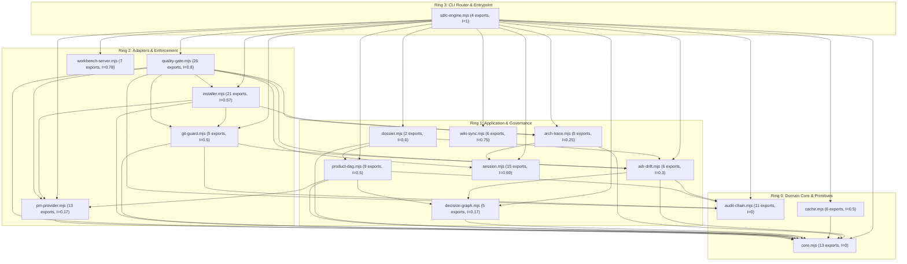

# 🗺️ Codebase-to-Wiki Traceability & Archlens Ring Map

> **Deterministic AST & Clean Architecture Inventory**  
> Generated and verified by `node .agent/scripts/sdlc-engine.mjs wiki sync` (`sdlc-wiki`) and governed by `.archlens/policy.json`.  
> Every module, exported symbol, concentric ring boundary, skill, capability (`CAP-XX`), and decision record (`ADR-00X`) is mapped below.

---

## 1. Archlens Concentric Ring Dependency Graph

In accordance with Robert C. Martin's **Clean Architecture** and `.archlens/policy.json`, dependencies point strictly inward toward **Ring 0 (Domain Core & Primitives)**.

- **Afferent Coupling ($Ca$)**: Number of modules that depend on this module (inward stability).
- **Efferent Coupling ($Ce$)**: Number of modules this module depends on (outward fan-out).
- **Instability ($I = \frac{Ce}{Ca + Ce}$)**: `0.00` indicates a maximally stable core module; `1.00` indicates a pure outer entrypoint/adapter.



---

## 2. Source Modules by Concentric Ring

### 🏛️ Ring 0: Domain Core & Primitives

| Source Module | Lines | $Ca$ / $Ce$ | Instability ($I$) | Exported AST Symbols (Line #) | Wiki Coverage |
| :--- | :--- | :--- | :--- | :--- | :--- |
| `.agent/scripts/lib/audit-chain.mjs` | 343 | 7 / 0 | `0` | `AUDIT_LEDGER_FILE` (L6), `GENESIS_HASH` (L7), `calculateRecordHash` (L9), `appendAuditRecord` (L14), `verifyAuditChain` (L58), `RECEIPT_KEY_FILE` (L150), `loadReceiptKey` (L158), `signReceiptPayload` (L183) +3 more | `wiki/Codebase-Map.md`, `wiki/Skills-Reference.md` |
| `.agent/scripts/lib/cache.mjs` | 162 | 1 / 1 | `0.5` | `getGateCachePath` (L9), `computeTreeHash` (L17), `getGateCacheHit` (L96), `recordGateCache` (L110), `getGateCacheStats` (L143), `clearGateCache` (L153) | `wiki/Codebase-Map.md`, `wiki/Skills-Reference.md` |
| `.agent/scripts/lib/core.mjs` | 274 | 14 / 0 | `0` | `loadEnv` (L10), `fileExists` (L40), `readFileSafe` (L48), `execCommand` (L56), `execAsync` (L65), `runParallelTasks` (L80), `parseFrontmatter` (L97), `inspectArchlens` (L120) +5 more | `wiki/Codebase-Map.md`, `wiki/Skills-Reference.md` |

### 🏛️ Ring 1: Application & Governance

| Source Module | Lines | $Ca$ / $Ce$ | Instability ($I$) | Exported AST Symbols (Line #) | Wiki Coverage |
| :--- | :--- | :--- | :--- | :--- | :--- |
| `.agent/scripts/lib/adr-drift.mjs` | 621 | 7 / 3 | `0.3` | `listADRs` (L40), `createADR` (L80), `decideADR` (L183), `compactADRs` (L256), `checkSpecDrift` (L422), `auditContractDrift` (L510) | `wiki/Codebase-Map.md`, `wiki/Skills-Reference.md` |
| `.agent/scripts/lib/arch-trace.mjs` | 435 | 6 / 2 | `0.25` | `checkArchDiff` (L7), `parseMermaidDiagram` (L157), `diffMermaidGraphs` (L229), `recordArchTrace` (L253), `scaffoldArchlensPolicy` (L374) | `wiki/Codebase-Map.md`, `wiki/Skills-Reference.md` |
| `.agent/scripts/lib/decision-graph.mjs` | 332 | 5 / 1 | `0.17` | `DECISION_GRAPH_FILE` (L5), `DECISION_MAP_MD` (L6), `appendDecisionEvent` (L8), `buildDecisionGraph` (L39), `syncDecisionMapMarkdown` (L257) | `wiki/Codebase-Map.md`, `wiki/Skills-Reference.md` |
| `.agent/scripts/lib/dossier.mjs` | 117 | 2 / 3 | `0.6` | `extractExportSignatures` (L7), `generateTicketDossier` (L23) | `wiki/Codebase-Map.md`, `wiki/Skills-Reference.md` |
| `.agent/scripts/lib/product-dag.mjs` | 837 | 4 / 4 | `0.5` | `renderCapabilitySpecMarkdown` (L10), `renderProductPrdMarkdown` (L61), `renderProductSrsMarkdown` (L110), `initProductConstitution` (L185), `scaffoldCapabilitySpec` (L387), `parseProductMarkdown` (L563), `planProductDAG` (L637), `controlProductDAG` (L705) +1 more | `wiki/Codebase-Map.md`, `wiki/Skills-Reference.md` |
| `.agent/scripts/lib/session.mjs` | 662 | 4 / 9 | `0.69` | `getSessionPath` (L16), `getSessionStatus` (L20), `startSession` (L56), `updateSession` (L130), `switchSession` (L198), `listSessions` (L220), `renderDashboard` (L242), `resumeSession` (L279) +7 more | `wiki/Codebase-Map.md`, `wiki/Skills-Reference.md` |
| `.agent/scripts/lib/wiki-sync.mjs` | 732 | 2 / 6 | `0.75` | `inspectSourceModule` (L35), `resolveArchlensRing` (L103), `buildWikiCodeMap` (L135), `auditWiki` (L319), `renderCodebaseMapMarkdown` (L511), `syncWiki` (L660) | `wiki/Codebase-Map.md`, `wiki/Skills-Reference.md` |

### 🏛️ Ring 2: Adapters & Enforcement

| Source Module | Lines | $Ca$ / $Ce$ | Instability ($I$) | Exported AST Symbols (Line #) | Wiki Coverage |
| :--- | :--- | :--- | :--- | :--- | :--- |
| `.agent/scripts/lib/git-guard.mjs` | 304 | 3 / 3 | `0.5` | `verifyCommitGuard` (L41), `verifyMergeGuard` (L99), `verifyPushGuard` (L144), `installHooks` (L178), `applyBranchProtection` (L260) | `wiki/Codebase-Map.md`, `wiki/Skills-Reference.md` |
| `.agent/scripts/lib/installer.mjs` | 1292 | 3 / 4 | `0.57` | `DEPRECATED_SDLC_SKILLS` (L10), `CANONICAL_SDLC_SKILLS` (L27), `ARCHLENS_SKILL_PACKAGE` (L40), `DEFAULT_GITIGNORE_ENTRIES` (L42), `upsertGitignore` (L52), `pinArchlensMcpConfigs` (L66), `SUPPORTED_AGENTS` (L82), `CONSTITUTIONAL_RULES_SUMMARY` (L144) +13 more | `wiki/Codebase-Map.md`, `wiki/Skills-Reference.md` |
| `.agent/scripts/lib/pm-provider.mjs` | 1066 | 5 / 1 | `0.17` | `CANONICAL_ISSUE_TEMPLATES` (L6), `scaffoldIssueTemplates` (L108), `loadIssueTemplate` (L130), `formatTemplatedIssue` (L184), `updateLocalKanbanState` (L249), `transitionPMState` (L332), `createTicket` (L652), `postPMComment` (L885) +5 more | `wiki/Codebase-Map.md`, `wiki/Skills-Reference.md` |
| `.agent/scripts/lib/quality-gate.mjs` | 1710 | 2 / 8 | `0.8` | `runDoctor` (L14), `generateRegressionProof` (L112), `monitorCanaryHealthAndWatchdog` (L273), `installCIWorkflow` (L386), `exportAgentRules` (L450), `scaffoldReproductionTest` (L467), `assessRisk` (L585), `generatePRSummary` (L659) +18 more | `wiki/Codebase-Map.md`, `wiki/Skills-Reference.md` |
| `.agent/scripts/lib/workbench-server.mjs` | 2667 | 2 / 7 | `0.78` | `parseKanbanMarkdown` (L63), `parseArchTraceMarkdown` (L144), `buildArchDiffPayload` (L178), `generateArchitectureWidget` (L255), `renderWorkbenchHTML` (L853), `ensureWorkbenchRunning` (L2428), `createWorkbenchServer` (L2466) | `wiki/Codebase-Map.md`, `wiki/Skills-Reference.md` |

### 🏛️ Ring 3: CLI Router & Entrypoint

| Source Module | Lines | $Ca$ / $Ce$ | Instability ($I$) | Exported AST Symbols (Line #) | Wiki Coverage |
| :--- | :--- | :--- | :--- | :--- | :--- |
| `.agent/scripts/sdlc-engine.mjs` | 1990 | 0 / 15 | `1` | `executeRelease` (L340), `runCLI` (L508), `formatCLIResult` (L1789), `cliExitCode` (L1971) | `wiki/Codebase-Map.md`, `wiki/Skills-Reference.md` |


---

## 3. Canonical SDLC Skills (`.agent/skills/`)

| Skill Name | Skill Definition Path | Purpose & Trigger | Documented In |
| :--- | :--- | :--- | :--- |
| `sdlc` | `.agent/skills/sdlc/SKILL.md` | Universal /sdlc {{args}} command router. Accepts any subcommand directly in chat (/sdlc doctor, /sdlc begin 4912, /sdlc status, /sdlc drift, /sdlc pre-pr, /sdlc gate, /sdlc kanban, /sdlc ui) and maps it 1:1 to sdlc-engine.mjs. | `wiki/Codebase-Map.md`, `wiki/Skills-Reference.md` |
| `sdlc-adr` | `.agent/skills/sdlc-adr/SKILL.md` | Architecture Decision Record (ADR) lifecycle manager and Spec-Drift Sentinel. Mints, lists, and approves/rejects ADRs in docs/adr/, verifies PRODUCT.md drift, and syncs docs/DECISION_MAP.md. | `wiki/Codebase-Map.md`, `wiki/Skills-Reference.md` |
| `sdlc-doctor` | `.agent/skills/sdlc-doctor/SKILL.md` | Stack detection, doctor --fix auto-healing, 4-Layer Git Guard hooks, .archlens/policy.json scaffolding, and multi-agent installer (Gemini, Claude Code, Cursor, Grok, Windsurf, Copilot). | `wiki/Codebase-Map.md`, `wiki/Skills-Reference.md` |
| `sdlc-flow` | `.agent/skills/sdlc-flow/SKILL.md` | Master SDLC orchestrator driving end-to-end feature implementation, bug fixes, and releases using composite stage transitions (stage begin, stage pre-pr, stage complete), Kanban synchronization, architectural traceability, Robert Martin TDD, and parallel fork-join subagent peer reviews. | `wiki/Codebase-Map.md`, `wiki/Skills-Reference.md` |
| `sdlc-gate` | `.agent/skills/sdlc-gate/SKILL.md` | Parallel Fork-Join PR peer reviewer, strict 9-pillar quality gatekeeper, Archlens concentric ring auditor, security/CVE scanner, and Stage 7 signed gate receipt issuer. | `wiki/Codebase-Map.md`, `wiki/Skills-Reference.md` |
| `sdlc-product` | `.agent/skills/sdlc-product/SKILL.md` | End-to-end spec-driven Product Autopilot and Feature Specification architect. Synthesizes raw specs into PRODUCT.md (CAP-XX, INV-XX, SPEC-XX), authors PRDs/SRS/C4/ADRs in docs/specs/, provisions templated tickets, and orchestrates topological DAG execution waves. | `wiki/Codebase-Map.md`, `wiki/Skills-Reference.md` |
| `sdlc-release` | `.agent/skills/sdlc-release/SKILL.md` | Synchronizes project documentation (README.md, docs/specs/, CHANGELOG.md, wiki/) and automates Semantic Versioning (SemVer) releases, Git tagging, regression proofs, and canary health watchdog verification. | `wiki/Codebase-Map.md`, `wiki/Skills-Reference.md` |
| `sdlc-status` | `.agent/skills/sdlc-status/SKILL.md` | Displays active SDLC session, 8-stage lifecycle progress, spec-drift check, living KANBAN.md board state, engineering ROI telemetry, and live Architecture Diff UI in one unified view. | `wiki/Codebase-Map.md`, `wiki/Skills-Reference.md` |
| `sdlc-tdd` | `.agent/skills/sdlc-tdd/SKILL.md` | Guides Robert C. Martin Test-Driven Development (Red-Green-Refactor, Transformation Priority Premise, F.I.R.S.T. isolation) and executes real Dual-Gate test coverage (>= 85%) and mutation testing (>= 80%) across polyglot stacks. | `wiki/Codebase-Map.md`, `wiki/Skills-Reference.md` |
| `sdlc-wiki` | `.agent/skills/sdlc-wiki/SKILL.md` | Technical Writer and AST-to-Wiki documentation architect. Synchronizes wiki/*.md pages with source code exports, Archlens Concentric Clean Architecture rings (.archlens/policy.json), PRODUCT.md capabilities, and ADR lineage, and audits wiki pages for broken paths or stale references. | `wiki/Codebase-Map.md`, `wiki/Skills-Reference.md` |

---

## 4. Product Capabilities (`PRODUCT.md`)

| Capability ID | Title | Functional Spec | Status | Depends On |
| :--- | :--- | :--- | :--- | :--- |
| **CAP-01** | Python AST Class-Level Edges, ABC/Protocol Stereotypes & Method Signatures | `docs/specs/cap-01.md` | `AMENDED (ADR-002)` | None |
| **CAP-02** | TypeScript/JS Multi-Line ESM, Barrel Re-Exports, tsconfig Aliases & CLI Scanner | `docs/specs/cap-02.md` | `AMENDED (ADR-002)` | None |
| **CAP-03** | Polyglot Surgical DIP Inverter & CLI Main Sequence Distance | `docs/specs/cap-03.md` | `AMENDED (ADR-002)` | CAP-01, CAP-02 |
| **CAP-04** | What-If Sandbox Simulation, Class-Move Precedence & Proposal Persistence | `docs/specs/cap-04.md` | `AMENDED (ADR-002)` | CAP-01, CAP-02 |

---

## 5. Architecture Decision Records (`docs/adr/`)

| ADR ID | Decision Title | Scope | Status | Amends / Supersedes |
| :--- | :--- | :--- | :--- | :--- |
| **ADR-001** | Quarkus 3.40 MCP 2.0 Hexagonal Decoupling, Virtual Threads & Main Sequence Calibration | `technical` | `accepted` | CAP-01, CAP-02, CAP-03, CAP-04 |
| **ADR-002** | Quarkus 3.40.1.1 BOM Upgrade, Ring 1 WorkspacePathResolver Binding & MCP Hibernate Validator | `technical` | `accepted` | CAP-01, CAP-02, CAP-03, CAP-04 |

---

## 6. Verification & Zero-Rot Commands

```bash
# 1. Rebuild AST-to-Wiki Codebase Map and synchronize tables
node .agent/scripts/sdlc-engine.mjs wiki sync

# 2. Audit all wiki/*.md files for broken paths, deprecated skills, or unmapped modules
node .agent/scripts/sdlc-engine.mjs wiki audit --strict

# 3. Inspect JSON Codebase Map & Archlens Ring Instability Metrics
node .agent/scripts/sdlc-engine.mjs wiki map
```
