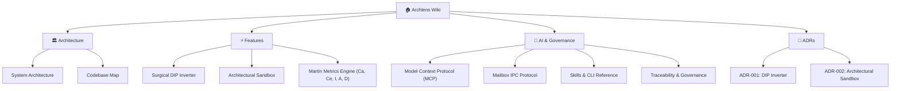

# Welcome to the Archlens Wiki

> *"Source code dependencies must point only inward, toward higher-level policies."*

**Archlens** is an interactive, real-time architectural visualization workbench, polyglot Clean Architecture governance engine, and autonomous AI refactoring platform for modern software systems.

Inspired by Clean Architecture principles, Archlens transforms the concentric Dependency Rule into a living, tactile feedback loop right in your browser, backed by polyglot source analysis across Java 25, Python, TypeScript/Svelte 5, Rust, and Go.

---

## 🧭 Wiki Directory

### Core Architecture & Foundations
- **[System Architecture](Architecture)**: The C4 model, Quarkus Java 25 reactive core, Svelte 5 runes, and polyglot scanners (Java AST + Python/TS/Rust/Go lexical).
- **[Concentric Rings & Governance](Architecture#the-concentric-rings)**: Ring tiers (`Domain Core`, `Application`, `Adapters`, `Frameworks`) and level inversion validation.
- **[Codebase Map & Module Inventory](Codebase-Map)**: Auto-generated AST module inventory across Rings 0–3 (`backend/`, `frontend/`, `cli/`, `.agent/scripts/`).

### Features & Capabilities
- **[Surgical DIP Inverter](Surgical-DIP-Inverter)**: 1-click violation remediation, polyglot interface port synthesis (`Java`, `Python`, `TypeScript`, `Go`, `Rust`), caller/adapter diffs, and surgical AI directives.
- **[Architectural Sandbox & Prototyping](Architectural-Sandbox)**: "What-If" simulation, staged class moves, real-time violation deltas, and proposal management.
- **[Component Coupling & Stability Metrics](Robert-C-Martin-Metrics)**: Coupling and stability metrics ($C_a, C_e, I, A, D$), Zone of Pain vs. Zone of Uselessness, and Main Sequence balance.

### AI Companions, Skills & Governance
- **[Model Context Protocol (MCP) Integration](MCP-Integration)**: Native Quarkus MCP server endpoints (`/mcp` and `/mcp/sse`) and CLI stdio bridge (`npx -y @fadym/archlens-skill mcp`), 11 MCP tools, 3 resources, and 2 prompts.
- **[Mailbox IPC Companion Protocol](Mailbox-IPC)**: Asynchronous IPC between the visual workbench and coding assistants via `.archlens/to-agent.json` and `.archlens/to-viewer.json`, plus verification, policy rollback, and living ADR endpoints.
- **[Skills & CLI Reference](Skills-Reference)**: Reference for `archlens` skills, the 10 canonical `sdlc*` skills, and `npx @fadym/archlens-skill` CLI commands.
- **[Traceability & Governance](Traceability)**: End-to-end lineage across `PRODUCT.md` (`INV-01..05`, `CAP-01..04`), `docs/KANBAN.md`, `docs/DECISION_MAP.md`, and `docs/adr/ADR-001..003`.

### Architectural Decision Records (ADRs)
- **[ADR-001: Surgical DIP Inverter](ADR-001-Surgical-DIP-Inverter)**: Rationale, alternatives, and technical design for 1-click AST interface extraction.
- **[ADR-002: Interactive Architectural Sandbox](ADR-002-Interactive-Architectural-Sandbox)**: Rationale and technical design for in-memory graph simulation and Martin metrics.

---

## ⚡ Quick Navigation

