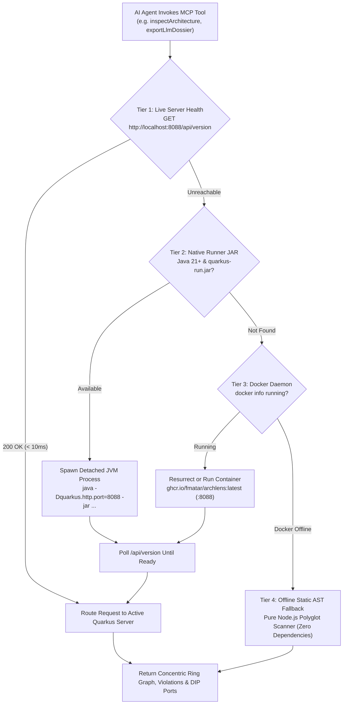

# Model Context Protocol (MCP) Integration

Archlens natively implements an embedded **Model Context Protocol (MCP)** server built on Quarkus. It provides AI coding assistants (Claude Desktop, Google Antigravity, Claude Code, Cursor, Windsurf, VS Code) with direct, structured access to codebase architecture models, dependency violation graphs, and automated DIP refactoring synthesizers.

---

## 🔌 Connection Endpoints

The Archlens container and native server expose three MCP transports:
- **Zero-Dependency CLI Stdio Bridge (Recommended)**: `npx -y @fmatar/archlens-skill mcp`
- **Streamable HTTP (`MCP 2.0`)**: `http://localhost:8088/mcp`
- **Server-Sent Events (`SSE`)**: `http://localhost:8088/mcp/sse`

---

## 🔄 Zero-Touch Startup: The 4-Tier Auto-Resurrection Waterfall

When configured via the CLI stdio bridge (`npx -y @fmatar/archlens-skill mcp`), you never need to start the Archlens server manually before prompting **Google Antigravity**, **Claude Code**, **Claude Desktop**, or **Cursor**. Every MCP tool call traverses a deterministic 4-tier resolution waterfall (`ensureServerRunning` in `cli/src/docker-runner.js`):



1. **Tier 1 — Live Server Reuse**: Pings `http://localhost:8088/api/version`. If the Quarkus server is already running, routes the request immediately.
2. **Tier 2 — Native Runner JAR**: If `java -version` succeeds and a native runner JAR exists (`ARCHLENS_JAR`, `~/.archlens/runner/quarkus-app/quarkus-run.jar`, or `target/quarkus-app/quarkus-run.jar`), launches a detached background JVM process on port `8088`.
3. **Tier 3 — Docker Container Auto-Resurrection**: If Docker is running (`docker info`), restarts an existing `archlens-server` container or launches `ghcr.io/fmatar/archlens:latest` detached on port `8088`.
4. **Tier 4 — Offline Static AST Fallback**: If neither Java nor Docker is available, executes the built-in Node.js static AST analyzer directly on disk—ensuring zero downtime in restricted sandboxes or offline environments.

---

## 🛠️ Available MCP Tools

### 1. `synthesizeDipInversion`
Synthesizes a complete Dependency Inversion Principle (DIP) refactoring plan to eliminate an outward architectural violation.

- **Parameters**:
  - `fromClass` *(string, required)*: Fully qualified class name of the caller class in the inner tier (e.g. `com.example.service.OrderService`).
  - `toClass` *(string, required)*: Fully qualified class name of the concrete class in the outer tier (e.g. `com.example.db.PostgresOrderRepo`).
  - `projectRoot` *(string, optional, default: `.`)*: Path to the target project directory.
- **Returns**: `DipInversionPlan` JSON object:
  - `portName`: Synthesized interface name (e.g. `OrderRepositoryPort`).
  - `portPackage`: Inward package for the port (e.g. `com.example.service.ports`).
  - `portInterfaceCode`: Complete Java interface source code.
  - `adapterRefactorPreview`: Code diff for the concrete adapter.
  - `callerRefactorPreview`: Code diff for caller constructor injection.
  - `surgicalPrompt`: Actionable refactoring directive for the AI agent.

---

### 2. `inspectArchitecture`
Extracts the complete Clean Architecture model of the target project.

- **Parameters**:
  - `projectRoot` *(string, optional, default: `.`)*: Path to target project.
- **Returns**: `ArchitectureGraph` JSON object:
  - `components`: Array of concentric rings and package groups.
  - `edges`: Array of dependency connections, each marked with `isViolating: boolean`.
  - `unassigned`: List of classes not yet assigned to an architectural tier.

---

### 3. `exportLlmDossier`
Generates a markdown refactoring prompt dossier diagnosing all concentric ring breaches and prescribing concrete interface ports.

- **Parameters**:
  - `projectRoot` *(string, optional, default: `.`)*: Path to target project.
  - `proposalId` *(string, optional)*: Optional structural proposal ID.
- **Returns**: Formatted Markdown string containing architecture overview, breach tables, and refactoring instructions.

---

### 4. `listSnapshots` & `getSnapshot`
Enables historical architectural comparisons against Git release tags and pre-compiled snapshots governed by `.archlens/policy.json`.

---

### 5. `evaluateFitness` & `getFitnessHistory`
Computes the Architecture Fitness Index (AFI), Main Sequence Distance, Screaming Architecture Score, and historical fitness trend (`STABLE`, `IMPROVING`, `DEGRADING`).

---

### 6. `proposeScreamingMigration`, `getPolicy` & `syncDipAdr`
Generates Screaming Architecture feature-slice migration proposals, inspects `.archlens/policy.json`, and mints Architecture Decision Records (ADRs) for Dependency Inversion Principle (DIP) refactorings.

---

## 📚 Available MCP Resources & Prompts

- **Resources**: `archlens://llms.txt` (LLM Dossier), `archlens://policy` (Active Policy JSON), and `archlens://fitness` (Live AFI Report).
- **Prompts**: `architectural-review` and `dip-refactoring-guide`.

---

## ⚙️ AI Client Configuration Guides

### ⚡ Automated 1-Command Setup (All Detected Clients)
```bash
npx @fmatar/archlens-skill --mcp
```

### 1. Google Antigravity (`~/.gemini/antigravity/mcp_config.json`)
`npx @fmatar/archlens-skill --mcp` automatically populates `~/.gemini/antigravity/mcp/archlens/*.json` and `instructions.md` as well as `~/.gemini/antigravity/mcp_config.json`:
```json
{
  "mcpServers": {
    "archlens": {
      "command": "npx",
      "args": ["-y", "@fmatar/archlens-skill", "mcp"],
      "env": {
        "ARCHLENS_SERVER_URL": "http://localhost:8088"
      }
    }
  }
}
```

### 2. Gemini CLI (`@google/gemini-cli`)
```bash
gemini mcp add archlens -- npx -y @fmatar/archlens-skill mcp
```
Or in `~/.gemini/settings.json` / `.gemini/settings.json`:
```json
{
  "mcpServers": {
    "archlens": {
      "command": "npx",
      "args": ["-y", "@fmatar/archlens-skill", "mcp"],
      "env": {
        "ARCHLENS_SERVER_URL": "http://localhost:8088"
      }
    }
  }
}
```

### 3. Claude Code (CLI) & Claude Desktop
```bash
# Stdio bridge (online + offline static fallback):
claude mcp add archlens -- npx -y @fmatar/archlens-skill mcp

# Direct Streamable HTTP / SSE (when Workbench is running on :8088):
claude mcp add --transport http archlens http://localhost:8088/mcp
```
Or in `.mcp.json` / `~/Library/Application Support/Claude/claude_desktop_config.json`:
```json
{
  "mcpServers": {
    "archlens": {
      "command": "npx",
      "args": ["-y", "@fmatar/archlens-skill", "mcp"],
      "env": {
        "ARCHLENS_SERVER_URL": "http://localhost:8088"
      }
    }
  }
}
```

### 4. Grok CLI (`xAI`)
Configure in `.grok/mcp.json` or `~/.grok/mcp.json`:
```json
{
  "mcpServers": {
    "archlens": {
      "command": "npx",
      "args": ["-y", "@fmatar/archlens-skill", "mcp"],
      "env": {
        "ARCHLENS_SERVER_URL": "http://localhost:8088"
      }
    }
  }
}
```

### 5. Cursor, Windsurf & VS Code (GitHub Copilot)
Configure in `.cursor/mcp.json` or `~/.codeium/windsurf/mcp_config.json`:
```json
{
  "mcpServers": {
    "archlens": {
      "command": "npx",
      "args": ["-y", "@fmatar/archlens-skill", "mcp"]
    }
  }
}
```
And in `.vscode/mcp.json`:
```json
{
  "servers": {
    "archlens": {
      "type": "stdio",
      "command": "npx",
      "args": ["-y", "@fmatar/archlens-skill", "mcp"]
    }
  }
}
```
