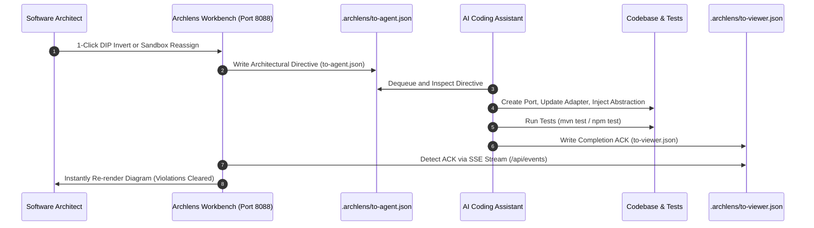

# Mailbox IPC Companion Protocol

The **Mailbox IPC Protocol** is the asynchronous bridge connecting the Archlens Visual Workbench with autonomous AI coding assistants (such as Claude Code, Google Antigravity, and Cursor).

Rather than forcing the developer to manually copy instructions or run multiple CLI tools, Archlens provides file-based mailbox queues located inside the project's `.archlens/` directory.

---

## 📬 Protocol Architecture



---

## 🗂️ Mailbox Files

| File Path | Role | Direction |
| :--- | :--- | :--- |
| `.archlens/to-agent.json` | Inbound command queue for the AI agent | Workbench $\to$ Agent |
| `.archlens/to-viewer.json` | Outbound response and ACK log | Agent $\to$ Workbench |

---

## 📋 Mailbox Command Reference

Commands in `.archlens/to-agent.json` are wrapped inside a transactional `MailboxEnvelope` (`{ "nextId": <int>, "queue": [ ... ] }`) managed by `FileMailboxService.java`.

### 1. `INVERT_DEPENDENCY`
Dispatched when clicking **`Dispatch to AI Agent`** in the **Surgical DIP Inverter modal** (`InvertDipModal.svelte`).

```json
{
  "nextId": 2,
  "queue": [
    {
      "id": 1,
      "ts": "2026-11-07T02:00:00Z",
      "op": "INVERT_DEPENDENCY",
      "target": {
        "id": "violation:io.slixes.archlens.usecase.GenerateDossierUseCase->io.slixes.archlens.delivery.rest.DiagramResource"
      },
      "payload": {
        "fromClass": "io.slixes.archlens.usecase.GenerateDossierUseCase",
        "toClass": "io.slixes.archlens.delivery.rest.DiagramResource",
        "portName": "DiagramResourcePort",
        "portPackage": "io.slixes.archlens.usecase.ports",
        "portFilePath": "src/main/java/io/slixes/archlens/usecase/ports/DiagramResourcePort.java",
        "portInterfaceCode": "package io.slixes.archlens.usecase.ports;\n\npublic interface DiagramResourcePort {\n    // Extracted method signatures\n}\n",
        "adapterRefactorPreview": "...",
        "callerRefactorPreview": "...",
        "surgicalPrompt": "..."
      }
    }
  ]
}
```

#### Expected Agent Actions:
1. Write the synthesized port interface to `portFilePath`.
2. Update the concrete adapter (`toClass`) to implement `portName`.
3. Refactor caller (`fromClass`) to inject the port interface.
4. Run project test suite (`mvn test` / `npm test`).
5. Write ACK to `.archlens/to-viewer.json` via `POST /api/mailbox/ack`.

---

### 2. `APPLY_PROPOSAL`
Dispatched when clicking **`Dispatch to Agent`** from the **Architectural Sandbox toolbar** (`SandboxToolbar.svelte`).

```json
{
  "nextId": 3,
  "queue": [
    {
      "id": 2,
      "ts": "2026-11-07T02:05:00Z",
      "op": "APPLY_PROPOSAL",
      "target": {
        "id": "proposal:sandbox-1730945100000"
      },
      "payload": {
        "proposalName": "Reorganize Core Domain",
        "moves": [
          {
            "className": "com.example.service.LegacyService",
            "fromPackage": "com.example.service",
            "toPackage": "com.example.usecase",
            "targetLevel": 1
          }
        ]
      }
    }
  ]
}
```

#### Expected Agent Actions:
1. Move classes to match the proposed concentric ring packages (`moves`).
2. Update import statements across the codebase.
3. Run test suites and verify compilation.
4. Acknowledge completion in `.archlens/to-viewer.json`.

---

### 3. `REGEN`
Dispatched when clicking the **`Regen`** button in the workbench navigation bar.
- Directs the agent to re-scan the codebase AST, evaluate package dependency rules, and verify architectural invariants.

---

### 4. `REFRESH_CRAP`
Dispatched when requesting refreshed code complexity and mutation metrics.
- Directs the agent to run unit test coverage (JaCoCo) and mutation testing (PITest / Stryker) to update CRAP risk scores.

---

## 🛡️ Closed-Loop Verification, Source/Policy Snapshot Rollback & Living ADR Endpoints

When `INVERT_DEPENDENCY` or `APPLY_PROPOSAL` is dispatched via `POST /api/mailbox/to-agent`, `VerifyAndRollbackRefactorUseCase` automatically captures a transactional pre-refactor snapshot (`snap-<timestamp>`) under `.archlens/snapshots/<snapshotId>/`:
- `policy.json`: Full backup of `.archlens/policy.json`.
- `manifest.txt` & `files/`: Complete copy of all scanned project source files (`.java`, `.py`, `.ts`, `.tsx`, `.js`, `.jsx`, `.mjs`, `.cjs`, `.svelte`, `.go`, `.rs`, `.clj`, `.cljs`, `.cljc`, `.edn`, `.kt`).
- Optional `architecturalIntent` notes entered in `InvertDipModal.svelte` or `SandboxToolbar.svelte` are embedded directly in the `.archlens/to-agent.json` command payload.

In addition to `.archlens/to-agent.json` and `.archlens/to-viewer.json`, `MailboxResource.java` exposes three closed-loop governance endpoints wired directly into the **`AgentDrawer.svelte`** telemetry bar (`Verify Refactor`, `Record ADR`, and `Revert Snapshot` buttons):

| Endpoint | Use Case Class | Behavior |
| :--- | :--- | :--- |
| `POST /api/mailbox/verify` | `VerifyAndRollbackRefactorUseCase` | Re-compiles the live AST graph, verifies `currentViolations <= baselineViolations` and `currentCycles <= baselineCycles`, optionally runs the project's automated test suite (`runTests: true` across Maven, Gradle, npm, Cargo, Go, and pytest), and records a `VERIFY_COMPLETE` telemetry event in `.archlens/to-viewer.json`. |
| `POST /api/mailbox/rollback` | `VerifyAndRollbackRefactorUseCase` | Restores `.archlens/policy.json`, restores all snapshotted source files from `.archlens/snapshots/<snapshotId>/files/`, deletes any newly created source files not present in `manifest.txt`, and triggers an SSE `reload`. |
| `POST /api/mailbox/sync-adr` | `SyncAdrUseCase` | Mints a numbered Markdown ADR in `docs/adr/` (also exposed via the `syncDipAdr` MCP tool and the **`Record ADR`** UI button). |
