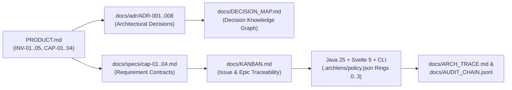

# 🎯 Traceability & Governance

End-to-end lineage across `PRODUCT.md`, `docs/KANBAN.md`, and `docs/DECISION_MAP.md`.

Archlens enforces deterministic, cryptographically auditable traceability linking constitutional product invariants (`PRODUCT.md`), Architecture Decision Records (`docs/adr/`), Concentric Clean Architecture policies (`.archlens/policy.json`), source code modules (`wiki/Codebase-Map.md`), and execution receipts (`docs/AUDIT_CHAIN.jsonl`).

---

## 🔗 1. Constitutional Governance Chain



---

## 🛡️ 2. System Invariants (`PRODUCT.md`)

| Invariant ID | Name | Enforcement Mechanism |
| :--- | :--- | :--- |
| `INV-01` | Concentric Dependency Rule | Every source dependency must point strictly inward (`Level 3 -> Level 2 -> Level 1 -> Level 0`). Verified by `GraphCompiler.java` and `npx @fmatar/archlens-skill check --max-violations 0`. |
| `INV-02` | Acyclic Dependencies Principle (ADP) | Package dependency graphs must remain a Directed Acyclic Graph (DAG). Verified by Tarjan's SCC (`PackageCycleDetector.java`) and `--detect-cycles`. |
| `INV-03` | Spec-Driven Traceability | Every capability (`CAP-XX`) maps to a specification in `docs/specs/` and an approved ADR in `docs/adr/`. Enforced by `node .agent/scripts/sdlc-engine.mjs drift check`. |
| `INV-04` | Dual-Gate Verification | Automated test suites enforce $\ge 85\%$ line coverage (JaCoCo / Vitest) and zero static analysis regressions (SpotBugs, PMD, Checkstyle). |
| `INV-05` | Living Documentation Parity | `wiki/*.md`, `docs/DECISION_MAP.md`, and `docs/ARCH_TRACE.md` remain 100% synchronized with the live AST via `node .agent/scripts/sdlc-engine.mjs wiki audit --strict`. |

---

## 📦 3. Capabilities & Specifications Matrix (`CAP-01` – `CAP-04`)

| Capability | Title | Spec File | Primary Implementation Modules | Status |
| :--- | :--- | :--- | :--- | :--- |
| `CAP-01` | Python AST Deep Class & Stereotype Extraction | `docs/specs/cap-01.md` | `backend/src/main/java/io/slixes/archlens/scanner/PythonAstScanner.java` | `COMPLETE` (`#5887`) |
| `CAP-02` | TypeScript/JS Multi-Line ESM, Barrel & Alias Resolution | `docs/specs/cap-02.md` | `backend/src/main/java/io/slixes/archlens/scanner/TypeScriptAstScanner.java`, `cli/src/checker.js` | `COMPLETE` (`#5912`) |
| `CAP-03` | Polyglot Surgical DIP Inverter & CLI Main Sequence Distance | `docs/specs/cap-03.md` | `backend/src/main/java/io/slixes/archlens/domain/dossier/DipInversionSynthesizer.java`, `cli/src/checker.js` | `COMPLETE` (`#5936`) |
| `CAP-04` | What-If Sandbox Simulation & Proposal Persistence | `docs/specs/cap-04.md` | `frontend/src/lib/state/diagram.svelte.ts`, `frontend/src/lib/components/Canvas.svelte`, `frontend/src/lib/components/SandboxToolbar.svelte` | `COMPLETE` (`#5962`) |

---

## 📜 4. Constitutional & Feature ADRs

### Constitutional ADRs (`docs/adr/`, Indexed in `docs/DECISION_MAP.md`)
- **`ADR-001`**: Quarkus 3.40 MCP 2.0 Hexagonal Decoupling, Virtual Threads & Main Sequence Calibration (`docs/adr/ADR-001-quarkus-3-40-mcp-2-0-hexagonal-decoupling-virtua.md`)
- **`ADR-002`**: Quarkus 3.40.1.1 BOM Upgrade, Ring 1 WorkspacePathResolver Binding & MCP Hibernate Validator (`docs/adr/ADR-002-quarkus-3-40-1-1-bom-upgrade-ring-1-workspacepat.md`)
- **`ADR-003`**: Multi-Agent Local MCP Registry, CI Hardening & End-to-End Smoke Suite (`docs/adr/ADR-003-multi-agent-local-mcp-registry-ci-hardening-end-.md`)
- **`ADR-004`**: Multi-Format Architecture Diagram Export (Mermaid, SVG, PNG) & v1.1.0 Release (`docs/adr/ADR-004-multi-format-architecture-diagram-export-mermaid.md`)
- **`ADR-005`**: Quarkus 3.40.1.2, MCP 2.0.4 & Latest GA Dependency Alignment (`docs/adr/ADR-005-quarkus-3-40-1-2-mcp-2-0-4-latest-ga-dependency-.md`)
- **`ADR-006`**: Release v1.1.1 — Manifest Synchronization, Brand Identity & GA Dependency Alignment (`docs/adr/ADR-006-release-v1-1-1-manifest-synchronization-brand-id.md`)
- **`ADR-007`**: Enforce Agent Skills Release Parity and Convert Skill Installer to `npx skills` (`docs/adr/ADR-007-enforce-agent-skills-release-parity-and-convert-.md`)
- **`ADR-008`**: Release v1.1.2 — Agent Skills Release Parity & `npx skills` Ecosystem Publication (`docs/adr/ADR-008-release-v1-1-2-agent-skills-release-parity-npx-s.md`)

### Foundational Feature ADRs (`wiki/`)
- **[ADR-001: Surgical DIP Inverter](ADR-001-Surgical-DIP-Inverter)** (PR #112)
- **[ADR-002: Interactive Architectural Sandbox](ADR-002-Interactive-Architectural-Sandbox)** (PR #113)

---

## 🔍 5. Running Traceability & Drift Audits

```bash
# Verify zero spec drift between PRODUCT.md, docs/specs/*.md, and docs/adr/*.md
node .agent/scripts/sdlc-engine.mjs drift check

# Synchronize and strictly audit the Wiki against the live codebase AST
node .agent/scripts/sdlc-engine.mjs wiki sync
node .agent/scripts/sdlc-engine.mjs wiki audit --strict

# Append a cryptographic architectural trace entry
node .agent/scripts/sdlc-engine.mjs arch trace --reason "Verified traceability"
```
